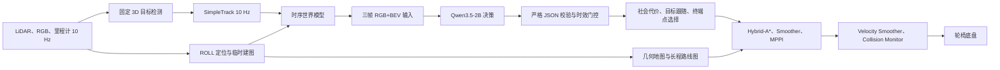

# 旧版方案：基于 VLM 的长程社交导航

> **旧版方案，仅供历史参考。** 本文的微调、小模型部署和1Hz硬目标不再是当前要求；当前方案请阅读[系统方案](../系统方案.md)。历史技术设计保留，项目标记统一采用不带版本号的名称；历史命令不保证可执行。

> 仓库文档索引：[系统方案](../系统方案.md) · [数据与评测](../experiments/数据与评测.md) · [JRDB参考](../experiments/JRDB参考.md) · [开发指南](../开发指南.md)

> 实机模型：Qwen3.5-2B（允许微调）；云端对照：Qwen3.8-27B（冻结）  
> 机器人平台：激光雷达与单前向 RGB 相机智能轮椅  
> 训练资源：公共阶段已验证 1 × H800 80 GB；原计划资源 4 × RTX 4090  
> 部署资源：Ubuntu 22.04，2 × RTX 4060 8 GB  
> 文档定位：面向实现、实验和论文撰写的完整技术路线
> 修订日期：2026-10-05；部署接口：`social_nav_prompt`

预览说明：公式使用 Markdown 数学扩展的 `$$ ... $$` 块语法，长公式使用 `aligned` 分行。预览器需启用数学渲染；普通、不含数学扩展的 Markdown 渲染器仍会显示公式源码。

本版将“部署接口”与“训练任务/数据来源”分离：部署保留三类决策，训练允许任意合适的辅助任务、公开数据和人工派生标注。当前先执行 [纯公开数据可行性验证方案](../experiments/数据与评测.md)，完整经历公共试标、主/辅助任务 SFT、隔离测试和连续回放，不依赖任何新实机数据。完成后再决定实机域适配、采集规模及闭环实验。数据入口和已测环境见 [公开数据入口与环境记录](../experiments/数据与评测.md)。本文后续实机参数和验收目标不是公共阶段的前置条件，也不是已完成结果。

当前先比较本地 `/share/public_models/qwen/Qwen3.5-2B` 与 `/share/public_models/qwen/Qwen3.8-27B`。后者作为冻结的云端能力对照，本轮用 H800 本机服务模拟调用，不更新权重；前者先做 zero-shot，再在人工复核的公开主/辅助标签上进行 SFT。使用现有 `python312`，不升级或替换其关键依赖；用户授权的SGLang Cu12测试仅安装于独立克隆 `python312_sglang_cu129`，不取代原vLLM/训练环境。T1 输入消融、实际结果和可复现命令见 [JRDB 双模型开发测试](../experiments/JRDB参考.md)。

当前T1工作方案（2026-10-05）：按用户选择，以已测27B链路中的最快策略继续开发，即只读 `Qwen3.8-27B-FP8`＋独立CUDA 12 SGLang＋3步原生MTP＋开启固定前缀缓存，串行、非思考、T=0；沿用完整规约/几何观测表、`aligned_history`三图与可逆tuple输出，仍由动态JSON Schema派生文法约束并做独立语义校验。H800冻结窗口的完整响应P50/P95=0.651/0.729秒，不代表真实云端或导航闭环1Hz已验收。JRDB原生成员标签与目标前向可观测REL语义、真实机器人分布不完全一致，不再用这批F1差异决定运行时选型，也暂不继续追查CP/缓存数值问题。可靠目标语义仍需人工补标和隔离评测；2B可训练实机角色、原BF16冻结对照及安全门控不变。配置与启动见[JRDB当前方案](../../outputs/archive/cleanup_20261005/source_before_cleanup.zip)。

2026-10-04 增加 `gpt-6.1-sol`、`gpt-6-luna` 的冻结远程能力对照：按用户提供的 Codex OAuth 调用方式，在同24个 `context` 开发窗口上分别完成推理，成员对 F1 为0.885/0.880，清晰切片为0.930/0.926，均24/24接口合法。这不是完整REL语义准确率，不构成正式盲测或训练收益；两个GPT模型不自动替换既定的2B实机候选/27B对照角色。当前兼容客户端不是公共API key生产接口，详情与限制统一见[JRDB测试记录](../experiments/JRDB参考.md)。

追加延时专项：连接复用、三图/Prompt不变时，sol-low的完整合法结果P50/P95为9.66/18.70秒，luna-low为3.68/7.08秒。luna可短时按1Hz并发提交，但结果仍落后数秒；none没有明显提速且出现格式失败。**当前GPT兼容通道未达到1秒新决策目标**，不放入已验收的实时关键路径；本地2B/4060仍须单独profiling，1Hz保持为待验收目标，不因并发吞吐通过而降低结果时效性门槛。完整口径见JRDB第7节。

## 1. 项目目标与总体方案

本项目面向真实公共环境中的长程社交导航。系统需要在约 500 m 的食堂—室外—大楼—房间路线中连续完成目标行人跟随、密集人群通行、排队队伍绕行、自主路线导航、社会群组避让和终端停靠。最终展示的目标时长约为 10 min，但安全、社会合规和任务完成优先于用时。

系统采用“VLM 低频语义决策、经典导航高频规划控制”的分层架构。3D 目标检测和 SimpleTrack 多目标跟踪提供稳定行人轨迹，ROLL 提供全局定位和临时建图，Qwen3.5-2B 根据三帧 RGB+BEV 判断社会关系、目标身份和终端位置语义。VLM 不直接生成速度、转角或连续轨迹；其离散结果由确定性的社会代价层、目标构造器和候选姿态模块转换为导航约束，再由车辆模型规划器执行。

VLM 在部署时统一承担三项主决策任务，训练时可以包含更多辅助任务：

| 任务 | 输入条件 | 输出 | 对导航系统的作用 |
|---|---|---|---|
| T1 行人群组与关系识别 | 三帧场景、轨迹表和历史决策 | 群组、类型、结构与可观测性 | 生成同行、交谈、队列、拍照等社会代价和禁穿区域 |
| T2 目标行人选择与重捕获 | T1 输入、目标外观描述和上一目标状态 | 目标短 ID 及可见状态 | 持续校验跟踪身份，修正 ID 错配并驱动动态跟随目标 |
| T3 房间内目标点选择 | 三帧场景、任务类型和几何候选姿态 | 候选 ID、无解或证据不足 | 在桌边交互位或空间角落候选中选择语义正确的停靠点 |

跟随阶段采用一次 `REL_FOLLOW` 请求联合完成 T1 和 T2；自主导航阶段采用 `REL` 请求完成 T1；进入目标房间后采用 `GOAL` 请求完成 T3。联合设计保证身份判断与社会关系共享同一组三帧视觉输入，并避免两次独立推理带来的重复视觉编码和额外时延。

公开视频可经人工补标直接生成三种主接口的训练/测试记录，不只作为“辅助预热”。辅助任务可涵盖图文人物匹配、同组判断、空间/运动/社会 QA、身份复核、队列角色、物体指代、候选可供性、运动预测、行为偏好和解释；是否加入由标签可靠性与迁移收益决定，不增加主部署链调用次数。

研究重点不是“首次使用 VLM 识别社交关系”：[GSON](https://arxiv.org/abs/2409.18084) 已研究群组语义到导航约束，[VLM-Social-Nav](https://arxiv.org/abs/2404.00210)、[LISN](https://arxiv.org/abs/2512.09920)、[SocialNav](https://github.com/AMAP-EAI/SocialNav) 等也覆盖视觉语言社会导航。应验证三个具体假设：H1，关系类型与队列/拍照结构比仅有群组包络更能减少社会违规；H2，描述条件下持续身份复核能减少错误跟随，且拒答不会造成不可接受的停滞；H3，小模型联合决策在实测资源预算内比独立模块更有收益。T3 是完整任务所需的终端能力，不能仅凭桌边/角落分类宣称导航创新。GRPO 是否带来增益是次级实验问题。

## 2. 系统条件与设计约束

### 2.1 已确定的平台条件

本节描述最终实机平台；PUBLIC-ONLY 阶段不要求访问轮椅、演员或场地，使用公开传感器标定、已验证 H800 和明确标注的虚拟足迹。H800 结果不能替代下述 RTX 4060 的部署验收。

部署平台包含两张桌面版 RTX 4060，每张显存 8 GB，操作系统为 Ubuntu 22.04。固定的 3D 检测和 SimpleTrack 总显存占用小于 1 GB，能够稳定运行在 10 Hz。SimpleTrack 输出跨帧轨迹 ID、位置与速度协方差，以及轨迹新建和删除事件。定位采用 ROLL，其预建 LiDAR 地图匹配与临时建图能力用于长期变化环境中的连续定位。

相机为单个前向 RGB，相机帧率按 10 Hz 处理，图像分辨率为 640 × 480。现有标定数据给出的内参为 `fx=594.1363`、`fy=593.6382`、`cx=329.7369`、`cy=235.9773`，径向畸变参数为 `k1=0.1372315`、`k2=-0.3426697`。系统从数据记录读取 `cam2img` 和 `lidar2cam`，不在模型中硬编码矩阵。RGB 在构建 VLM 输入前去畸变，BEV、轨迹 ID 和目标候选使用同一套标定与时间戳。

数据采集场地包括研究所大楼、图书馆和食堂，演员约 5 人。VLM 数据只包含行人，不保留骑行者。数据集作为项目内部数据管理，保留演员同意记录、访问控制、数据版本和标注审计信息。

### 2.2 待测车辆参数

轮椅约 0.6 m 的轮间距不足以确定运动学模型。导航集成前需要实测车体长度、宽度、多边形足迹、轴距或轮距、最小转弯半径、最大转向角、最大速度、加减速度、制动距离、指令响应延迟及倒车传感器覆盖。P0 阶段根据实测结果决定使用 Ackermann 还是差速运动模型，并冻结 Hybrid-A*、MPPI、Velocity Smoother 和 Collision Monitor 的参数。在完成辨识前，系统只进行低速空载测试。

### 2.3 地图与任务边界

系统不建立人工语义地图。长期地图由 ROLL 的 LiDAR 地图自动投影为二维几何地图，路线图从自由空间骨架自动生成。任务文件只保存起点、模式切换检查点、目标房间度量坐标和终端任务类型 `desk/corner`。这些坐标属于任务配置，不包含“大厅”“走廊”“桌子”等人工地图语义。

## 3. 总体系统架构



系统按三个时间尺度运行。检测、跟踪、局部地图和安全控制运行在 10–20 Hz；跟随阶段的 `REL_FOLLOW` 和自主导航阶段的 `REL` 通常运行在 1 Hz；T3 只在房间入口、目标候选失效或停靠重试时触发。低频 VLM 结果带有传感器时间戳和 TTL，高频规划器在新结果到达前持续使用仍有效的上一决策，因此 VLM 推理不会阻塞底盘安全环。

| 运行模式 | VLM 请求 | 进入条件 | 退出条件 |
|---|---|---|---|
| `FOLLOW` | `REL_FOLLOW`，约 1 Hz | 食堂起点完成初始化并获得目标描述 | 到达大楼入口检查点或跟随任务终止 |
| `NAVIGATE` | `REL`，0.5–1 Hz | 入口地理围栏触发模式切换 | 到达目标房间检查点 |
| `DOCK` | `GOAL`，事件触发 | 房间内生成有效候选姿态 | 停靠成功、无安全候选或达到重试上限 |
| `SAFE_STOP` | 不依赖 VLM | 传感器、定位、规划、VLM或控制链发生硬故障 | 故障消除并由状态机或人工确认恢复 |

## 4. VLM 决策系统

### 4.1 三帧输入与滑动窗口

原始传感器流以 10 Hz 对齐，每隔 0.5 s 选取一个基础时间点。长度 1.0 s、步长 0.5 s 的窗口定义为：

$$
W_k=(t_k,t_k+0.5,t_k+1.0),\qquad t_k=0.5k
$$

在线时刻记为窗口末端 `t`，三帧分别对应 `t−1.0 s`、`t−0.5 s` 和 `t`。标签与模型输出统一定义为第三帧时刻应作出的决策。相邻窗口共享两帧，例如 `0/0.5/1.0 s`、`0.5/1.0/1.5 s` 和 `1.0/1.5/2.0 s`。同步误差必须记录；超过冻结容差的窗口从数据集中排除。

每个时刻的去畸变 RGB 与 BEV 拼成一张固定组合图，因此一次请求严格包含三张图像，而不是六张独立图片。初始组合画布为 896 × 448，左侧为等比例缩放和 letterbox 后的 RGB，右侧为 BEV。最终像素尺寸由显存和精度实验冻结，训练、验证和部署使用同一配置。

JRDB T1 开发实验另比较 1280×544 的非对称布局（RGB 800×512、BEV 480×480）、人物裁剪图以及自适应范围的前视人员 BEV。它们有独立输入指纹，不直接覆写旧样本。自适应 BEV 仅补充前视远处人物的空间语义上下文，不扩大导航 costmap、不注入视场外人员或群组真值；是否纳入实机输入须经 2B 精度和 4060 资源实测，不能直接宣称原固定 12 m 协议已经通过验证。

### 4.2 BEV 表示

VLM 的 BEV 范围固定为 12 m × 12 m。轮椅位于画面下部中央，前向 10 m、后向 2 m、左右各 6 m。该范围覆盖局部社会交互，同时避免远处小目标和点云噪声增加识别难度。BEV 显示轮椅朝向与足迹、行人短 ID、3D 中心、速度箭头、最近轨迹、当前局部路径、时间索引，以及 T3 模式下的候选目标姿态。

SimpleTrack 的全局 ID 在进入活动区域后映射为 0–99 范围内的短 `pid`。映射在轨迹生命周期中保持稳定，VLM 只读写短 ID，系统内部再映射回全局轨迹。该设计减少长数字对视觉识别和自回归输出的影响。

主协议初始单次最多处理 20 名活动行人。超限是显式 `input_overflow`，不能静默删去影响规划的行人；系统降速/停车并重新观察，几何避障仍处理全部检测。每条记录保存 ID 映射版本，历史记录不能引用被重新分配给他人的短 ID。

VLM 的 12 m × 12 m BEV 只服务于语义决策，不替代约 20 m × 20 m 的导航局部 costmap。导航层仍使用更高分辨率、更大范围的实时 LiDAR 地图执行制动和绕行。

### 4.3 结构化上下文与提示组织

提示由静态前缀和动态尾部组成。静态前缀约 800–1500 tokens，包含坐标定义、关系类别、输出 Schema、安全约束和少量固定示例；动态部分约 500–1500 tokens，包含当前任务、活动 `pid`、位置、速度、协方差、track age、视场状态、上一目标、最近决策、丢失时长和候选姿态。总文本控制在约 1500–3000 tokens，连同三张图限制在 8192 token 的部署上下文内。

固定规则放在提示前部，以提高 vLLM prefix cache 的命中机会。动态轨迹和图像位于提示尾部。缓存只能复用完全相同的前缀并加速 prefill，不能消除新图像的视觉编码，也不能加速自回归 decode，因此系统允许较完整的输入，但严格限制输出长度。

T1公开开发阶段新增输入输出候选：把布局/坐标/表格列/输出编码等不变量留在固定前缀，动态观测用固定列数组，去除仅在当前窗口中确为空或重复的字段；动态PID Schema作为解码参数，不在文本中重复完整Schema。固定前缀长度须结合真实缓存粒度验收，不能为了缩短文本丢失全部APC命中，也不以无意义填充增加命中数。运动、路线、历史等已有有效信息不可用此规则静默删除。

串行非思考可用可逆的T1 tuple wire `[成员数组,关系,k]`，由JSON Schema派生的紧凑解码文法硬约束格式，随后还原主接口m/r/k并进行语义校验。队列顺序、拍照角色与unknown保留。它是版本化开发候选，不直接改变附录A、T2/RF/GOAL或已有训练标签；若选定用于SFT/部署，必须同步输入版本、wire版本和标签导出，不能混用。

三种主请求的共享 system prompt、动态字段和 Schema 统一定义在 [本文附录 A 的 Prompt 契约](旧版方案.md)。同一主任务的训练与部署使用同一协议，`prompt_schema` 必须记录；辅助任务使用独立的任务模板，可采用单图或不同视频长度，不受主接口三帧限制，也不能冒用主输出协议。

### 4.4 T1 行人群组与关系识别

T1 根据当前有效行人判断群组成员和群组关系。关系类别及导航含义如下：

| 代码 | 关系 | 导航解释 |
|---|---|---|
| `w` | 一同行走 | 将群组视为整体动态区域，不从成员之间穿过 |
| `t` | 交谈 | 保护群组内部及成员面向区域，必要时等待 |
| `q` | 排队 | 相邻成员间隙均不可穿越，从队列外侧或队尾绕行 |
| `p` | 为其拍照 | 保护摄影者、被摄者及两者之间区域 |
| `o` | 其他 | 使用保守群组包络和个人空间 |

T1 采用以下紧凑输出：

```json
{"g":[{"m":[3,7],"r":"q","k":1}],"u":[]}
```

`u` 保存群组归属证据不足的行人 ID；`g` 与 `u` 互斥，未被列出的有效行人才表示在当前证据下确认不成组。成员关系确定、类别不确定时使用 `r="u"`，它不是第六种社会活动；`o` 仅用于确有证据的其他关系。`k=1` 表示队首→队尾顺序或摄影者→主要被摄者角色可判定；只对 `q/p` 使用。无法判定结构时 `k=0`，成员按 ID 排序，不把数字顺序当作真实角色。其他关系固定 `k=0`。确认没有群组且没有不确定人员时才输出 `{"g":[],"u":[]}`。T1 不输出路径或控制量。

### 4.5 T2 目标行人选择与重捕获

T2 输入人工编写的外观描述、三帧组合图、活动轨迹表和上一目标状态，输出目标 `pid` 以及状态：

| 状态 | 含义 |
|---|---|
| `v` | 目标当前可见且身份确认 |
| `o` | 目标短时遮挡，但现有轨迹可以暂时保持 |
| `a` | 存在可能匹配者但证据不足；也包括单个候选模糊，不限于多人相似 |
| `l` | 历史中曾确认目标，当前无可确认或可保持的匹配者 |
| `n` | 历史中从未确认目标，当前没有可见的合理匹配者；不声称整个片段或视场外没有目标 |

目标确认时输出 `{"id":7,"s":"v"}`，无有效目标时使用 `id=-1`。SimpleTrack 的 ID 即使尚未删除，也可能在遮挡或交叉后对应到错误人物，因此 T2 在整个跟随阶段持续运行，而不是只在轨迹删除后触发。

`LAST_TARGET` 必须包含 `ever_confirmed` 和 `last_confirmed_ts`；标签只依据当前及过去可用证据。`o` 要求上一目标已确认、其轨迹仍有效且连续性通过门控。真实人物身份和全录像事实用于事后分析，不作为模型输入；观察不足时不强制模型猜中物理真值。

### 4.6 T1 与 T2 联合请求

`FOLLOW` 模式只允许一次性返回 T1 和 T2：

```json
{"g":[{"m":[3,5],"r":"q","k":1}],"u":[],"id":7,"s":"v"}
```

即使没有群组，也需要返回 `g`、`u`、`id` 和 `s`。当前身份无法确认时返回 `id=-1` 及 `a/l/n` 状态。主任务标注、SFT 和部署使用联合格式；公开数据可用独立辅助任务预热，但不能伪装成信息完整的联合标签。

### 4.7 T3 房间内目标点选择

任务类型 `desk` 表示桌边空闲交互位，`corner` 表示不阻塞门口和主通道的空间角落。几何模块生成最多 8 个满足足迹、无碰撞和运动学初检的候选 `(x,y,yaw)`，用独立的 `cid=0–7` 编号。VLM 输出 `{"p":4,"s":"v"}`；确认全部不合适或候选为空时输出 `{"p":-1,"s":"n"}`；证据不足时输出 `{"p":-1,"s":"u"}`。后二者分别触发重生成/报告无解和安全重新观察，不能混成一个负类。

VLM 只选择候选 ID，不回归任意浮点坐标。候选姿态由确定性几何模块生成并通过车辆规划器验证，从接口层阻止不可达目标和冗长坐标输出。

### 4.8 输出约束与结果门控

| 请求 | 初始 `max_tokens` | 冻结条件 |
|---|---:|---|
| `REL` | 256 | 覆盖最多 20 人的合法最坏输出，使用实际 tokenizer 核验 |
| `REL_FOLLOW` | 288 | 覆盖 T1 最坏输出及身份字段 |
| `GOAL` | 24 | 覆盖全部合法候选及拒答状态 |

部署使用 `temperature=0`、`do_sample=false`，禁止解释文字、Markdown、置信度小数和思维过程。三个请求模式分别使用严格 JSON Schema。校验器检查字段集合、嵌套结构、枚举、活动 ID、候选范围、传感器时间戳和 TTL。非法或过期响应不能进入导航系统，也不从自然语言中猜测答案。

预算不是要求模型生成固定长度。冻结前穷举边界结构并实测 token 数；原先 56/64/8 的预算不足以保证多人和新增状态完整输出。允许的拒答属于合法业务输出，不算 JSON 失败。时延必须按新的真实输出分布重测。

## 5. 多源数据与人工标注

### 5.0 当前优先阶段：仅公开数据与人工补标

正式实机采集之前，先用 JRDB 构造 REL/REL_FOLLOW，用 ScanNet RGB-D/可选公开场景渲染构造 GOAL，使用 RSTPReid 及适用的公开 QA/指代/轨迹数据训练辅助能力。先做约 300 条公共试标，再根据学习曲线扩至约 4k 公共派生主任务；所有主/辅助派生任务在根录像、身份、物理房间层面隔离。感知标注上界与因果跟踪回放分别报告，完整方案、数量和门槛见 [独立测试方案](../experiments/数据与评测.md)。

本阶段不录制新实机数据、不制作本地房间测试视频、不等待 ROLL 或真实车辆参数。人工在公开数据上新增社会标签、目标描述、身份状态和候选集合完全属于合法的本阶段数据。下述 5.1–5.4 保留为公共阶段结束后、决定开展实机域适配时的采集规范，不是当前必须执行的工作。

### 5.1 后续实机域适配的采集流程

最终训练集不限定来源。公开主任务、公开辅助任务和后续实机域适配数据统一版本化管理，分别记录来源、许可、标签生成和根序列。若决定开展实采，新录制部分从零组织，现有 3D 检测数据不自动转为 VLM 社会真值；可复用标定/可视化或在授权、可对齐且重新审核的条件下派生任务。分别报告纯公开、后续公开+实采及必要的仅实采对照，不声称全部数据来自人工自采。

研究所、图书馆和食堂录制完整序列，保存 10 Hz RGB、LiDAR、ROLL 位姿和检测跟踪。先标注任务区间及交互事件，再生成 0.5 s 步长窗口。训练标注队列按事件分层选择稳定窗口与事件边界，优先覆盖交叉、遮挡、ID 错配、入队、解散和候选失效；完整连续测试片段不抽稀。T3 以候选生成/失效事件采样，避免同一静态桌边每 0.5 s 重复标注。记录所有纳入/排除规则，不能仅保留模型容易答对的窗口。

检测、跟踪、窗口和候选生成不自动产生可信社会标签。本项目新增主任务金标准必须人工审核，禁止将未经复核的大模型答案或自动关系传播当评测真值。公开已有人工标签可复用；空间/运动的可验证程序标签，以及来源清晰的公开合成/弱监督训练数据可以使用，但须标明 provenance 并单列消融。人工复制相邻主标签仍需逐窗口确认和操作日志，不能将“复用已有标签”与“机器答案即人工真值”混淆。

### 5.2 后续实采规模与场景构成（非公开阶段要求）

长度为 `D` 秒的连续有效区间产生的窗口数为：

$$
N(D)=\max\left(0,\left\lfloor\frac{D-1.0}{0.5}\right\rfloor+1\right)
$$

只有公共阶段结束并决定实机域适配后，才考虑双标 500 条、覆盖至少 50 个独立事件，再做 1k/3k/5k 学习曲线；收益仍增长时再考虑 12k–16k 或 20k。实采没有预设最低规模，500 条也不是当前纯公开验证的前置条件。以下 16k 仅为未来扩量预算示例；连续密集采样等效 133.4 min 不代表采集只需 3 h，事件、服装和布局多样性决定工时。

| 记录模式 | 示例窗口数 | 密集采样等效时间，非实际采集预算 | 标签 |
|---|---:|---:|---|
| `REL` | 5,000 | 约 41.7 min | T1 |
| `REL_FOLLOW` | 8,000 | 约 66.7 min | T1+T2 联合标签 |
| `GOAL` | 3,000 | 约 25.0 min | T3 |
| 合计 | 16,000 | 约 133.4 min | 数量是扩量预算示例，T3 按独立候选事件采样 |

T1 初始采集参考配额：无群组/困难负例 20%，同行 20%，交谈 20%，排队 25%，拍照 5%，其他 10%。这是事件采集指引，不是多群组窗口的互斥标签比例；另设观察不足配额并记录实际分布。训练按事件和类别平衡，测试保持实际环境分布并单列困难集。

T2 采集参考配额为可见正确 40%、短遮挡 20%、尚未找到/丢失 15%、外观歧义 10%、存活 ID 错配 15%；这些是场景类别，不等同五状态标签。演员跨日换装并记录 outfit ID。人工构造错误 LAST_TARGET 只用于训练难例，标记 intervention，保持时间与轨迹条件可解释；正式测试以自然错误为主，不能把构造错误混作自然失败率。

T3 中 desk/corner 初始按 60%/40% 采集，分别覆盖合适、明确无解和观察不足。标注可接受集合 A、可选首选、拒答原因以及候选生成器版本。A 中候选在成功判定和主奖励上等价，不因符合任务但非首选而惩罚；软偏好单独评测。候选集没有包含真实可行解是生成器失败，不应归因于 VLM。

以 16k、70/15/15 划分、训练 20% 双标和验证测试全双标为例，约需 23,040 次独立标注判断；若每次 20–40 s，纯判断约 128–256 人时，尚不含采集、复核和仲裁。实际预算由 500 条试标的中位数/p90 工时更新。相邻窗口高度相关，应报告独立事件/序列数而不只报告窗口数。

### 5.3 标注工具与标签格式

标注工具的主标签界面只展示模型可获得的三帧与因果历史。支持 T1 群组/类别/结构分别不确定、T2 五状态和 T3 无解/证据不足。完整录像可供另一轮物理真值审计，但不能据未来补全主决策标签。记录可观测决策标签与物理真值两套字段，先验证人类在同输入下能否一致判断。

每条记录保存 `source_sequence_id`、有效区间 ID、窗口索引、三个原始帧索引、时间戳、同步偏差、任务模式、短 ID 映射、原始标签、仲裁标签和 Schema 版本。工具提供自动保存、撤销、字段校验、复核、仲裁和按 train/val/test 分开导出，避免同一原始帧通过不同导出流程跨集合泄漏。

增加 `source_family/root_sequence_id/event_id/session_id/actor_ids/outfit_ids/layout_id`、标注证据、拒答原因、候选版本、输入历史来源和每帧物理身份↔track 映射。未知字段显式为 null，不从文件名猜测后当真值。训练中可重编号 PID/CID，但必须一致更新三图、表格、历史和标签，不能只改答案。

### 5.4 数据划分与标注质量

训练/验证/测试约 70%/15%/15%，先按根录像、采集 session 和共享事件分组划分，再生成窗口。同一原始录像裁剪出的不同文件、同次表演的重复视角和派生数据不得跨集合；公共源还要检查数据家族重叠。正式实机日期和完整路线隔离。

500 条试标全双标；扩量后训练随机 20% 双标、验证测试全双标仲裁。初始 IAA 门槛：T1 pairwise F1≥0.88、已知关系 κ≥0.80；T2 ID+状态一致率≥0.95；T3 集合 Jaccard≥0.90，两个空集记 1。另报告不确定标签、结构标签一致性和覆盖率，防止只在容易样本上达标。演员留出若只留出“作为目标”的出现，必须称 target-actor-out；真正 actor-out 要从训练画面中排除该人的所有出现，5 人同演可能无法满足，应如实报告并优先追加演员。跨场地留出不与随机分割混报。

## 6. VLM 训练与部署

### 6.1 SFT 多任务微调

基础模型从 `Qwen/Qwen3.5-2B` post-trained 权重起步，主任务关闭 thinking，仅输出规范 JSON。主任务可来自公开派生或实采数据，均对应 REL/REL_FOLLOW/GOAL，并保持训练/部署输入输出一致。辅助任务使用独立模板，允许已有公开问答、可观测解释或其他适用监督；不能因主接口禁止解释，就禁止训练一切解释任务，也不能让辅助格式泄漏到部署输出。

当前先做约 300 条公共试标、50–100 条公共训练样本拟合检查与硬件 profiling，再开展约 4k 公共派生主任务及辅助任务 SFT，不使用任何实采样本。默认冻结视觉编码器与连接层、语言侧 LoRA；外观/桌边成为明确瓶颈时再解冻并消融。主任务内部以 30:45:25 起步，另按任务、来源和根事件限权；损失只作用于 assistant 答案 token。

T3 主训练优先使用集合似然 `-log Σ(y∈Y_A) P(y|x)`，Y_A 是所有可接受候选对应的规范 JSON；拒答样本仅保留对应 n/u 答案。若框架暂不支持，先按 epoch 随机选择一个可接受答案作为工程近似并明确记录，不固定惩罚其他合适选择。首选候选只用于辅助排序指标。

至少比较 B2=仅公共主任务、B3=公共辅助预热后公共主任务、B4=公共主辅混合，检查负迁移与样本效率。任务池开放，首轮优先人物匹配、同组、候选可供性，再按已选数据角色引入空间/运动/社会 QA；比例在 dev 上选择，例如主辅 70:30 或 50:50，不设 20% 硬上限。公共数据可由用户新增 q/p、身份状态和停靠标签；禁止的是把缺失字段补成负例或把复制单图伪装成真实三帧。后续实机域适配时仍可保留适用公开任务，不要求训练数据转为以自采为主。

历史输入必须来自过去时刻的因果规则或训练折外模型 rollout；这些预测只是输入，不替代人工标签。训练时加入有记录的历史缺失/错误难例；验证测试使用实际闭环历史，另报理想历史上界，避免只在 teacher-forced 历史下表现良好。

| 参数 | 主训练配置 |
|---|---|
| 硬件与精度 | 当前 1 × H800 80 GB，BF16；后续可用 4 × RTX 4090 |
| 参数高效训练 | LoRA，`r=32`、`alpha=64`、`dropout=0.05` |
| 学习率 | `1e-5` 起步；小规模搜索 `1e-5/5e-5/1e-4`，依据收敛而非预设最优 |
| epoch | 2–3，按验证集早停 |
| 有效 batch | 公共阶段 16–32 起步，按实测显存/吞吐调整 |
| 优化 | cosine，warmup ratio 0.03，gradient clipping 1.0 |
| 最大输出 | 主协议初始 `REL=256`、`REL_FOLLOW=288`、`GOAL=24`，实测后冻结 |

模型选择先约束错误跟随、非法输出和拒答覆盖，再比较任务指标，不能靠全拒答达标。先测 100 step，再按实际训练 split、辅助采样和 token 数估算预算，不提前承诺固定小时数。未来若使用 16k 总记录、70% 训练划分，则约 11.2k 训练记录，batch=32、3 epoch 约 1,050 optimizer step；这只是算例，不是当前公共阶段必须达到的规模。

### 6.2 可选的单阶段 GRPO 实验

GRPO 不是公共阶段或项目成功的前置条件，可仅用经人工审核的公共主任务训练 split，从最佳 SFT 开始做语言 LoRA、G=4、100 step 诊断；记录奖励方差、独特答案、状态覆盖和错误跟随。短 JSON 没有有效奖励差异时不盲目扩量。此处三项主任务奖励不读取未来帧；独立的辅助预测任务可以用未来真值作为标签，但不能放进当前输入。具体硬件布局依资源实测，以下多 GPU rollout 表是后续参考而非 H800 单卡前置要求。

总奖励为：

$$
R=0.05R_{fmt}+0.95R_{task}-P_{invalid}
$$

格式奖励允许部分正确：

$$
R_{fmt}=0.25I_{parse}+0.25F1_{key}+0.25Acc_{type}+0.25I_{strict}
$$

`I_parse` 表示是否能解析为单个 JSON 对象，`F1_key` 衡量字段集合，`Acc_type` 衡量已出现字段的类型和嵌套结构，`I_strict` 表示是否完整通过严格 Schema 且没有 JSON 外文字。输出长度不单独奖励；长度随人数与群组数变化，由 Schema 和 token 上限约束，不能奖励省略必要成员。

格式约束解码已经使格式分近乎常量时，不把格式改善当作语义提升；0.20 格式权重仅作为消融。非法 JSON 的任务分为 0，禁止从错误字符串中宽松抽取有利字段。

`P_invalid` 处理不存在的 `pid`、同一人重复归组、候选越界等语义非法项，每类扣 0.25，单样本最多扣 0.5。缺字段、多余字段和 JSON 外文字由格式奖励处理，不重复扣分。

T1 任务奖励为：

$$
R_{task}^{T1}=0.40F1_{pair}+0.25S_{relation}+0.20S_{structure}+0.15S_{uncertainty}
$$

`S_relation` 使用成员 IoU≥0.5 的一对一匹配，漏检群组计 0，不只统计匹配成功者。`S_structure` 在真值 k=1 的 q/p 上计算有向相邻顺序/摄影者与被摄者角色；漏组或错类型计 0。`S_uncertainty` 评价人员归属未知、关系未知和 k 可判定性。掩码只由人工真值决定，预测 u/k=0 不能让困难项退出计分。无适用结构项时按预先固定规则重归一化；已知区域 pairwise 预测与真值都空时记 1，单边空记 0。这些权重是待消融起点，须先用“倒序队列、交换角色、全拒答、空群组”等反例单测奖励。时序翻转留给评测，避免奖励盲目保持旧状态。

T2 任务奖励为：

$$
R_{task}^{T2}=I((id,s)=(id^*,s^*))
$$

正确拒答和正确选人同为 1；错误拒答为 0。预测 v/o 却选择错误人物额外扣 0.5，错误跟随单独作为模型选择约束。不能因为 id=-1 恰好相同就给错误拒答状态 0.75 高分。ID switch、重捕获时间等只作连续评测，不声称逐窗口奖励优化了完整控制任务。

联合请求的任务奖励为：

$$
R_{task}^{RF}=0.45R_{task}^{T1}+0.55R_{task}^{T2}
$$

T2 权重略高，以降低跟错人的风险；T1 与 T2 任一部分出现非法 ID 都触发语义惩罚，但另一部分的有效监督仍然保留。

T3 选择任一人工可接受候选且 s=v 得 1；正确 n/u 得 1；其他为 0，越界另扣非法项。取消“首选 1、其他合格 0.7”的主奖励，以免将主观首选当唯一正确解。

| 参数 | 主 GRPO 配置 |
|---|---|
| GPU 分配 | 3 × RTX 4090 训练，1 × RTX 4090 运行 vLLM rollout server |
| generations | 4；显存允许时消融 6 |
| 采样 | `temperature=0.7`、`top_p=0.9` |
| 学习率 | `5e-6` 起步，验证 `2e-6/5e-6/1e-5` |
| epoch | 1，验证集早停 |
| KL 系数 | 搜索 `0/0.01/0.02` |
| 最大输出 | 与部署完全一致 |

固定模型、Transformers、vLLM、CUDA、训练框架及具体提交版本，验证多图、LoRA 同步、非思考模式和奖励。ms-swift/TRL 的选用以实测兼容性为准，不因软件名称就假设支持。11.2k 训练 prompt、G=4、1 epoch 对应约 44.8k responses，预算依据实测有效 rollout/s 与更新耗时，不再预承诺 28 h。若兼容性代价过大、奖励无方差或验证增益不稳定，停止 GRPO 并保留 SFT 为最终系统；这不是用 SFT 冒充 RL，而是报告 RL 未获益/未完成的真实结果。

### 6.3 vLLM BF16 部署

| GPU | 部署职责 |
|---|---|
| RTX 4060 #0 | Qwen3.5-2B BF16 vLLM 服务 |
| RTX 4060 #1 | 3D 检测、SimpleTrack、ROLL 及其他 GPU 节点 |

ROS 2 Humble 和 Nav2 运行在 Ubuntu 22.04。Schema 校验、行为树、规划和日志优先使用 CPU。两个 GPU 进程通过设备可见性、ROS 2 namespace 和独立进程隔离。VLM 不量化；若 8 GB 显存不足，依次降低组合图像素、`max_model_len` 和并发数，不改用 INT4 或 INT8。

服务初始配置如下：

```bash
CUDA_VISIBLE_DEVICES=0 vllm serve /models/social-nav-qwen3.5-2b \
  --dtype bfloat16 \
  --tensor-parallel-size 1 \
  --max-model-len 8192 \
  --max-num-seqs 1 \
  --limit-mm-per-prompt '{"image":3}' \
  --enable-prefix-caching \
  --gpu-memory-utilization 0.90
```

服务使用 OpenAI-compatible API 和 Structured Outputs。CPU 端预先生成三张组合图，固定前缀启用 Automatic Prefix Caching。每次只保留一个活动请求，新事件可以取消过期推理。跟随阶段默认 1 Hz；密集区域只有在实测无排队时才提高到 2 Hz；自主导航阶段根据行人密度在 0.5–1 Hz 间运行；T3 最多重试两次。

实机放行门槛为：三图 `REL_FOLLOW` 完整响应 p95 不高于 1.0 s，硬超时为 1.5 s；连续运行 2 h 无 OOM、崩溃和请求积压；JSON 语法合法率达到 100%，语义有效率不低于 99.9%；VLM 运行期间另一张 GPU 上的检测和跟踪仍稳定保持 10 Hz。T1 超时可以暂时沿用未过期关系和个人空间，T2 或 T3 超时则进入停车或安全保持状态。

8 GB 可容纳权重不等于可容纳视觉激活、KV cache 和服务预留。部署 profiling 前置到公开数据阶段；1 Hz 是目标而非推断结论。若 BF16 三图无法满足预算，先测试像素/上下文下调和事件触发，保持所有对照同设置；仍失败则停止宣称当前硬件方案可行，需另行确认硬件或模型规模变更。

2026-10-04新增本地延时专项：在现有python312/vLLM 0.19.1及H800上，使用独立APC/CUDA Graph服务，不更改历史eager结果或模型权重。固定前缀先作一次仅含相同System和首图说明的纯文本预热，为Qwen hybrid的align缓存保留可复用边界；不同窗口的三图、动态人员字段与Schema仍各自完整推理。实际cached_tokens、完整合法结果延时、输出质量和1Hz到达→结果年龄分别验收，完整重放仅作上界。H800的T1结果不代替4060上的REL_FOLLOW、连续2h或感知到决策验收；本轮设置与实测见[JRDB第8节](../../outputs/archive/cleanup_20261005/source_before_cleanup.zip)。

本轮结果：2B scene三图完整响应P50/P95=0.378/0.422秒且24/24接口合法，但原始成员对F1仅0.3308，仍需补标与训练。27B context非思考为1.342/2.165秒；修正low预热后的512-budget思考六窗口为12.137/13.320秒。27B非思考1Hz负载仍丢弃5/24窗口，不能以缓存命中或首token低于1秒宣称稳定1Hz。保持既定模型角色，不因速度测试擅自改为其他硬件、量化或模型。

用户另行指定的27B-FP8已作为冻结云端附加对照测试，不改变实机2B的BF16约束或自动替换27B默认权重。H800固定前缀非思考P50/P95=0.978/1.852秒、成员F1=0.6175；完整24窗口受限思考=10.207/10.992秒、F1=0.8310。权重显存约省44%，但当前1Hz仍有丢弃和长尾；缓存路径下质量变化必须单独验收。详见[JRDB第9节](../../outputs/archive/cleanup_20261005/source_before_cleanup.zip)，不将群组成员诊断当作完整REL语义无损结论。

同日串行非思考I/O专项采用同服务新对照：完整固定规约＋观测表格＋可逆数组输出＋仅降低历史两图分辨率，24窗口P50/P95=0.891/1.137秒、原生成员F1=0.8309，独立复测输出24/24一致；对照为1.149/1.748秒、F1=0.6728。20/24在1秒内完成，仍不满足严格每次1秒deadline。仅删空格反而降低质量，未采用。新候选与限制见[JRDB第10节](../../outputs/archive/cleanup_20261005/source_before_cleanup.zip)，未外推到BF16/2B或4060，也未替代正式盲测与在线感知到决策验收。

2026-10-05新增独立环境的SGLang 0.5.19/CUDA12.9测试：冻结27B-FP8、相同aligned_history和Schema派生解码约束，较均衡候选为原生MTP 3步且关闭hybrid前缀缓存。独立复测P50/P95=0.705/0.786秒、成员F1=0.8134、24/24低于1秒；单在途1Hz短回放的到达→合法结果=0.709/0.794秒。相比历史vLLM质量仍略低，MTP/缓存路径会改变部分预测，不视为无损优化；没有计入感知、渲染或真实云端网络，不能替代在线闭环与盲测验收。原vLLM默认配置不变，当前只是进一步开发候选，见[JRDB第11节](../../outputs/archive/cleanup_20261005/source_before_cleanup.zip)。

## 7. 长程导航系统

### 7.1 坐标系与地图表示

导航系统使用 `map → odom → base_link` TF 链。ROLL 发布 `map→odom`，底盘里程计发布 `odom→base_link`。检测轨迹、VLM 群组、动态目标和终端姿态在进入规划器前转换到统一坐标系。

系统分离长期定位地图、全局导航地图和局部代价图，防止将行人写入长期静态地图：

| 层级 | 表示 | 分辨率与范围 | 用途 |
|---|---|---|---|
| ROLL 地图 | 3D 点云或体素 | 保持 ROLL 原始格式 | 长期定位与临时建图 |
| 全局地图 `M_G` | 二维占据栅格、距离场和几何路线图 | 0.10 m/cell | 500 m 路由与分段 Hybrid-A* |
| 局部地图 `M_L` | rolling costmap | 约 20 m × 20 m，0.05 m/cell | 实时障碍、社会代价和 MPPI |

二维地图通过地面拟合和重力对齐后，将位于轮椅可碰撞高度范围内的点投影到栅格。初始高度范围为地面上 0.10–1.80 m，最终根据 LiDAR 安装位置、桌面和悬空障碍实验冻结。沿 LiDAR 射线更新自由空间，门框和桌腿等细结构不得被过度滤除。人体检测框内点只进入实时障碍层和跟踪层，不写入长期静态地图。

全局 costmap 由 `StaticLayer + TemporaryGeometryLayer + InflationLayer` 构成；局部 costmap 由 `Obstacle/VoxelLayer + TemporaryGeometryLayer + SocialLayer + InflationLayer` 构成。可靠临时几何以可衰减补丁进入地图，持续多次观测后才允许生成版本化稳定补丁。

### 7.2 无语义长程路线图

全局自由空间首先按照轮椅外接半径和安全余量膨胀，然后通过欧氏距离变换与 Voronoi/medial-axis 骨架生成路线图。骨架端点、交叉点和曲率突变点成为图节点，长边每 3–5 m 增加采样节点。不能容纳足迹、净空不足或明显违反车辆曲率要求的边被删除。每条边只保存长度、最小净空、累计转角和阻塞状态，不保存人工场所语义。

长程边代价为：

$$
\begin{aligned}
c_e ={}& L_e+\lambda_c\int_e\frac{1}{d_{obs}(s)+\epsilon}\,ds \\
&+\lambda_\theta\sum|\Delta\theta|+\lambda_b I(e\text{ blocked})
\end{aligned}
$$

长度项保证效率，净空项偏好宽阔通道，转角项减少车辆难以执行的急转，阻塞项使被长期障碍或群组完全封锁的边退出搜索。初始 `λ_c=0.5–1.0`，`λ_θ=0.2–0.5 m/rad`，最终通过短程实机任务冻结。

ROS 2 Humble 下实现轻量 `geometric_route_planner` lifecycle node，使用 A* 或 Dijkstra 返回路线边序列并接受边阻塞更新。较新 Nav2 Route Server 作为接口设计参考，只有源码回移通过稳定性和兼容性测试后才替换项目节点。若不同场地需要多张 ROLL 地图，各地图单独生成路线图，并使用经过实测的刚体变换连接；无法获得可靠跨图变换时，系统不得假设坐标连续。

### 7.3 车辆可执行路径构建

路径构建采用“几何图路由—分段 Hybrid-A*—曲率平滑—MPPI 跟踪”四层结构。长程路线确定需要经过的几何通道；规划器截取前方 20–40 m 路线并扩张为约 3–5 m 的搜索走廊，在 `(x,y,yaw)` 空间中调用 Nav2 `SmacPlannerHybrid`。Hybrid-A* 使用车辆运动原语和实测最小转弯半径生成 SE(2) 路径，随后由 Constrained Smoother 优化长度、障碍距离、平滑度和曲率，并以 0.10–0.20 m 间距重采样。

| Profile | 运动模型 | 使用区域 | 主要约束 |
|---|---|---|---|
| `CruisePlanner` | Ackermann 下采用 Dubins/前进优先 | 食堂、室外、大厅和走廊 | 禁止常规倒车，72 个朝向离散，最小半径取实测 `R_min` |
| `DockPlanner` | Reeds–Shepp | 房间内最后 2–3 m | 高倒车惩罚，低速倒车，仅在传感器覆盖允许时启用 |

轮椅前进 10–20 m、局部路径失效或路线边阻塞时滚动生成下一段。若实测平台属于差速驱动，则保留相同分层结构，但替换 Hybrid-A* 和 MPPI 的运动模型，不将未知的 0.6 m 尺寸直接作为轴距。

### 7.4 几何与个人空间代价

几何代价由静态地图、临时几何、实时障碍和膨胀层取最大值：

$$
C_{geom}(x)=\max(C_{static},C_{temp},C_{live},C_{inflate})
$$

初始膨胀形式为：

$$
C_{inflate}(x)=\exp[-k\max(0,d_{obs}(x)-r_{inscribed})]
$$

对第 `i` 个行人，未来 `τ` 秒的位置均值由 `μ_i(τ)=p_i+v_iτ` 预测，各向异性个人空间定义为：

$$
C_i(x,\tau)=\exp\left[-\frac12(x-\mu_i)^T\Sigma_i^{-1}(x-\mu_i)\right]
$$

`Σ_i` 综合行人前、侧、后方向尺度、SimpleTrack 位置协方差和轮椅定位协方差。初始侧向和后向尺度为 0.6 m，前向尺度为 `0.8+0.5||v_i|| m`。轨迹不确定性增大或即将删除时自动扩张个人空间，最终尺度由真实舒适距离实验确定。

### 7.5 群组约束与社会代价

T1 结果转换为关系相关的硬禁区和外围软代价：

| 关系 | 硬禁区 | 软代价 |
|---|---|---|
| 一同行走 | 成员预测位置间胶囊并集或群组凸包 | 包络外 0.6–1.0 m 渐变，运动前侧更宽 |
| 交谈 | 成员凸包、连线胶囊及相向中心区 | 凸包外围渐变；狭窄场景无绕行空间时等待 |
| 排队 | 相邻成员之间的胶囊链；顺序不稳定时覆盖全体成员的保守凸包 | 队列两侧和队尾保留渐变，不开放队内间隙 |
| 拍照 | 成员凸包和成员间胶囊 | 可靠识别角色时再扩展拍摄视线保护区 |
| 其他 | 保守成员凸包或胶囊并集 | 较低权重外围渐变 |

仅对连续两次确认、位置可信且几何一致的已知关系建立硬区域，TTL 为 2 s。u 人员/r=u 只增加保守软代价和观察请求，不用一次不确定判断永久封路。q/p 的 k=0 不推断队尾/摄影角色；先保护已确认群组并等待重新观察。弯曲队列凸包可能错误封闭大块自由空间，必须检查包络与真实布局。TTL 内位置由 10 Hz 轨迹更新；过期后撤销陈旧结构约束并平滑回退到个人空间。空间仍被人占据时，几何安全层始终阻止通行。

非致命社会代价采用饱和合成：

$$
C_{social}=1-\exp\left[-w_p\sum_iC_i-w_g\sum_gC_g\right]
$$

轮椅足迹与几何致命障碍或群组硬区相交时直接判为 lethal；其他位置的总代价为：

$$
C_{total}=1-(1-C_{geom})(1-C_{social})
$$

该合成保证社会代价不能覆盖几何致命障碍。T1 无效或超时时，群组约束回退为时空距离与速度规则，个人空间始终保留。

### 7.6 MPPI 局部轨迹规划

局部控制采用 Nav2 MPPI。Ackermann 模型在采样时直接施加最小转弯半径，项目增加 `SocialTrajectoryCritic` 对未来个人空间和群组包络进行预测评价。对轨迹 `τ_j={(x_k,u_k)}`：

$$
\begin{aligned}
J(\tau_j) ={}& \sum_k \Bigl[
w_o C_{geom}(x_k)+w_s C_{social}(x_k,k\Delta t) \\
&+w_p d_{path}^2+w_h\Delta\psi^2-w_v\Delta s \\
&+w_u\lVert u_k\rVert^2+w_{du}\lVert\Delta u_k\rVert^2
\Bigr]+J_{goal}
\end{aligned}
$$

几何 critic 检查实时 costmap 和真实多边形足迹；路径 critic 保持轨迹沿 Hybrid-A* 路径；约束 critic 限制速度、加速度、转向率和最小转弯半径；社会 critic 在每个采样时刻查询行人预测和群组包络。任一预测足迹与 lethal cell 或群组硬区相交时淘汰该轨迹。所有采样轨迹均不可行时输出规划失败，行为树进入等待或换路，而不是执行“最不坏”的碰撞轨迹。

初始控制频率为 20 Hz，CPU 不足时最低为经过验证的 10 Hz；预测域为 2.5–3.0 s，`model_dt=0.05 s`、`time_steps=50–60`，`batch_size=1000–2000`、`iteration_count=1`。最大速度从 0.5 m/s 的低速配置开始，根据制动距离和舒适度实验提高，不根据最终 Demo 时长反推速度。

### 7.7 目标行人跟随

每个 `REL_FOLLOW` 响应将短 `pid` 映射回全局 SimpleTrack ID。更换跟随 ID 需要连续两次 VLM 确认，并通过位置、速度和协方差连续性门控。T2 决定身份，10 Hz 跟踪器负责在两次 VLM 调用之间更新目标运动。

目标速度大于 0.2 m/s 时使用速度方向作为朝向；低速时使用最近 1–2 s 轨迹主方向，仍不可靠则沿用上一朝向。动态跟随点位于目标后方：

$$
g_f=p_t-d_f\frac{v_t}{\lVert v_t\rVert+\epsilon}
$$

`d_f` 初始为 1.8–2.2 m，并随轮椅速度、目标协方差和局部人群密度增大。跟随点与障碍、群组硬区或路线冲突时，在目标后方半圆搜索同半径可达姿态；没有安全解则原地等待。

目标确属队列且 k=1 时，跟随点移到队尾外侧；仅仅靠近队伍不能推断入队。顺序未知时停车观察，不猜队尾。同行时只跟群组后方。遮挡 0–1 s 且连续性可信时允许降速预测；1–5 s 停车并继续复核；超过 5 s 终止跟随并请求人工恢复。a 状态立即停止身份驱动运动；几何安全停车优先于上述计时。

### 7.8 终端候选姿态与停靠

进入房间检查点后，局部几何模块生成最多 8 个候选姿态。桌边候选通过局部障碍轮廓和分段直线提取边界，沿边界每 0.3–0.5 m 采样，在自由空间法向侧偏移半个轮椅长度与期望桌边距离，并令朝向指向边界。候选需要通过最终足迹、驶入扫掠体、门区和通道占用、两侧净空及 `DockPlanner` 可达性检查。

角落候选通过墙线拟合寻找约 70°–110° 的角点，沿角平分线按足迹和安全余量向自由空间偏移，生成平行墙面或朝向房间内部的姿态。位于门口、主通道、未知空间或不可达区域的候选在进入 VLM 前删除。

VLM 选中候选后，`DockPlanner` 生成最后 2–3 m 路径，Constrained Smoother 锁定最终朝向，MPPI 切换 `DockController`：最大速度 0.2 m/s，提高障碍和 GoalAngle 权重，并降低倒车速度。位置误差不高于 0.30 m、朝向误差不高于 15°且连续稳定 1 s 后停车。候选被占用或路径失效时立即停车并重新生成，T3 最多重试两次。

必须分别测量候选召回率、给定含解候选集的选择成功率和最终停靠成功率。纯几何边界也可能是柜体/墙而非桌边；不可假设生成器天然覆盖正确桌边。门/主通道的几何预筛只是保守近似，语义复核仍由 VLM 与人工真值评价。s=u 先安全观察，s=n 重生成或报告无解；不能将看不见的区域当空闲。

### 7.9 行为树与安全控制链

`SocialLongRangeNav` 行为树依次完成长程图路由、局部 Hybrid-A*、路径验证和 MPPI 跟踪。短时动态阻塞首先等待 2–5 s；同一通道持续封锁时提高相应路线边的阻塞代价并重新路由；连续两次局部规划失败时尝试下一条几何路线；所有路线均失败时停车并报告 `no_safe_route`。ROLL 定位质量低于阈值时冻结目标和速度命令，等待临时建图或重定位恢复。

底盘命令链固定为：

`MPPI /cmd_vel_nav → Velocity Smoother /cmd_vel_smoothed → Collision Monitor /cmd_vel → 底盘`

Collision Monitor 直接读取原始 LiDAR，不依赖 VLM、SimpleTrack 或社会代价。其外区限速、内区停车，TTC 模型使用实测足迹和制动距离；stop 区包含感知控制延迟及 0.2–0.3 m 余量。传感器超时、ROLL 失锁、规划无解和控制超期停车。REL 无效按 6.3 回退到有效历史/个人空间；REL_FOLLOW 身份部分无效及 GOAL 无效停止该模式运动。业务拒答与系统硬故障分别记录。物理急停、遥控接管和安全员不能被 VLM 取消。

## 8. 长程任务运行流程

| 阶段 | 系统状态 | 主要决策与导航行为 |
|---|---|---|
| 食堂初始化 | `FOLLOW` | 读取目标描述，联合 T1+T2 选择目标并检查传感器和急停 |
| 食堂跟随 | `FOLLOW` | 1 Hz 联合复核身份和群组，10 Hz 更新动态跟随点 |
| 密集区与队列 | `FOLLOW` | 降速，保护个人空间和群组包络，禁止穿越队列成员间隙 |
| 食堂出口与室外段 | `FOLLOW` | 处理遮挡和 ID 错配，持续跟随至大楼入口检查点 |
| 大楼入口 | `NAVIGATE` | 由 ROLL 度量地理围栏结束跟随并计算长程几何路线 |
| 大厅与走廊 | `NAVIGATE` | T1 更新同行和交谈群组，Hybrid-A* 与 MPPI 绕行或等待 |
| 目标房间 | `DOCK` | 生成桌边或角落候选，调用 T3 选择语义正确姿态 |
| 终端停靠 | `DOCK` | 低速末端规划，达到位置和朝向门槛后停车 |

500 m/10 min 需要约 0.83 m/s 的全程平均速度，同时还包括社会等待和终端停靠，因此 10 min 仅作为展示目标。完整任务必须优先满足零碰撞、零队列穿越和安全回退，不能通过压缩个人空间或提高密集区速度换取时长。

## 9. 实验设计

### 9.1 评测层级

分阶段建立证据：当前 PUBLIC-ONLY 的主要结论来自隔离公开数据、人工补标和因果回放；允许公开三维资产渲染或仿真作单列扩展。后续实际导航结论才来自实机微任务和组合任务。回放及合成场景不能替代真实机器人闭环，实机采集也不是公共阶段结论的先决条件。

| 层级 | 数据或任务 | 研究问题 |
|---|---|---|
| PUBLIC-ONLY | 公开原标注+公共派生主任务+辅助训练 | 不采集实机数据时，标签、学习、接口与回放是否可行 |
| 单决策样本 | 一个三帧滑动窗口 | T1/T2/T3 精度、格式和奖励效果 |
| 连续序列 | 独立真实序列切出的 20–60 s 片段 | 关系翻转、ID 错配发现、重捕获和目标抖动 |
| 受控实机微任务 | 5–30 m、约 20–90 s | 单项能力对闭环导航的作用 |
| 短程组合任务 | 30–100 m、约 1–3 min | 多任务衔接、社会合规和系统成功率 |
| 最终 Demo | 约 500 m、约 10 min | 冻结系统的工程集成展示 |

连续片段只从已隔离的测试序列中生成。20 s 片段包含 39 个窗口，60 s 片段包含 119 个窗口。同一原始序列产生的多个切片共享 `source_sequence_id`，统计时不能视为完全独立样本。

### 9.2 公平比较协议

三项主任务均比较工程下界、即用型方法、监督非大模型和 Qwen zero-shot/SFT/可选 GRPO。公共阶段在相同 P0/P1 感知条件、三时刻观测与候选集下比较；后续实机再统一 SimpleTrack。禁止不对称地给某方法未来帧或 oracle 输入。非大模型可直接读取图像/数值，不必渲染为文字。辅助原生 benchmark 单独遵循自己的输入协议。

首轮不同时实现全部网络，先做规则/冻结编码器、zero-shot 与 B2/B3/B4。非大模型获得同等可用标注和调参预算。公共阶段比较“公开主任务/公开辅助预热/主辅混合”，后续才追加实采对照。SUB 可选 SUB-E 外测、SUB-T 根录像留出训练或 SCAND-Train 家族训练，角色在实验前冻结；任何正式 test 及同源派生物都不得训练，不能排除重叠时不宣称独立外测。原生与改编协议分别报告。

即用型方法使用公开算法或公开预训练权重，不以项目训练集更新模型；必要状态阈值只在验证集选择一个 operating point，并同时报告未校准结果。项目训练的非大模型与 Qwen 使用同一 `source_sequence_id` 级划分，测试集只进行一次最终报告。所有方法统一报告准确率、参数量、MACs/FLOPs、峰值显存、功耗和端到端 p50/p95 时延。

目标实机运行时每种决策方案独占 GPU #0，检测/跟踪/ROLL 在 GPU #1；当前公共阶段在可用 H800 上测量，不假设存在第二张卡或 ROLL 节点。RF 比较完整 T1+T2 wall-clock：联合请求对照双模块完整流水线，不拼接各自最优单项时延；H800 与目标 4060 的结果分开。

### 9.3 T1 离线 Baseline

| 编号 | 方法 |
|---|---|
| R0 | 单帧距离阈值与速度相似度工程下界 |
| R1 | 无监督时空人际距离图 ST-ID + 冻结的五类关系适配 |
| R2 | 项目数据训练的 SA-GAT-style：ResNet-18/RoIAlign + self-attention + GAT |
| R3 | Qwen3.5-2B zero-shot |
| R4 | Qwen3.5-2B SFT |
| R5 | Qwen3.5-2B SFT+GRPO |

R1 使用欧氏距离和离散 Fréchet 距离构造社会交互图并聚类，再以冻结的速度、夹角、队形、朝向和姿态规则映射 `w/t/q/p/o`。原方法只解决群组检测，因此实验分别报告原始群组结果和完整 T1 结果。R2 保留 SA-GAT 联合预测社会群组和组活动的结构，用共享 ResNet-18 适配三张稀疏帧，以同组边 BCE/focal loss 和 class-balanced 关系交叉熵训练。

T1 报告 pairwise precision/recall/F1、B-cubed F1、ARI。关系指标在成员集合 IoU 不低于 0.5 的 Hungarian 匹配群组上计算 macro-F1 和各类 F1。端到端指标包括成员与关系同时正确的 group exact-match、social-activity AP、关系翻转/分钟，以及 Qwen 输出的 JSON 与 ID 有效率。

同时报告未匹配群组计错的端到端关系结果、q 的有向相邻顺序准确率、p 角色准确率、k 判定 F1、u 检测 F1 和风险—覆盖曲线。只在匹配群组上报关系分会掩盖漏组；只删除模型拒答样本会虚高准确率。确定标签的样本被预测为不确定应计漏检/错误，不从分母移除。

### 9.4 T2 离线 Baseline

| 编号 | 方法 |
|---|---|
| F0 | 只信任当前跟踪 ID，不持续复核；公共阶段用固定在线关联，后续实机用 SimpleTrack |
| F1 | 冻结 SigLIP2-B/16，对描述和三帧人物 crop 做相似度排序 |
| F2 | 项目数据训练的 IRRA-CN：IRRA + Chinese-CLIP ViT-B/16 初始化 + 状态头 |
| F3 | Qwen3.5-2B zero-shot `REL_FOLLOW` |
| F4 | Qwen3.5-2B SFT `REL_FOLLOW` |
| F5 | Qwen3.5-2B SFT+GRPO `REL_FOLLOW` |

F1 对候选 track 的三帧可见 crop 做置信度加权池化，再与目标描述计算余弦相似度；候选为空、轨迹遮挡和 Top-1/2 分差由冻结规则映射为 `v/o/a/l/n`。F2 保留 IRRA 的跨模态隐式关系推理和相似度分布匹配，以 Chinese-CLIP 初始化中英文图文编码器，使用同场相似衣着和 ID 错配人物作为 hard negative。小型状态头读取相似度、候选分差、track age、可见性和协方差。

T2 报告可见帧 Top-1 ID、CMC Rank-1/5、mAP、五状态 macro-F1、错配发现率与延迟、重捕获成功率与时间、错误 ID 持续时间、ID switch/分钟和非法 ID 率。F3–F5 额外报告联合响应内的 T1 指标及关系与身份全部正确的 joint exact-match。

CMC/mAP 只用于确有候选排序分数的检索模型或独立评分协议；只输出一个 JSON ID 的生成模型不能凭空得到 Rank-5/mAP，主比较统一用 Top-1、状态和错误跟随时间。报告错误接受率、错误拒答率及各状态覆盖率，区分“信息足够却错选”和“输入本来不可判定”。

### 9.5 T3 离线 Baseline

| 编号 | 方法 |
|---|---|
| G0 | 最近的几何可行候选 |
| G1 | 冻结 Mask2Former ADE20K-R50 + 确定性语义几何打分 |
| G2 | 项目数据训练的 ResNet-18 + BEV CNN + Set Transformer 候选排序器 |
| G3 | Qwen3.5-2B zero-shot |
| G4 | Qwen3.5-2B SFT |
| G5 | Qwen3.5-2B SFT+GRPO |

G1 从 RGB 提取桌、椅、墙、地面和门等语义并投影到几何，按桌边朝向、净空、通道占用打分。G2 将图像、BEV、候选几何和任务类型编码为候选 token，以 Set Transformer 输出候选与 n/u 的分数，使用可接受集合损失。全部方法使用相同候选、相同未知状态定义，不给非大模型缺少必要拒答选项的劣势设置。

T3 主报告候选召回率、含解条件下可接受命中率、整体命中率、n/u 分别的 precision/recall/F1、目标抖动和几何有效率。Top-2/NDCG 仅用于有排序输出的辅助协议，不将离散 JSON 当排序。实机报告位置朝向误差、停靠成功和通道阻塞。

R2、F2 和 G2 使用 AdamW、BF16、类别平衡采样或损失，并在验证主指标连续 8 个 epoch 无提升时早停。每个网络训练 3 个随机种子，报告均值、标准差和最佳单模型结果。显存不足时可以冻结前半视觉主干并使用梯度检查点和梯度累积，但必须记录冻结范围、可训练参数量和训练时长。与 VLM 使用相同主任务金标准；程序生成/弱监督辅助训练若使用，应给予对照方法同等数据访问、明确来源并单列，不得混入评测真值。

### 9.6 关键消融与部署实验

输入消融比较单帧、两帧和固定三帧，RGB-only、BEV-only 与 RGB+BEV，0.25/0.5/1.0 s 帧间隔，以及 8/12/16 m 的 BEV 范围。结构化上下文消融比较是否包含速度、协方差、轨迹历史、上一目标和短 `pid`。接口消融比较 T1/T2 两次调用与一次联合调用、普通解释输出与短 JSON，以及 T3 坐标回归与候选 ID 选择。

公共阶段优先比较“单帧/三帧、RGB/融合、联合/独立、公共主任务/辅助预热/主辅混合”，并区分标注感知上界与因果感知、完整几何上界与历史观测几何；全序列优化位姿须标为 oracle-localization，不能称完整因果定位。后续决定实采后再补仅实采/公开+实采对照。H1 的规划闭环实验属于后续实机/可交互仿真阶段，另做相同群组成员下的“统一包络/类型化代价/类型+结构”，加入人工真值语义上界，避免把规划器参数改善误判为 VLM 关系改善。社会违规由独立人工或冻结真值区域评价，不能使用模型自身预测区域作为成功判据。

训练消融比较 SFT 与 SFT+GRPO、二值与分级格式奖励、不同任务奖励权重。导航消融使用相同 ROLL 位姿、检测、跟踪、车辆参数和速度上限，设置四个递进配置：`NAV0` 在完整全局栅格上直接运行 Hybrid-A* 并仅使用几何代价；`NAV1` 使用自动路线图、分段 Hybrid-A* 和曲率平滑；`NAV2` 在 `NAV1` 上增加当前时刻的个人与群组 SocialLayer；`NAV3` 进一步增加时变 `SocialTrajectoryCritic`，作为最终导航系统。

导航实验同时使用独立 ROS bag 回放和配对实机 episode，报告路线与分段规划成功率、A*/Hybrid-A* p50/p95、峰值内存、路径长度、最小几何净空、最大曲率及违规次数、MPPI 周期 p95 与超期率、横向跟踪 RMS、控制 jerk、碰撞或接管、个人空间违反时间、群组与队列硬区穿越、等待时间和死锁率。`NAV2` 与 `NAV3` 必须在相同行人轨迹回放和相同实机布局下比较，不能只展示轨迹图。

部署实验比较 Transformers BF16、vLLM BF16 以及检测和 ROLL 同时运行时的在线性能。使用真实三图请求测量冷启动、热缓存、prefix cache 开关、连续滑动窗口、多模态处理缓存、首 token、decode、完整响应 p50/p95/p99、显存、功耗和 2 h 稳定性。

### 9.7 受控实机微任务

以下为扩展实验清单，先做小规模 pilot，再按方差、功效和资源冻结方法与重复数，不作为首轮必须全部完成的任务。M1 使用 5 名演员构造同行、交谈、3–5 人排队、拍照、多群组并存和无群组负例。每类每个入选方法初始预算 30 个 episode，候选对照为普通动态避障、个人空间、R1、R2、zero-shot、SFT 及可选 GRPO。指标包括成功、碰撞或接管、队列穿越、群组侵入、个人空间违反、TTC、时间、路径、等待和死锁。

M2 目标跟随包括直线、转弯、食堂密集区、短时遮挡、相似衣着交叉和目标加入队列，每类至少 20 个 episode，比较 F0–F5。主要身份对照统一使用相同 R1 社会代价，以隔离 T2 影响；另报告每种方法使用自身 T1 的完整系统结果。指标包括首次选人、全程跟随、错配发现、错误人物跟随时间、1.5–2.5 m 距离带占比、重捕获、目标丢失时间、接管和完成时间。

M3 在研究所和图书馆设置至少 20 个桌边布局和 15 个角落布局，改变人员、椅子和通道占用，比较 G0–G5。所有方法使用同一几何候选集。指标包括可接受目标选择率、实际停靠成功、位置和朝向误差、重试次数、门或通道阻塞、接管和完成时间。

### 9.8 短程组合任务与完整系统对照

| 场景 | 长度与时长 | 组合能力 |
|---|---:|---|
| `SC1` 食堂跟随、密集人群和队列绕行 | 30–60 m，1–2 min | T1+T2、社会代价和跟随控制 |
| `SC2` 相似人物交叉与错误 ID 修正 | 20–40 m，30–90 s | 身份复核、降速和换 ID 门控 |
| `SC3` 大厅与走廊群组导航 | 40–80 m，1–2 min | T1、群组代价和车辆规划 |
| `SC4` 房间入口到桌边或角落 | 5–15 m，20–60 s | T3、候选姿态和末端控制 |
| `SC5` 跟随、自主导航与停靠串联 | 60–100 m，2–3 min | 三任务和状态机衔接 |

| 系统 | 决策模块组成 |
|---|---|
| `SYS0` | 固定个人空间 + SimpleTrack 当前 ID + 最近几何候选 |
| `SYS1-direct` | ST-ID 关系适配 + 冻结 SigLIP2 + 冻结 Mask2Former 语义几何打分 |
| `SYS2-nonllm` | SA-GAT-style + IRRA-CN + CNN-Set Transformer |
| `SYS3-zero` | Qwen3.5-2B zero-shot 三任务系统 |
| `SYS4-sft` | Qwen3.5-2B SFT 三任务系统 |
| `SYS5-grpo` | Qwen3.5-2B SFT+GRPO 三任务系统 |

所有系统使用同一检测、跟踪、ROLL、规划、安全层、候选和速度限制。先每场景 5 次 pilot 估方差，冻结方法后按功效分析确定独立 episode 数，20 次仅为初始预算，不保证统计功效。主要闭环保留 SYS1-direct、验证集选出的最强非大模型和 SYS4-sft；SYS5 仅在通过兼容性及验证门槛后加入。9.7 的全方法/重复数是完整实验预算，先小规模筛选再扩量，避免一开始开展上千次实机试验。

短程组合实验的主要指标为 episode 与阶段成功率、碰撞、近碰、接管、急停、队列或群组穿越、个人空间违反时间、身份错配发现与修正、模式切换、目标选择、停靠成功、完成时间、路径长度、等待、死锁、重规划，以及 VLM 时延、超时、非法响应和规则回退。

### 9.9 统计方法与验收目标

单决策结果同时报告 sample-micro 和 source-sequence-macro。连续切片以 `source_sequence_id` 为 cluster，使用 cluster bootstrap 95% CI 或序列随机效应模型。实机任务随机化方法顺序，将演员、布局、路线方向和时段作为随机效应。成功率采用 McNemar、Fisher exact 或混合效应 logistic 模型，连续指标采用配对 bootstrap、Wilcoxon 或混合效应模型，并报告效应量和多重比较校正。

后续完整系统的主要预注册比较为 SYS4-sft 对即用型及最强非大模型；GRPO 对 SFT 是次级比较。若验证阶段预先选定 SYS5 为最终系统，须在测试前冻结，不能看测试结果后挑赢家。以下为完整系统的工程目标，不是当前公共 pilot 的继续投入门槛；公共阶段按独立方案第 9 节判定。均不是已有结果，且 u/a 覆盖率必须同时报告。

| 层级 | 验收目标 |
|---|---|
| T1 | pairwise F1 ≥ 0.90，关系 macro-F1 ≥ 0.85，队列 F1 ≥ 0.90 |
| T2 | 可见目标 Top-1 ≥ 0.95，错配发现率和重捕获成功率 ≥ 0.90 |
| T3 | 含解条件下可接受命中率 ≥ 0.90，明确无解 n 的 F1 ≥ 0.85；另报生成器召回和 u |
| VLM 部署 | JSON 语法合法率 100%，语义有效率 ≥ 99.9%，p95 ≤ 1.0 s，连续 2 h 无 OOM |
| 路由与路径 | 正式路线全部连通；20–40 m Hybrid-A* 分段规划 p95 ≤ 0.5 s；足迹碰撞和曲率违规为 0 |
| 局部控制 | 20 Hz 下 MPPI 周期 p95 ≤ 50 ms、超期率 < 1%；达不到时降至通过验证的 10 Hz |
| 实机微任务 | 碰撞和队列穿越为 0，安全接管率 < 5% |
| 短程组合 | 冻结后的最终系统成功率目标 ≥ 85%、观察到的碰撞为 0；报告独立 episode CI，零事故不等于安全性证明 |

### 9.10 最终长程 Demo

最终 Demo 的路线为：食堂目标跟随、密集人群、排队队伍、食堂出口与室外段、大楼入口停止跟随、大厅同行群组、走廊交谈群组、目标房间和桌边停靠。Demo 只运行已经由离线、连续片段、微任务和短程组合实验选出的冻结系统，不重复运行 Baseline。

正式展示建议包括空场路线检查、一次带演员的低速预演和 1–3 次正式运行。记录实际距离、总时间、各阶段完成状态、碰撞或接管、VLM 请求、ROLL 状态和最终停靠误差。单次长路线不计算置信区间，也不拆分成多个独立样本。若安全等待使总时间超过 10 min，应如实记录，不修改短程定量结论。

## 10. 实施计划与风险控制

### 10.1 实施阶段

| 阶段 | 周期 | 主要交付物 | 放行条件 |
|---|---:|---|---|
| PUBLIC-ONLY U0–U4 | 首轮信号 7–10 工作日；完整比较约 4–6 周起，授权另计 | 300 公共试标、约 4k 公共主任务、主辅 SFT、隔离测试/回放 | 按独立公共方案形成通过/部分通过/失败结论，不依赖实采 |
| P0 平台与地图链 | 1–2 周 | 足迹、运动学、制动、3D→2D 地图、TF 报告 | 空场定位、规划和控制稳定 |
| P1 实机数据工具适配 | 按已有公共工具复用程度调整，初始最多约 3 周 | 接入实机日志/标定，复用三任务补标与复核界面 | 保存恢复和 Schema 测试通过 |
| P2 后续域适配试标 | 决定实采后另排约 2 周 | 可选 500 条实采、域差异报告 | 公共阶段已完成，并确认确需实采 |
| P3 主数据集 | 按学习曲线调整，初始 4–6 周 | 先 3k–5k，必要时 12k–16k；事件和根序列清单 | IAA、事件多样性和困难样本达标 |
| P4 SFT | 1–2 周 | zero-shot、SFT 和输入消融 | 格式与离线指标达标 |
| P5 可选 GRPO | 先 100 step，继续时另排 2–3 周 | 奖励单测、方差诊断、SFT 对照 | 无收益则停止，SFT 继续闭环 |
| P6 部署与导航 | 3–4 周 | vLLM、路线图、Hybrid-A*、MPPI、社会层和安全链 | 时延、稳定性、规划和控制门槛通过 |
| P7 实机微任务 | 3–4 周起 | M1–M3 的筛选对照，再扩量 | 通过低速安全验收和预注册样本量 |
| P8 短程定量与 Demo | 3–4 周起 | SC1–SC5、冻结的主要系统对照、500 m 视频 | 有效样本数达到预注册要求 |
| P9 论文与归档 | 2–3 周 | 论文、数据卡、配置和日志 | 结果、代码和版本可审计 |

PUBLIC-ONLY 是当前唯一前置实验阶段，详细顺序以独立文档 U0–U4 为准；上表 P0–P9 是其后决定实机集成时的路线，不要求先做 P0 或 P2 才能公共训练。原 5.5–6.5 个月仅是全量工程初始估计，按访问、补标人时与吞吐重排。最终保留三任务与长程目标，先验证公共数据上的 T1/T2/T3，再决定域适配及真实闭环投入。

### 10.2 主要风险与确定性回退

车辆参数未知时只允许低速空载辨识；ROLL 无法跨场地保持统一坐标时使用经过实测的多地图刚体变换，无法验证变换则停止跨图导航；前向相机遮挡目标时只允许 SimpleTrack 进行短期运动保持，超时后停车；T1 抖动通过双确认、TTL 和规则群组回退处理；T3 场景不可见时先移动到安全观察位，再重新生成候选。

多模态 GRPO 不稳定或不增益时保留 SFT，不持续投入自研 RL 框架；BF16 8 GB OOM 先降低图像/上下文/并发，不擅自改量化要求。演员有限时明确外推边界，不能以换装替代新身份。即用型或非大模型更优须如实报告。若三帧中人类也无法判定关系，则改观察策略/任务边界或保留未知，不靠扩大不可判定标签数量解决。

## 11. 待确认参数

正式导航集成前仍需确认 0.6 m 尺寸的物理含义、轮椅驱动类型和倒车能力；确认 ROLL 地图能否连续覆盖食堂、室外和目标大楼，以及多地图切换接口；测量正式路线的门宽、坡度、阶段距离和最大安全速度；确定目标房间坐标的下发方式；明确桌边停靠所需朝向和桌边距离；记录 SimpleTrack 新建、删除和遮挡保持阈值；实测 GPU #1 同时运行 ROLL 与检测跟踪时的总显存和 p95 周期。

这些真实平台参数在后续 P0 阶段形成版本化配置，不阻塞当前 PUBLIC-ONLY；公共 T3 使用明确标注的虚拟足迹/运动模型并做敏感性分析，不把假设当实测。真实参数变化仍须重新通过空场规划、Collision Monitor 和停靠验收。

## 12. 预期成果

第一阶段成果为公开数据派生的主任务/辅助任务集、人工补标手册、隔离评测与回放结果、多任务迁移的正负结论和资源报告。后续如开展实机阶段，再形成三场地域适配数据及长程轮椅系统。小模型最终统一三类部署决策，但训练任务与来源不受三类/自采限制。GRPO 为可选研究，不能预先写成已成立贡献。

论文的核心证据由三任务离线实验、连续真实序列、即用型与非大模型 Baseline、三类实机微任务和短程组合任务组成。约 500 m 的完整路线作为系统集成与实用价值展示，不替代可重复的定量实验。

## 13. 参考资料

### 13.1 模型、训练与部署

- [Qwen3.5-2B 官方模型卡](https://huggingface.co/Qwen/Qwen3.5-2B)
- [Qwen3.8-27B 官方模型卡](https://huggingface.co/Qwen/Qwen3.8-27B)
- [SigLIP 2: Multilingual Vision-Language Encoders](https://arxiv.org/abs/2502.14786)
- [SigLIP2 Base 模型卡](https://huggingface.co/google/siglip2-base-patch16-224)
- [Chinese CLIP: Contrastive Vision-Language Pretraining in Chinese](https://arxiv.org/abs/2211.01335)
- [ms-swift GRPO 文档](https://swift.readthedocs.io/en/v3.12/Instruction/GRPO/GetStarted/GRPO.html)
- [Hugging Face TRL GRPOTrainer](https://huggingface.co/docs/trl/grpo_trainer)
- [vLLM OpenAI-compatible Server](https://docs.vllm.ai/en/latest/serving/openai_compatible_server/)
- [vLLM Structured Outputs](https://docs.vllm.ai/en/latest/features/structured_outputs/)
- [vLLM Multi-modal Inputs](https://docs.vllm.ai/en/latest/features/multimodal_inputs/)
- [vLLM Automatic Prefix Caching](https://docs.vllm.ai/en/latest/features/automatic_prefix_caching/)

### 13.2 三项任务 Baseline

- [A New Approach for Social Group Detection Based on Spatio-Temporal Interpersonal Distance Measurement](https://pmc.ncbi.nlm.nih.gov/articles/PMC9576905/)
- [Joint Learning of Social Groups, Individual Actions and Sub-group Activities in Videos](https://www.ecva.net/papers/eccv_2020/papers_ECCV/html/761_ECCV_2020_paper.php)
- [JRDB-Act: A Large-Scale Dataset for Spatio-Temporal Action, Social Group and Activity Detection](https://openaccess.thecvf.com/content/CVPR2022/html/Ehsanpour_JRDB-Act_A_Large-Scale_Dataset_for_Spatio-Temporal_Action_Social_Group_and_CVPR_2022_paper.html)
- [IRRA: Cross-Modal Implicit Relation Reasoning and Aligning for Text-to-Image Person Retrieval](https://openaccess.thecvf.com/content/CVPR2023/html/Jiang_Cross-Modal_Implicit_Relation_Reasoning_and_Aligning_for_Text-to-Image_Person_Retrieval_CVPR_2023_paper.html)
- [IRRA 官方实现](https://github.com/anosorae/IRRA)
- [Chinese-CLIP 官方实现](https://github.com/OFA-Sys/Chinese-CLIP)
- [Mask2Former: Masked-Attention Mask Transformer for Universal Image Segmentation](https://openaccess.thecvf.com/content/CVPR2022/html/Cheng_Masked-Attention_Mask_Transformer_for_Universal_Image_Segmentation_CVPR_2022_paper.html)
- [Mask2Former ADE20K Model Zoo](https://github.com/facebookresearch/Mask2Former/blob/main/MODEL_ZOO.md)
- [Set Transformer: A Framework for Attention-based Permutation-Invariant Neural Networks](https://proceedings.mlr.press/v97/lee19d.html)
- [Set Transformer 官方实现](https://github.com/juho-lee/set_transformer)

### 13.3 定位、跟踪与导航

- [ROLL: Long-Term Robust LiDAR-based Localization With Temporary Mapping in Changing Environments](https://arxiv.org/abs/2203.03923)
- [SimpleTrack: Understanding and Rethinking 3D Multi-object Tracking](https://arxiv.org/abs/2111.09621)
- [Nav2 Navigation Concepts](https://docs.nav2.org/concepts/)
- [Nav2 Costmaps](https://docs.nav2.org/configuration/packages/configuring-costmaps.html)
- [Nav2 Smac Hybrid-A* Planner](https://docs.nav2.org/configuration/packages/smac/configuring-smac-hybrid.html)
- [Nav2 Constrained Smoother](https://docs.nav2.org/configuration/packages/configuring-constrained-smoother.html)
- [Nav2 MPPI Controller](https://docs.ros.org/en/ros2_packages/humble/api/nav2_mppi_controller/)
- [Nav2 Velocity Smoother](https://docs.nav2.org/configuration/packages/configuring-velocity-smoother.html)
- [Nav2 Collision Monitor](https://docs.nav2.org/configuration/packages/collision_monitor/configuring-collision-monitor-node.html)
- [Nav2 Route Server](https://docs.nav2.org/configuration/packages/configuring-route-server.html)

### 13.4 社交导航相关工作

- [GSON: Group-based Social Navigation with Large Multimodal Model](https://arxiv.org/abs/2409.18084)
- [SocialNav 官方仓库：训练数据发布状态以仓库说明为准](https://github.com/AMAP-EAI/SocialNav)
- [Uni-NaVid 官方仓库](https://github.com/jzhzhang/Uni-NaVid)
- [YesTrack：目标判别与跟踪相关研究](https://arxiv.org/abs/2609.02318)
- [VLM-Social-Nav](https://arxiv.org/abs/2404.00210)
- [LISN: Language-Instructed Social Navigation](https://arxiv.org/abs/2512.09920)
- [G2-Nav: Grounded and Guarded Vision-Language Costmaps](https://arxiv.org/abs/2607.16956)
- [SocialNav-SUB](https://proceedings.mlr.press/v305/munje25a.html)
- [Principles and Guidelines for Evaluating Social Robot Navigation Algorithms](https://arxiv.org/abs/2306.16740)

公开数据的具体下载入口、许可边界、可转换标签、不可验证的能力和实验顺序统一维护在 [公开数据验证文档](../experiments/数据与评测.md)，不把“论文训练规模”当作“当前可下载规模”。


## 附录 A：主接口与 Prompt 契约

以下内容合并自原 Prompt 文档；主接口规范与辅助任务契约统一在本文件维护。实际 JRDB 开发专用文本保存在 `configs/prompts/`，其差异不是主部署接口已经改变。

> 主接口 Schema：`social_nav_prompt`；修订：2026-10-03  
> 主请求：REL / REL_FOLLOW / GOAL；实机：Qwen3.5-2B（可微调，关闭 thinking）；云端对照：Qwen3.8-27B（冻结）  
> 主请求使用三张真实时序 RGB+BEV 组合图；辅助训练可使用独立模板和其他观察长度

### A.1 协议与迁移

主协议与早期简化格式不兼容：T1 显式包含归属未知 `u`、关系未知 `r=u` 与结构有效位 `k`；T2 区分 a/n 并包含历史字段；T3 使用状态 s 区分无解与证据不足。旧数据必须重新审核，不能一律补 u=[]、k=1。训练导出、模型配置、校验器和部署日志使用一致的字段定义及资产摘要，拒收不匹配的输入输出；不以项目版本号替代实际契约检查。

主请求消息装配为 system 静态规则，以及 user 中按时间顺序排列的 IMAGE_0、IMAGE_1、IMAGE_2、动态文本。三帧分别对应 t−1.0、t−0.5、t，输出描述 t。输入只含 ≤t 的因果信息，禁止未来平滑轨迹、未来确认身份和当前人工答案。部署确定性解码；训练 rollout 可采样，但字段语义相同。

三种主请求是部署接口，不是训练任务数量限制。公开数据经人工补标且字段完整时，可直接使用主接口训练和测试；字段不完整时使用独立辅助任务，不能把未标注写成空群组、无目标或无候选解。当前执行 [纯公开数据可行性验证方案](../experiments/数据与评测.md)，无需先采集实机数据。辅助模板见本附录 A.8 节。

主任务初始最多 20 名活动行人、8 个候选；max_tokens 初值 REL=256、REL_FOLLOW=288、GOAL=24，实际 tokenizer 检验最坏合法输出后冻结。超限显式 input_overflow 并安全处理，不静默忽略人员。公共辅助任务独立模板，不能复制单帧假装时间序列。

#### A.1.1 已实现的 JRDB / REL 开发调用

`scripts/run_jrdb_t1_qwen.py` 使用三张真实图、显式白名单文本和逐样本动态 `response_format.type=json_schema`，不是只在 Prompt 中要求 JSON。动态 Schema 限制本次 `VALID_PID`、键集合、关系枚举及列表长度；vLLM 的 XGrammar 约束解码，随后执行主 Schema、ID 互斥及 k/r 检查。允许的后处理**仅是无语义集合排序**：k=0 的成员、组列表、u；不改 q 的队首→队尾，不改 p 的前两项角色，不补删 ID 或修改关系。原始输出、排序变化和错误均保存，失败不得作为成功计分。

历史专用 Prompt 分别用于旧图消融和上下文 BEV 候选，原文件保存在实验归档；当前主线维护 `decision/vlm/configs/prompts/jrdb_t1_rel.txt`，旧P0兼容前缀与历史输入指纹保留。此 public pilot 不提供可靠 ego 运动补偿，禁止把跨帧位置差当速度。`NEAR_PAIR_DIST_M` 只含程序计算的帧内距离，不是群组提示；群组/动作/HHI 真值与审计映射不进入模型请求。更多布局和实际比较见 [T1 工具文档](../experiments/JRDB参考.md)。

开发请求输出上限暂取 1024 token 留出余量，不能把这个值当作实机已冻结预算；部署 256 等初值仍须按实际 tokenizer 和最大合法结果验证。27B 思考模式必须另记录思考预算、总输出上限、延迟和截断率，不把思考 token 当成免费开销，也不把截断结果补成合法答案。

### A.2 共享 System Prompt

以下代码块是主任务统一静态前缀。

```text
你是智能轮椅的社会场景决策模块。只根据输入图像、轨迹、任务与过去历史输出当前决策，不生成控制量。

【时间与图像】
IMAGE_0=t-1.0s，IMAGE_1=t-0.5s，IMAGE_2=t。输出只描述 IMAGE_2 时刻。
每图左侧为前向 RGB，右侧为 12m×12m BEV：前10m、后2m、左右各6m。
RGB/BEV 同一人的编号为 pid。速度和轨迹只表示已观测历史。
只使用 VALID_PID。编号大小不代表身份、队列顺序或角色。
图像外不是空闲区域，历史不能覆盖当前证据；看不清按下述规则输出未知。

【T1 群组、关系与可观测性】
群组至少两人，每人至多属于一个群组。空间接近本身不构成群组。
输出 g 为群组列表，每组含 m、r、k；u 为群组归属无法判定的 pid 列表。
g 与 u 的人员不重叠。既不在 g 也不在 u 的有效人员表示当前证据下确认不成组。
若某人的未知归属会改变组成员，将受影响成员列入 u，不输出互相矛盾的群组。
r=w：有共同运动和结伴证据的一同行走。
r=t：有相互交流证据的交谈。
r=q：沿队列排列并等待/缓行的排队，不能只凭站成直线推断。
r=p：摄影者正在为被摄者拍照，有相机/姿态等可见证据。
r=o：确定存在的其他社会关系，不用于看不清的关系。
r=u：成员确定，但关系类型证据不足；不是第六种活动。
同一组同时符合多类且证据充分时，按导航约束优先级 q>p>t>w>o 选择。
k=1 仅用于 q/p 且顺序/角色有证据：
q 的 m 按队首到队尾；p 的 m 前两项是摄影者、主要被摄者，其余按 pid 升序。
q/p 看不清顺序/角色时 k=0，m 按 pid 升序。w/t/o/u 固定 k=0，m 按 pid 升序。
g 按每组最小 pid 排序，u 升序。确认无群组且没有不确定人员时 g=[]、u=[]。

【T2 描述条件下身份复核】
结合 TARGET_DESCRIPTION、当前证据和 LAST_TARGET，不盲信旧 ID。
s=v：当前可见且唯一目标可确认，id 为其有效 pid。
s=o：此前确认的目标短时遮挡，旧轨迹仍有效且连续性可保持，id 为旧目标有效 pid。
s=a：有可能匹配者但证据不足，包括多候选相似或单候选模糊，id=-1。
s=l：曾确认过目标，当前无可确认或可保持的匹配者，id=-1。
s=n：从未确认目标，当前无可见合理匹配者，id=-1；不声明视场外或整段录像没有目标。
优先判断 v，其次符合条件的 o，再判断 a；无合理匹配时按 ever_confirmed 选择 l/n。
换 ID 要有身份及运动证据，不因旧 ID 存活就坚持跟随。

【T3 终端候选】
CANDIDATES 使用 cid，与行人 pid 不同。几何初筛不保证语义正确或当前仍可达。
TASK_TYPE=desk：桌边空闲交互位，邻近并朝向桌边，不被人/椅占用，不堵门或主要通道。
TASK_TYPE=corner：净空足够的合适墙角，不堵门或主要通道。
选择一个确定合适的候选：p=其 cid，s=v。
确认全部候选不合适，或候选列表为空：p=-1，s=n。
无可确认合适候选，且有候选因遮挡/视场等无法判断：p=-1，s=u。
存在明确合适候选时可选它，不因另一候选看不清而拒绝全部选择。

【输出】
REL：只含 g、u。
REL_FOLLOW：只含 g、u、id、s，一次完成 T1+T2。
GOAL：只含 p、s。
仅返回一个 JSON 对象，不要解释、Markdown、置信度、注释或思维过程。
```

重叠/层次群组在原始标注中保留多关系事实，主接口按导航优先级投影成互斥分组，记录投影规则与被舍弃关系；不能一致投影的样本单列 unsupported。这是紧凑接口的表达边界。

### A.3 动态字段与坐标

| 字段 | 约束 |
|---|---|
| SCHEMA / MODE | social_nav_prompt 与三个模式之一 |
| NOW_TS / FRAME_TS | 传感器秒时间戳；三个真实帧升序，末帧等于 NOW_TS |
| VALID_PID | 当前可引用短 ID，0–99，最多 20 个，不重复 |
| TRACKS | 位置、速度、协方差、年龄、视场、生命周期、因果历史 |
| DECISION_HISTORY | 最近 2–3 个过去决策，缺失为 []，不含当前答案 |
| ROUTE_CONTEXT | 已知路线方向/阶段，不注入人工社会标签 |
| TARGET_DESCRIPTION / LAST_TARGET | 仅跟随任务：人工描述和过去确认状态 |
| TASK_TYPE / CANDIDATES | 仅 GOAL：desk/corner 和候选表 |

轨迹格式：

```text
pid=7; pos=(2.30,-0.80); vel=(0.30,0.00); cov=(0.05,0.05,0.00);
age=3.50; visible=1; lifecycle=active;
history=[(-1.00,2.00,-0.80),(-0.50,2.15,-0.80)]
```

位置和速度统一到当前机器人坐标，x 向前、y 向左，单位 m、m/s；历史位置也转换到当前坐标，避免混用各帧坐标。数值保留两位小数。visible 不等于身份确认。PID 在输入窗口及引用历史内稳定，不能复用给另一人。

公共主任务使用公开标定或显式定义的虚拟基座坐标，不能假设公开相机高度、视场、畸变与实际轮椅相同；图像、轨迹和候选必须经同一变换。P0 标注感知上界与 P1 因果感知输入分别记录，未知协方差等写为 null，不编造真实跟踪质量。源数据没有可靠 BEV/时间戳时，先导出对应的单图或视频辅助协议，不伪造完整主输入。在线关联造成的 ID 切换是待测试故障，不得用隐藏的真身份映射在评测时偷偷修正。

JRDB T1 已提供 [专用输入渲染与真值可视化](../experiments/JRDB参考.md)。其 `jrdb_t1_p0_local` 明确是公开 pilot 输入变体：三张真实前向 RGB+BEV 图、实际选帧时间、P0 框/关联；没有可靠 ego 位姿时不提供速度/跨帧轨迹，没有传感器时间戳时标记名义时间。使用随样例导出的专用 system/user 文本，不直接套用本节固定半秒、完整运动信息的部署前缀；输出仍校验主 Schema 的 REL 模式。

### A.4 三种 User Prompt

模板均放在三张图像 content 后。缺失显式使用 null、[] 或 none，不编造数值。

#### A.4.1 REL

```text
SCHEMA: social_nav_prompt
MODE: REL
NOW_TS: {{now_ts}}
FRAME_TS: {{frame_ts_json}}
VALID_PID: {{valid_pid_json}}
TRACKS:
{{track_rows}}
DECISION_HISTORY: {{past_rel_decisions_json}}
ROUTE_CONTEXT: {{route_context}}
请输出当前群组与人员归属未知列表；仅返回含 g、u 的 JSON。
```

#### A.4.2 REL_FOLLOW

```text
SCHEMA: social_nav_prompt
MODE: REL_FOLLOW
NOW_TS: {{now_ts}}
FRAME_TS: {{frame_ts_json}}
VALID_PID: {{valid_pid_json}}
TARGET_DESCRIPTION: {{manual_description}}
LAST_TARGET:
{"pid":{{last_pid_or_minus1}},"status":{{last_status_json_or_null}},"ever_confirmed":{{bool}},"last_confirmed_ts":{{ts_or_null}},"held_for":{{seconds}},"lost_for":{{seconds}},"switch_candidate":{{pid_or_minus1}}}
TRACKS:
{{track_rows}}
DECISION_HISTORY: {{past_joint_decisions_json}}
ROUTE_CONTEXT: {{route_context}}
请联合复核群组与目标身份；仅返回含 g、u、id、s 的 JSON。
```

ever_confirmed=false 时 last_confirmed_ts=null；为 true 时确认时间不晚于 NOW_TS。历史来自实际状态机或因果回放，不能来自完整录像的先知身份。held_for/lost_for 单位为秒。

#### A.4.3 GOAL

```text
SCHEMA: social_nav_prompt
MODE: GOAL
NOW_TS: {{now_ts}}
FRAME_TS: {{frame_ts_json}}
VALID_PID: {{valid_pid_json}}
TRACKS:
{{track_rows}}
ROUTE_CONTEXT: {{route_context}}
TASK_TYPE: {{desk_or_corner}}
CANDIDATES:
{{candidate_rows}}
请选择一个可确认合适的候选，或区分无解/证据不足；仅返回含 p、s 的 JSON。
```

候选行：`cid=4; pose=(x,y,yaw); clearance=...; path_length=...; geometry_valid=1`。yaw 为弧度，坐标定义同轨迹。执行前重新验证几何。人工可接受集合、首选和语义答案不能进入候选输入表。

### A.5 合法示例

下列仅为协议示例，不是真实图像的预测；假设所用 ID 在输入中。

```json
{"g":[{"m":[3,7,9],"r":"q","k":1}],"u":[]}
```

```json
{"g":[{"m":[3,7],"r":"u","k":0}],"u":[9]}
```

```json
{"g":[],"u":[3,7],"id":-1,"s":"a"}
```

```json
{"g":[],"u":[],"id":7,"s":"o"}
```

```json
{"p":4,"s":"v"}
```

```json
{"p":-1,"s":"n"}
```

```json
{"p":-1,"s":"u"}
```

### A.6 机器 Schema 和语义校验

机器定义见 [social_nav_prompt.json](../../decision/vlm/configs/schemas/social_nav_prompt.json)。根 Schema 接受三类响应；实际请求必须按 MODE 使用 `$defs/REL`、`$defs/REL_FOLLOW` 或 `$defs/GOAL`，并保留共同 `$defs` 引用，不能只检查根 oneOf。

Schema 检查类型、字段、范围和状态条件；应用层必须继续检查：

1. 组内/组间不重复，g 与 u 互斥，总人员数≤20，均属于 VALID_PID，规范排序正确。
2. v/o 的 id 有效；o 对应已确认旧目标并通过连续性门控；l/n 与 ever_confirmed 一致。
3. 非负 p 属于本次候选，空候选只能 n；返回后重新验证占用与可达性。
4. 输入同步、PID 映射版本、时间戳、TTL 有效；响应截断、过期、额外文字均拒收。
5. 拒答覆盖率与错误接受率并报，不能靠总是未知获得虚高安全分。

约束解码使用实际 vLLM 版本支持的 Structured Outputs 配置，不代替动态语义校验。本文提供协议和静态 Schema，尚未实现 ROS 部署校验节点。

### A.7 最低测试与训练导出

接口至少测试无人、20 人多组、归属/关系未知、队列倒序、角色互换、重复人员、越界 ID、单人组、k 不相容、删除旧目标、空候选、未来历史、ID 复用和截断。奖励单测必须确认倒序队列和角色互换低于正确答案；静态 Schema 本身不能判断真实队列顺序。

记录 messages、规范 assistant 答案、可接受答案集合（仅标签侧）、prompt_schema、input_hash、dataset/revision/license/source_family/root_sequence_id/physical_scene_id/parent_sample_id/event_id/split/task_id/input_protocol/label_provenance 和审计。先按根录像、人物身份或物理空间隔离，再派生主/辅助任务；元数据、隐藏真身份和标签集合不自动拼进模型输入。仅 assistant token 参与 SFT 损失；q/p 且 k=1 的语义顺序不能规范化成数值排序。

训练任务池开放，不限 AUX_PERSON_MATCH / AUX_GROUP_PAIR，也不限定公开任务只能用于预热。纯公开主任务、辅助预热后主任务、主辅混合分别比较；混合比例和任务取舍由 dev 集选择。外部 QA 使用原生 Prompt；改成三帧时明确命名 adapted-3frame，不与官方成绩混比。SocialNav-SUB 是否用于训练，按独立方案的 SUB-E / SUB-T / SCAND-Train 协议事先冻结，不允许同源训练与测试泄漏。

### A.8 辅助训练任务注册与模板

本节是待实现的训练协议设计，不是已经交付的辅助 JSON Schema/转换器。建议协议族命名 `social_nav_aux`，每种任务另有版本和校验器；不能向现有主 Schema 增加辅助 MODE，也不能用主 Schema 校验这些输出。新任务不设数量上限，但必须登记输入、标签来源、输出契约、拆分规则和迁移假设。

#### A.8.1 消息边界

辅助 system 按任务定义，只声明实际提供的图像/轨迹/候选，不复用第 2 节“三帧固定 RGB+BEV”的前缀。推荐的通用动态头如下；它是模板说明而非可直接训练的完整样本。

```text
PROTOCOL: social_nav_aux
TASK_ID: {{registered_task_id}}
INPUT_PROTOCOL: {{single_frame / multicrop / causal_video / rgb_bev / rgbd_render}}
FRAME_TS: {{actual_timestamps_or_null}}
OBSERVATION_END: {{last_observed_time_or_null}}
AVAILABLE_MODALITIES: {{actually_available_modalities}}
VALID_IDS_OR_OPTIONS: {{ids_or_options_required_by_this_task}}
TASK_INPUT: {{description / pair / question / candidates}}
OUTPUT_CONTRACT: {{task_specific_fields_and_allowed_values}}
```

来源、split、标注方法和父对象在样本旁路元数据中保存；不把答案分布、未来帧、真身份、人工可接受集合或仅用于评测的完整场景信息注入 TASK_INPUT。独立预测任务可以把未来运动作为 assistant 监督目标，但观察截止时间必须明确。原生 benchmark 评测仍用其原生协议，不因训练有统一动态头就替换官方 Prompt。

#### A.8.2 首轮任务契约

| TASK_ID | 合法输入和监督 | 输出契约与边界 |
|---|---|---|
| AUX_PERSON_MATCH | RSTP 原图/人员 crop + 文本，或公开帧中的候选人 + 人工描述 | 自定义候选协议输出 `id` 与 `s=v/a/n`；v 为唯一可确认，a 为可能匹配但不能唯一确认，n 为当前候选无合理匹配。RSTP 原生仍报告检索指标；a/n 需另构造并复核，不能假设原生提供 |
| AUX_GROUP_PAIR | JRDB 中两个已对齐人物及可见上下文 | `same_group=yes/no/u`；只有完整或明确负标注才能生成 no；不能由“距离近”直接生成 yes |
| AUX_SPATIAL_QA / AUX_MOTION_QA | 已校准位置/轨迹、图像与可验证问题 | 按注册的问题类型输出有限选项；保留计算定义、容差和证据不足选项，不宣称坐标计算就是视觉推理 |
| AUX_SOCIAL_QA | 按已选数据角色使用 SUB/SNEI 的图像、问题及选项 | 保留原问题的单选/多选语义、选项和人工答案分布；软标签在监督侧，不把分歧简单变成 u |
| AUX_TRACK_VERIFY | 公共因果窗口 + 描述 + 历史；暂未补齐 T1 时可独立训练 T2 | 只含 `id,s`，沿用 T2 五状态与历史约束；不补 `g=[]` 冒充 REL_FOLLOW |
| AUX_REL_STRUCTURE | 已人工确认的 q/p 群组与可见队列/角色证据 | `m,k`：顺序/角色可判才 k=1，否则规范排序且 k=0；只是在给定成员条件下的结构任务，不等于完成群组检测 |
| AUX_OBJECT_GROUNDING | ScanRefer 等物体描述与对应公共 RGB-D/渲染候选 | 选择当前输入可定位的物体 ID，拒答规则单独补标；3D 指代框不是停靠姿态标签 |
| AUX_GOAL_AFFORDANCE / AUX_GOAL_SET | 公共场景、任务和几何候选；人工审核语义 | 前者逐候选输出 acceptable/reject/unknown；后者输出可接受候选集合及未知集合，两集合互斥。主 GOAL 仍只选一个候选或 n/u |

还可登记运动预测、社会行为偏好或有证据的解释等任务，但应控制长答案的采样/损失权重，单独检查对主任务的收益或负迁移。主请求始终保持短 JSON，不额外输出解释。

#### A.8.3 导出与验收

1. 同一公开父样本的描述改写、裁剪、负例、辅助标签和主任务记录必须留在同一 split；ScanNet 重扫同一物理空间也不能跨 split。
2. 缺时序的样本可以训练外观/指代，缺联合关系标注的样本可以训练身份复核，但只有主输入和主标签完整的样本才导出主协议。
3. 分别校验主/辅助输出格式、ID 引用和任务语义，混合训练后额外测试主 Prompt 是否输出了辅助字段。现有主 Schema 测试通过不代表辅助校验器已实现。
4. 报告每任务、每来源、每根事件的采样量与 token 占比；仅有辅助测试提升不能证明 REL / REL_FOLLOW / GOAL 的迁移成功。
