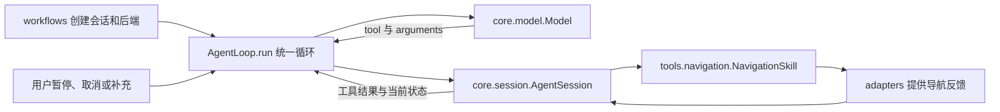

# Agent 技术实现

外层 Agent 使用托管 VLM 理解长程导航指令，当前模型标识为 `qwen3.8-flash`。它采用单模型工具循环：每轮选择一个工具，读取工具返回的结果，再决定下一步。任务规划和视觉审查由同一个模型完成，导航、控制和独立安全仍由本地模块承担。当前不依赖局部 T1、T2、T3。

本文结合代码说明输入如何变成工具调用，以及程序怎样处理观察、反馈和用户事件。研究依据与待开发内容见[技术开发计划](Agent技术开发计划.md)，启动命令与测试方法见[长程导航任务与评测计划](长程导航任务与评测计划.md)。

## 代码组织与入口

`decision/agent/` 按核心循环、工具、外部适配和运行流程组织。目录表示代码职责，不表示多个 Agent，也没有额外的任务规划器。

```text
decision/agent/
  __main__.py                 python -m decision.agent 的薄入口
  cli.py                      参数解析与流程选择
  __init__.py                 项目根目录和配置目录
  core/
    loop.py                   AgentLoop.run：统一运行，tick 单步调度，stop 取消确认
    session.py                AgentSession：任务状态、工具分派和上下文
    model.py                  Model：托管 API、Prompt 与响应处理
    async_model.py            AsyncModel：单个后台请求及结果失效
    memory.py                 EvidenceMemory：可关闭的证据记忆
    store.py                  Store 与 Budget：会话数据库和共享费用账本
  tools/
    framework.py              工具定义、响应 Schema 和参数检查
    navigation.py             NavigationSkill：单次导航调用的生命周期
    places.py                 Catalog：地点目录与本次出发点
    observations.py           Observation 与 ObservationSet：同源观察及保存读取
    environment.py            独立只读场景和地图查询
  adapters/
    simulation.py             合成运动反馈
    shadow.py                 已保存观察和 runtime 的非执行导航适配
    runtime.py                Unix socket 客户端与后台 RGB 观察生成
  workflows/
    common.py                 组装模型和循环，输出JSON
    run.py / shadow.py        准备仿真或影子后端，调用统一循环并保存结果
    drivers.py                仿真时间预算、离线观察推进与测试节奏
    prepare.py / evaluate.py  因果 RGB 准备与合成反馈检查
    replay.py / interaction.py 离线工具轨迹与终端用户事件
  configs/                    地点登记配置
```

[cli.py](../../decision/agent/cli.py)选择后端和输入，再通过 `workflows/` 调用同一个 `AgentLoop.run()`。两个启动脚本不再分别维护持续调度循环。配置仍集中在 `configs/`；项目根目录和配置目录由包入口计算，移动内部文件不会改变资产路径。统一入口仍为 `python -B -m decision.agent`。

## 输入、模型与工具

### core/loop.py：一轮决策怎样进行

`workflows/run.py` 或 `workflows/shadow.py` 先创建导航适配器、会话数据库和 `AgentSession`，再由 `make_loop()` 组装 `AgentLoop`。默认使用托管模型；显式指定 `--actions` 时使用离线工具轨迹，不读取 API 凭证。

`AgentLoop.run()` 是持续运行入口，例如已有会话和模型调用函数时：

```python
agent = AgentLoop(session, model_call)
state = agent.run(console=console)
```

循环接收用户事件、执行单步调度，并在任务完成或取消后返回。没有交互输入时，需要用户回答、继续或恢复的状态也会返回，保存原状态供查看。核心循环不读取仿真时间；可选 `timeout_s` 限制墙钟运行时间，退出后仍执行必要的取消确认。单步入口 `tick()` 保留给局部检查与显式调度。

[workflows/drivers.py](../../decision/agent/workflows/drivers.py)提供测试侧驱动。`SimulationDriver` 管理仿真时长、测试节奏及显式脚本用户事件；`SavedObservationDriver` 在等待观察或导航事件时推进保存输入，模型请求期间保持原观察。等待澄清不会继续遍历录包，输入耗尽会返回 `input_exhausted`。普通实时后端不需要这两个驱动。

[AgentLoop.tick()](../../decision/agent/core/loop.py)按以下顺序工作：

1. 调用 `AgentSession.tick()`，处理导航反馈、取消确认和等待事件。
2. 从 `AsyncModel` 取回已经结束的请求，核对任务修订、活动调用、观察及空间上下文。
3. 结果仍适用时，调用 `AgentSession.call()` 执行一项工具，并保存返回值。已经过期或被取消的结果仅记录，不应用。
4. 会话可以继续且没有未决请求时，组装下一轮上下文并提交后台模型请求。等待事件时不反复调用模型。



`AsyncModel` 一次只允许一个后台请求。用户暂停或取消会立即使未决结果失效，无需等待 API 返回；导航状态仍由主循环处理。退出时尚未返回的请求保留费用预留。

### core/model.py：模型实际收到什么

[Model.decide()](../../decision/agent/core/model.py)是唯一的模型决策入口。输入来自 `AgentSession.prompt()`：原指令、用户补充、任务修订、有限工具历史、地点目录、当前导航状态，以及可选记忆。已确认到达记录单独保存，不依赖模型记忆。

只有模型先调用 `observe_scene`，下一轮才附带取得的 RGB 和同源场景摘要。没有当前有效图像时返回不可用，不拿历史图冒充当前图。客户端维护图像缩放、输入上限、输出预算和请求设置。

模型返回一个对象，例如：

```json
{"tool":"navigate","arguments":{"place_id":"lobby_entrance"}}
```

[tools/framework.py](../../decision/agent/tools/framework.py)集中维护 `TOOL_SPECS`、`action_schema()` 和 `validate_call()`。外层 Schema 限定工具和参数名称，本地再检查该工具的必填项和类型。客户端保留原始响应，不修复参数、拆分数组、更换工具或重试。当前使用受限 JSON，不依赖服务端原生函数调用，也不要求输出模型内部思维链。

API 地址和密钥来自被忽略的 `configs/agent_api.local.json`，密钥也可由环境变量提供。客户端使用 HTTPS，不继承无关 shell 代理；保存的请求不含密钥、认证头或私有地址。本机解释器见[本机记录](../../ENVIRONMENT.local.md#外层agent开发)。Agent 使用独立托管 API，局部 SGLang 不作为自动备用。

## 任务执行与反馈

### core/session.py：任务状态与工具分派

[AgentSession](../../decision/agent/core/session.py)保存一个任务的原指令、补充、修订、工具历史、当前观察和导航调用。它按 `TOOL_SPECS` 将工具名登记到同名方法；`call()` 检查参数、记录意图、执行方法，再保存结果。它不维护逐步骤运行的完整计划。

| 工具 | 实际代码与行为 |
|---|---|
| `lookup_places` | `AgentSession.lookup_places()` 查询 `Catalog`，仅向模型提供地点身份、名称、坐标和状态等允许字段。 |
| `observe_scene` | `AgentSession.observe_scene()` 从后端读取观察，检查源时间、RGB、定位和地图对应关系，供下一轮使用。 |
| `navigate` | 调用 `NavigationSkill.start()`，内部检查目标与几何后异步提交。 |
| `get_navigation_state` | 返回 `NavigationSkill.snapshot()`，含当前调用、已确认到达和尝试记录。查询不刷新测量时间。 |
| `cancel_navigation` | 调用 `NavigationSkill.cancel()`，有活动调用时等待对应反馈。 |
| `wait_for_event` | 在会话中等待导航、新观察或用户继续事件。 |
| `ask_user` | 保存澄清问题并等待回答；活动导航必须先撤销并确认。 |
| `finish_task` | 检查执行依据后记录结果。成功目前只允许仿真范围；失败涉及活动导航时先请求取消。 |

`answer` 补充原任务，澄清内容独立保存，不会随工具历史裁剪而丢失。`replace` 更换指令，等待旧调用撤销后才增加任务修订并生效。暂停和取消直接进入 `AgentLoop.event()`，随后由会话请求停止，不经模型决策。

等待 `user_continue` 前必须有停车反馈；影子模式不能提供这一证明，澄清提问也不代替停车确认。等待新观察时，只有不同于等待开始时的观察才会唤醒循环。恢复暂停后由模型依据实际状态决定下一步，不自动重发旧目标。

[tools/environment.py](../../decision/agent/tools/environment.py)另外提供只读场景和地图查询函数，目前尚未全部登记为模型工具。

### tools/navigation.py：一次导航调用如何完成

[NavigationSkill](../../decision/agent/tools/navigation.py)只管理一个异步导航调用，不理解长程指令。`start()` 先查询地点、检查当前定位与路线，再记录意图并提交目标。接收 ACK 只表示请求被接收，活动调用仍保留。

`tick()` 持续检查后端反馈的任务、目标修订、调用身份、来源、坐标与测量时间。定位健康失效、源数据过期或空间上下文变化时请求取消。断连或 ACK 丢失会保留未确认调用，不自动重发目标；新目标必须等待旧调用结束。

仿真到达需要同一调用的执行反馈、完成和停稳证明。runtime 取消需要对应 `cancelled_request` 回执及空活动目标，旧空状态不足以确认处理。取消影子意图也不等于轮椅实际停车。跨模块字段含义见[接口约定](../接口约定.md#外层agent开发接口)。

`finish_task(succeeded)` 还要求本任务修订有已确认到达记录、全部已尝试地点完成、无活动调用，以及当前有效停稳反馈。这些检查不能形式化证明完整自然语言要求；遗漏站点、顺序错误或视觉误判仍需具体任务评测。

## 观察与导航适配

核心循环接收后端对象，不直接驱动底盘。导航技能使用其 `snapshot()`、`check_route()`、`start()`、`tick()` 和 `cancel()`；存在相机数据的后端另提供 `observe()`。

| 后端与文件 | 输入和反馈范围 |
|---|---|
| [SimulationNavigation](../../decision/agent/adapters/simulation.py) | 调用项目参考规划、DWA、独立安全和差速积分，生成明确属于合成仿真的运动反馈。没有真实相机渲染。 |
| [SavedShadowNavigation](../../decision/agent/adapters/shadow.py) | 读取已有观察和几何，提交目标建议。bag 中的驾驶不响应 Agent，不能报告执行成功。 |
| [RuntimeShadowNavigation](../../decision/agent/adapters/shadow.py) | 通过 `RuntimeClient` 查询状态、读取可选 RGB、提交影子目标和取消，无底盘输出。 |

[tools/observations.py](../../decision/agent/tools/observations.py)定义 `Observation` 和保存读取它的 `ObservationSet`。一份观察保留源场景、RGB 摘要、源时间和位姿；RGB 必须来自观察截止时刻之前。跟踪缺失时人数保持未知。

[adapters/runtime.py](../../decision/agent/adapters/runtime.py)包含只允许状态、目标和取消请求的 `RuntimeClient`，以及 `ObservationWorker`。后者复制即将释放的共享主机 RGB，在限频、限队列的后台支路中编码，保留同源 CPU 场景。runtime 只有显式启用 `--agent-observations` 才运行这条支路，不加载 YOLO、不传整套 GPU 地图，也不等待模型。

[tools/places.py](../../decision/agent/tools/places.py)读取地点登记。`Catalog.bind_start()` 为每次任务创建目录副本，把有效车体起点记为 `mission_start`，不写回共享资产。有图起点须对应当前地图；缺失时返回 `destination_not_bound`，不补零坐标。合成测试预设的返程朝向与测得的初始朝向分别记录。

[floor1.json](../../decision/agent/configs/floor1.json)引用真实一楼开发资产，资产不存在时保留无坐标模板。[simulation.json](../../decision/agent/configs/simulation.json)使用合成坐标，两者的可达性结论不能互用。

## 记忆与持久化

[EvidenceMemory](../../decision/agent/core/memory.py)是可关闭的上下文组件，目前保存带源观察的历史模型工具选择。它按地点和源时间检索，不自动提取或认证地标事实，也不证明当前通行或任务到达。定位会话、时钟或地图对应关系改变后，历史记录保留，空间有效性撤销，旧任务不会自动恢复。`--no-memory` 关闭这一组件，但保留原任务、补充和必要历史。

`AgentSession.context()` 为请求记录任务修订、活动调用、观察身份、实际输入摘要和空间上下文；`valid_context()` 在结果返回时重新核对这些对应关系及观察年龄。源时间始终是测量时间，不改成 API 返回时间。过期结果只记录，不能覆盖新状态，也不自动重试失败请求。

[Store](../../decision/agent/core/store.py)在单个 `session.sqlite` 中保存任务状态、工具事件、执行证明和原始请求响应。给模型的旧导航历史使用摘要，完整结果仍留在数据库。`Budget` 使用跨会话共享账本，发送前预留、按返回用量计提；结果不明时保留预留，新建会话不会重置额度。

`AgentLoop.run()` 在超预算、输入结束、中断或异常退出时，通过 `stop()` 撤销活动调用并短时等待确认；无法确认时保存停止未确认，未决模型结果也会失效。退出原因保存在事件和运行摘要中。等待取消期间断连不会改变用户要求的终止结果。进程重启后只能只读查看记录，不能自动续跑。

## 运行流程与扩展位置

| 要处理的内容 | 从哪里修改 |
|---|---|
| 启动参数、流程选择 | `cli.py`；`__main__.py` 只调用入口。 |
| 持续运行、用户事件和退出处理 | `core/loop.py` 的 `run()` 与 `stop()`。 |
| 仿真或影子测试的准备与结果保存 | `workflows/run.py`、`workflows/shadow.py`；模型与循环组装在 `common.py`。 |
| 仿真时长、离线输入和测试节奏 | `workflows/drivers.py`，不把环境时钟写入 Agent 核心。 |
| 原有场景补充 RGB | `workflows/prepare.py`；仅准备图像对应关系，不重算检测或定位。 |
| 无模型的工具与反馈检查 | `workflows/replay.py`、`workflows/evaluate.py`；固定工具动作不计为 VLM 任务成绩。 |
| 新增模型工具 | 在 `tools/framework.py` 声明参数，在 `AgentSession` 增加同名处理方法；复杂执行逻辑放对应工具模块。 |
| 接新的导航反馈来源 | 在 `adapters/` 实现相同方法，再由运行流程选择；沿用导航技能中的调用和停止检查。 |

当前只实现反馈仿真和非执行影子运行。真实底盘反馈、主动移动观察及局部技能调度仍待接通；Agent 不提供任意 Shell、`override` 或解除安全保护的工具。后续工作见[技术计划](Agent技术开发计划.md#后续开发)，已有验证见[任务与测试](长程导航任务与评测计划.md#开发验收与已有依据)。
