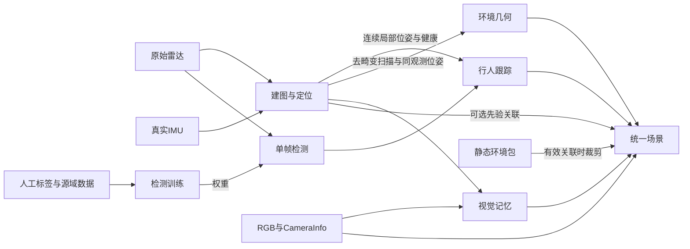

# 感知总览

感知模块将传感器观察转换为行人、连续自车位姿、环境几何和可追溯的场景输入，供决策与导航使用。当前已有bag回放与ROS在线入口、标注工具和基础跨模块适配；完整决策—导航闭环尚未接通。

## 职责与文档

| 内容 | 职责与当前入口 | 技术文档 |
|---|---|---|
| 传感器与标定 | 接入RSHELIOS_16P和D435i，保留原始时间、坐标及安装关系；实现位于`perception/sensors/` | [建图与定位：传感器与标定](技术实现-建图与定位.md#传感器与标定) |
| 检测训练与标注 | 源域完整框、目标域弱监督、本机／Windows远程人工中心复核、任务场景加权微调及基线对比 | [技术实现-检测训练](技术实现-检测训练.md) |
| 检测与跟踪推理 | 单帧VoxelRCNN检测，结合有效定位维护连续世界轨迹；支持独立推理、ROS与显示 | [技术实现-检测与跟踪推理](技术实现-检测与跟踪推理.md) |
| 建图与定位 | ROLL＋FAST-LIO建图／有图定位、FAST-LIO无图定位，支持手动可信区域及离图／返图门控；PIN-SLAM保留为实验后端 | [技术实现-建图与定位](技术实现-建图与定位.md) |
| 环境地图与场景 | 局部几何、静态环境包、视觉／地点记忆及统一场景，支持按关联撤销／恢复的先验视图、只读查询和决策数据适配 | [技术实现-环境地图与场景表示](技术实现-环境地图与场景表示.md) |

启动与查询命令集中于[感知操作速查](感知操作速查.md)，未完成实现、验收及数据需求集中于[待办与数据采集](待办与数据采集.md)。本机解释器、资源和成绩只记录在[环境记录](../../ENVIRONMENT.local.md)，消息约定由[接口约定](../接口约定.md)维护。

## 内部数据流

- 检测直接使用原始雷达，世界跟踪依赖有效定位；缺定位仍能输出传感器检测，世界轨迹明确降级。
- 建图定位与检测跟踪是同级计算分支，统一入口负责启动和绑定来源。环境模块复用定位观察，不重复实现SLAM或人物跟踪。
- 环境几何、记忆与场景使用独立有界队列，图像读取或模型延迟不阻塞几何更新。统一场景按观察截止时间组合各模态，不能按回调到达顺序拼接“最新数据”。
- 原始里程计不作为可靠定位；未知／未观测不当作空闲，人工中心不当作完整3D框真值。

## 与其他模块的关系

| 消费者 | 感知提供 | 消费者负责 |
|---|---|---|
| `decision/vlm/` | RGB、局部BEV、人物身份与状态、历史观察、独立静态先验视图；已有中性视图适配 | 任务输入协议、模型调用、语义校验及结果时效／身份接收 |
| `decision/agent/` | 地点、历史观察及几何的只读事实查询 | 长程任务状态、技能调用、预算和基于真实反馈的推进 |
| `navigation/` | 定位健康、局部占据与观测覆盖、静态地图格式、人物运动状态 | 车体可行性、规划、控制、独立安全监督和真实执行反馈 |

场景、查询或PGM文件存在不代表消费者已经接通；几何空闲不等于轮椅可通过，查询成功不等于任务成功。实机运动由导航与安全准备另行约束。

## 运行与维护边界

| 运行范围 | 解释器／资源 |
|---|---|
| ROS、bag、定位与显示 | 匹配系统ROS ABI的Python与C++工作区 |
| 检测、训练、Linux标注服务 | 已准备的开发／检测环境；真实检测需要权重和兼容GPU扩展 |
| PIN-SLAM | 独立算法环境，由统一入口显式指定 |
| Windows标注 | 客户端Conda环境与Tailscale；数据、检测和标签留在Linux |

公共路径与迁移见[开发指南](../开发指南.md#数据入口与迁移)。只保存必要参数、来源和结果；既有标定、权重与人工标签保持来源绑定，当前操作文档不累积历史排错流水。
