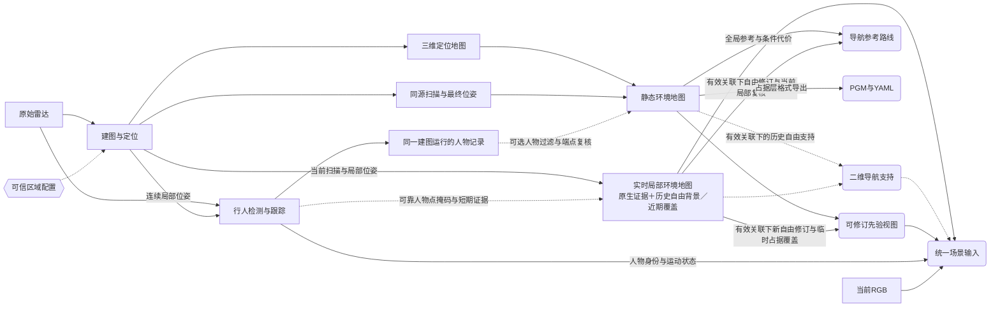

# 技术实现：环境地图与场景表示

环境表示回答“哪些位置有障碍、哪些位置有自由依据、哪些地方还不知道”。`perception/environment/` 将扫描与定位转换为可查询图层，再按观察时间组合人物、可用 RGB 和历史先验，供导航、局部 VLM 与外层 Agent 使用。

当前局部地图积累滚动背景证据并复用近场历史自由，采用整数高度覆盖计数和0.45局部自由概率门限。可靠人物点交给独立动态圆表示，不写入背景占据；未接管的短期人物证据仍使用0.2秒期限。直接运行时另生成二维导航支持层，在有效地图关联下使用所选静态地图的自由依据，不等待在线地面再次确认。配置在[environment.yaml](../../perception/environment/configs/environment.yaml)，当前检查见[背景与人物验证](../../outputs/navigation/history/offline/background_person_navigation/report.md)。冻结静态包和检测、定位原始点云保持不变。

默认由[感知导航运行时](../感知导航总览.md)调用核心。原生占据树仍使用CUDA默认流，地图线程显式建立其与PyTorch流的依赖；二维支持核在地图线程的当前流运行。静态数组按资产和关联生命周期缓存，已封存图层不得原地修改。GPU消费者直接引用设备地图，CPU安全和参考搜索复用一次合包下载的安全胶囊，导航三层在GPU生成并直接供设备消费者使用。

常规导航的扫描接收与地图更新各保留一个正在处理的观察和一个最新待处理观察。定位状态完整送往独立安全进程，替换帧不刷新测量时间。归档、完整场景、决策记录和Agent观察仍使用顺序处理。跳帧后的检测质量与短暂障碍召回尚需独立验收。

地图线程顺序更新背景原生树、近场记忆和二维支持。支持层从当前所选静态图读取地面参考，保存普通端点与未接管人物端点的命中时间数组。人物圆随观察封存，以少量元数据交给消费者。关联失效或生命周期变化撤回静态支持并重置其记忆，旧任务不能发布到新会话。

独立安全用自己加载的静态资产重算整格重叠支持。只有同一场景及同一资产字节的复核可以复用，每次仍检查关联年龄。ROS诊断继续输出基础局部图；轻量支持目前接入直接运行时及显式回放工具，不由ROS环境节点自动生成。距离场仍完整计算，显式合包和复制量另行统计。

先读[地图分类](#地图与非地图对象)，了解定位地图与环境地图的用途，再读[局部构建](#实时局部环境地图)和[静态构建](#静态环境地图)。需要接接口时查询[属性定义](#栅格属性与共用规则)、[先验视图](#静态先验场景视图)、[场景输入](#统一场景输入)与[文件格式](#保存与传输)。日常推理和地图导出分别见[运行操作](../感知导航运行手册.md#日常运行与回看)与[地图准备](../感知导航运行手册.md#地图准备)，剩余工作在[共同清单](../感知导航实机问题.md)。

## 地图与非地图对象

当前按用途区分三类地图，每类都可以有不同楼层或采集来源。表中的 2.5D 表示 XY 栅格附带地面、障碍高度等图层，并不是完整三维体素地图。

| 地图类型／`map_type` | 内容与更新方式 | 用来做什么 | 实现位置 |
|---|---|---|---|
| **三维定位地图** `localization_map` | ROLL关键帧特征、位姿及整体点云；建图保存，固定地图定位时只读 | 扫描配准和自车定位；点云本身不表达完整自由空间 | [建图与定位](技术实现-建图与定位.md#结果与地图资产) |
| **静态环境地图** `static_environment_map` | 最终优化后的几何与射线证据，离线生成2.5D图层；文件冻结，历史占据可被新观察修订 | 整体结构及全局路线先验，不代表永久障碍 | `StaticEnvironmentMap` |
| **实时局部环境地图** `local_environment_map` | 当前扫描与局部位姿持续更新的有界滚动2.5D图层 | 当前障碍／未知范围，为局部决策和避障提供输入；无图路段继续运行 | `LocalEnvironmentMap` |

下面这些对象不增加地图种类：

| 对象类别 | 具体对象 | 与地图的关系 |
|---|---|---|
| **派生视图** | 静态先验视图 `StaticPriorView` | 从静态环境地图裁剪当前位置附近的区域，并绑定当前有效地图关联；离图撤销 |
| **导航派生** | `NavigationSupport` | 当前局部证据优先，在有效关联与楼层对应下补充静态自由支持 |
| **导航派生** | 规划代价栅格 | 导航从原图生成的私有搜索输入，加入足迹与离障代价；不覆盖感知几何 |
| **导出格式** | PGM＋YAML／ROS `OccupancyGrid` | 占据层的文件／传输表示，不自动增加车体膨胀或导航能力 |
| **约束配置** | 手绘可信区域 `PriorCoverage` | 约束三维定位地图的匹配与关联范围，不表达障碍或自由空间 |
| **数据容器** | `GridSnapshot`／`DeviceGridSnapshot` | 前者保存主机数组／文件，后者持有设备数组及就绪事件；显式按消费字段导出，不增加地图种类 |
| **场景输入** | `SceneInputs` | 按同一截止时间组合当前RGB、人物、局部地图和可选先验视图 |

FAST-LIO内部点地图和OctoMap体素树是算法工作表示，不额外登记为地图产品。导航自己的代价栅格与足迹检查见[路径规划](../navigation/技术实现-路径规划.md#搜索与完整足迹)。

实线是主要数据流，虚线是可选辅助或区域约束。人物信息先进入环境处理，再进入统一场景；静态过滤只使用同一建图运行的记录，不修改三维定位地图。近场历史是局部图内部的一种证据处理方式，不新增地图类型，也不能把复用的历史自由当作新观察去永久清除静态先验。

直接运行时默认构建局部图，并把安全检查所需图层取回为“安全胶囊”。`--record-views` 另外限频保存带 RGB 的完整场景，建图默认封存静态融合需要的扫描。

ROS 诊断分别通过 `--environment`、`--scene` 和 `--record-environment-scans` 开启对应工作。此分支支持ROLL和FAST-LIO。参数以 [environment.yaml](../../perception/environment/configs/environment.yaml) 为准，命令见[直接运行时操作](../感知导航运行手册.md#日常运行与回看)。

原始雷达供定位／检测使用；环境过滤在独立分支进行。配置明确绑定`lidar`／`rslidar`同传感器别名，显示专用降采样云不能反向作为计算输入。地图关联由[定位适配器](技术实现-建图与定位.md#局部定位与先验关联)维护，环境不自行估计全局位姿。

## 栅格属性与共用规则

### 栅格与坐标

静态与局部环境地图共用 11 个基础图层，每层是独立的 `H×W` 数组，按 `[行y, 列x]` 访问。它们类型不同，不预先拼成 `H×W×11` 浮点张量。`GridSnapshot` 保存数组和元数据，格式见[保存与传输](#保存与传输)。

当前CPU和CUDA局部地图均生成完整的`clearance`、`unknown_distance`和`frontier`，用于距离查询、碰撞检查和前沿显示。

不同用途另有附加层：静态地图保存 `endpoint_count` 和 `conditional_obstacle`，修订先验视图保存 `revised_free_stamp`，局部近场历史保存五个来源与时效层。人物背景标记另用于导航动态视图。二维导航支持增加三个派生层，含义见[静态自由支持](#静态自由支持的导航派生图)。

栅格`[i,j]`的中心为`(x0+(j+0.5)r, y0+(i+0.5)r)`，其中`r=resolution`、`[x0,y0]=origin_xy`，单位均为米。局部地图使用连续`odom`系；静态地图使用源定位地图的坐标系，通常为`map`。不能直接按数组下标叠加两者。

`resolution` 同时控制 XY 栅格与内部占据体素边长。两类地图也共用地面拟合、障碍高度带、概率和覆盖规则，但证据来源与保留时间不同。修改配置只影响后续构建与新静态导出，已有地图按自己的元数据读取，不会自动重采样。

### 属性定义与作用

| 属性（类型／单位） | 含义与计算 | 主要作用 |
|---|---|---|
| `occupancy`（int8） | `-1/0/100`＝未知／有证据空闲／占据；由命中、射线及高度覆盖共同决定。存在 `person_objects` 时不含已移交人物点 | 背景障碍表达；当前接触须叠加人物圆 |
| `ground_z`（float32／米） | 本格有支持的地面Z坐标；由地面内点及邻近支持生成，缺失为NaN | 作为障碍相对高度的基准；不是固定的雷达高度 |
| `ground_support`（bool） | 是否在有效地面样本的支持半径内；不是拟合置信度 | 判断地面高度及自由空间推断是否有依据 |
| `obstacle_min_z`（float32／米） | 障碍高度带内，已观测占据证据相对`ground_z`的最小高度 | 表达低处障碍下界；无证据为NaN |
| `obstacle_max_z`（float32／米） | 同一高度带内的最大相对高度 | 表达障碍上界；不是完整物体高度或3D框 |
| `observed`（bool） | 本格是否含保留的体素证据，静态图还包括最终地图端点 | 区分有证据和未观测；true不代表空闲或完整扫描覆盖 |
| `last_observed`（float64／秒） | 本格体素命中或自由射线最近更新时刻；不使用导出时间填充 | 判断证据年龄；不等于整个场景的采集时间 |
| `coverage`（float32／0～1） | 本格障碍相关高度带内，有实际自由射线证据的不同高度格所占比例 | 决定是否有足够证据将该格标为空闲；不是XY覆盖率或置信度 |
| `clearance`（float32／米） | 本格中心到最近已知占据格中心的二维距离；未知格、无已知障碍时为NaN | 供下游计算障碍间距；未扣除车体尺寸，不能当作可通行余量 |
| `unknown_distance`（float32／米） | 到最近未知格中心的二维距离，图幅外也按未知处理 | 衡量未知区域接近程度；未知格自身为0 |
| `frontier`（bool） | 空闲格的四邻域是否含未知格，并排除图幅最外圈 | 提供探索边界候选；未检查连通性或车辆可达性 |
| `endpoint_count`（int32，仅静态） | 本格保留的最终地图点数，包含地面与障碍等端点；启用过滤时只统计通过筛选的子集 | 追溯端点支撑数量；不是独立观测次数或概率 |

局部图没有体素证据时，`last_observed=-inf`；静态图缺失时间时使用 NaN。JSON 查询将非有限数统一返回为 `null`。观察、时间、地面支持和占据要分别判断：例如一个格子保留了最终地图端点，可能 `observed=true`，却没有可用时间或空闲依据。

近场复用格的 `ground_z/ground_support/coverage/last_observed` 来自此前的完整自由证据，不是当前快照时刻的新测量。近期障碍覆盖使用实际命中时间，下列附加层用于区分两者：

| 图层 | 含义 |
|---|---|
| `near_field_free`（bool） | 本次由历史自由背景恢复的位置；其他空闲仍来自保留的射线证据 |
| `near_field_free_classified_at`（float64秒） | 历史自由分类时刻；非复用格为NaN，不等于整列体素的统一测量时间 |
| `near_field_obstacle`（bool） | 基于缓存地面及近期实际命中生成的临时障碍覆盖 |
| `near_field_obstacle_stamp`（float64秒） | 盲圈内保留的末次实际障碍命中；圈外或缺失为NaN |
| `near_field_obstacle_expires_at`（float64秒） | 覆盖截止时刻；普通与可靠人物命中遵循各自期限，缺失为NaN |
| `person_background_free`（bool） | 当前占据仅由可靠人物证据支撑，且同位置有仍有效的历史自由依据；供导航构建独立动态碰撞视图，原`occupancy`仍为占据 |

### 共用投影规则

三维证据按以下共用规则投影。静态融合保留`project_evidence()`参考实现；局部地图直接在CPU／GPU常驻证据上投影，之后采用等价的距离场和边界规则。最终局部图还执行下述近场历史处理，各后端与参考实现逐层对照：

1. 按XY位置归格，汇总观测标记与最近更新时间；时间计算使用float64，避免历元秒精度丢失。
2. 相对本格地面计算高度，仅把配置的障碍高度带用于占据、自由覆盖和障碍高度包络。
3. 命中占据概率阈值的体素标为占据；有效扫描端点及静态障碍候选也可保守保留占据，同次更新命中优先。
4. 只有地面有支持、自由射线覆盖满足阈值且没有占据命中时，才标为空闲。覆盖按实际落在高度带内的世界体素中心计数，高处射线不能清空低处障碍。
5. 从最终占据层计算距离与边界图层。没有扫描到的角度、被裁剪点和检测未命中都不作为空闲证据。

覆盖分子和分母统一使用世界Z方向的整数体素键。高度带边缘允许1e-5格的数值误差，重复证据只计一次，缺一层仍不满足完整覆盖。局部`free_probability=0.45`接受已有的弱自由射线；`free_vertical_coverage=1.0`、地面支持和命中优先保持不变，没有射线的高度层不能补成自由。

Python参考、CPU与CUDA使用一致的整数计数。离线导出单独使用`static.free_probability=0.35`，避免局部阈值调整同时放宽静态地图。已有静态包和保存场景保持原图层与摘要；新导出使用当前计数修正，须记录生成来源。

两类地图的差别在证据来源、位姿修正和保留时间，而非给相同字段另设含义。仅端点静态图的受限字段见[静态构建状态](#静态环境地图)。

## 实时局部环境地图

`LocalEnvironmentMap` 持续维护轮椅周围的证据，有图、无图和混合路段都运行。它先选择同次观察的扫描与位姿，估计有支持的地面，累积三维命中与自由射线，再投影为二维图层。滚动窗口移动只改变栅格原点，不重置连续坐标生命周期。

| 阶段 | 输入与处理 | 产生的内容 |
|---|---|---|
| 扫描／位姿配对 | 按相同观察时间绑定去畸变扫描、有效定位和地图关联，再按配置限频处理 | 当前`odom`点及雷达位姿 |
| 地面更新 | 平衡XY采样、剔除竖直点柱，比较独立低点与历史高度带候选，检查拟合和高度外推尺度；保留实测地面内点，旧地面随窗口移动并按时效淘汰 | `ground_z`、`ground_support`及地面参考状态 |
| 三维证据累积 | 用射线与概率模型更新可淘汰稀疏体素；普通与人物证据分别按配置时效淘汰，窗口外证据删除 | 命中／自由概率、实际更新时间及内部人物标记 |
| 分层输出 | 调用共用投影规则，生成只读快照并放入有界缓存 | 11个基础图层与定位、时间、关联绑定 |

射线原点优先按逐点时间，从同会话有效位姿插值得到。`curvature` 保存相对首点的有符号毫秒偏移，并以扫描结束时刻对应最大偏移。组织化扫描中的早期点不能被截为零。插值不跨越定位失效或过大时间间隔，也不使用未来位姿。

原点不足时，只有位移足够低且配置允许，才近似使用扫描末端单原点；否则只累积命中，不生成自由射线。定位失效或重置会清空融合状态。

原生体素证据过期后回到未知，近场输出可按后文规则恢复历史背景。恢复背景不是新的自由测量，新的实测自由仍需射线。人物轨迹则保留为独立动态信息。

地面与自由体素按 `voxel_ttl_s` 保留历史观察，占据体素按更短的 `obstacle_ttl_s` 从最后命中计时。持续命中会续期，但没有新命中不能无限保留障碍。到期删除后，仍需地面支持和足够高度覆盖才能成为原生空闲。

原始局部构图不外推缺失地面，也不直接清空自车周围未知区。当前导航派生只使用合格静态自由支持，不补小孔，也不改写原始地面。默认期限由环境配置维护。

当前扫描的有效端点优先标为占据。局部跨帧命中按传感器概率模型、新命中保护和短期占据期限处理，持续观测会续期；离线整段静态融合保留累计概率规则，不能用局部期限删除早期看到的墙体。

局部图默认启用 `hit_invalidates_free`。新命中先撤销同体素负的历史对数几率，再累计命中，防止很强的旧自由概率压住新障碍。之后需要新的自由射线重新确认，占据到期则删除。

历史背景恢复发生在独立近场层，始终保留来源。离线静态融合仍使用原累计概率模型，不使用这个局部开关。

快照用 `evidence_retention_s/obstacle_retention_s/free_vertical_coverage_required` 记录当前条件，快照时间新不表示每个高度体素都刚被扫描。`max_rays` 只限制自由更新的射线密度，碰撞端点仍全部参与。预算过小可能长期缺少某一高度层，调整时需同时检查覆盖和耗时。

静态融合单独使用`static.max_rays`，旧配置缺失时沿用顶层预算，避免局部射线调优同时改变已接受的静态导出设置。

### 地面候选与参考

`ground.py:GroundTracker` 只选择环境分支的地面候选，不删除定位或检测原始点。它先按 XY 小格均衡端点，排除高度跨度明显的竖直点柱，再从独立低点和历史高度带分别拟合候选。每帧比较实际低处支持、残差、点数、二维跨度和坡度，历史参考不能独占选点。

候选计算在CPU批量执行。XY小格编码为保持有符号坐标排序的64位整数键，最低点及同高点的先后次序保持原规则。同一帧复用坐标矩阵和已筛选点，只有索引及顺序完全相同的候选组才共用拟合与评分。每组仍使用原来的40次独立三点抽样、退化阈值、坡度限制和首次最高内点数选择规则；批量求解后，对胜出内点执行原最小二乘精修。

抽样索引按点数缓存，最多保留64项且只读。平面、内点和地面支持仍由当前观察重新计算，计算优化没有放宽候选质量与重获确认条件。公共`ground_plane()`入口继续执行范围和高度筛选；地面跟踪内部使用已经通过相同筛选的点，避免重复计算。该次计算优化的标量对照、四场景逐格一致性及性能范围见[地面计算验证](../../outputs/navigation/history/offline/ground_fit_performance/report.md)，不据同机一致性承诺所有平台逐位相同。

局部单平面构图选出地面内点后，按当前扫描点序将高度写入XY格，同格多个点沿用最后写入值。旧地面按`voxel_ttl_s`及滚动窗口保留；邻近支持只在配置半径内传播，不生成完整自由高度列。该写入方式容易受点序和稀疏地面影响，剩余验证见[规划诊断](../感知导航实机问题.md#现场出现后再处理的问题)。

候选还检查在雷达位置外推高度是否可靠，避免远处窄条地面与墙面混合后得到错误安装高度。检查尺度来自空间分布与拟合容差，是启发式适用性判断，不是标定误差置信区间。

低处证据不足时返回不可用，不改选较高的假平面。`ground_z/ground_support` 只来自实测点和有界支持邻域，不把整张拟合平面填成地面。

初始化要求连续高度的中位绝对偏差和全范围都稳定。正常跟踪用有界历史中位值更新参考，允许已经观测到的坡面变化。质量合格的新候选明显低于旧参考时，设置`history_suspended=true`，暂停依赖局部地面的自由判定，保留旧地面、近场缓存和原观察时间。此时仍更新体素与障碍，旧高度只用于障碍分类；普通缺点或遮挡本身不触发暂停。

暂停后，点数不足或拟合不确定只能中断新地面的确认，不能解除暂停。重新观测到与旧参考一致的合格地面时恢复使用历史；新地面通过`reacquire_observations`次稳定确认后，才设置`clear_ground_history=true`，切换参考并清空旧地面及近场历史。会话、代次或坐标变化仍执行完整重置，地面期限和滚动窗口不因暂停而延长。

CPU与CUDA近场处理共同禁止暂停期间的自由认证、历史自由恢复及人物背景自由提示，同时保留当前命中与近期障碍覆盖。暂停通过已有投影和近场处理执行，不复制多份历史地图；CUDA库须支持`sn_occupancy_suspend_free_history`，旧库会被明确拒绝。当前仍使用单平面和整体暂停、确认后的整体清理，没有固定世界地面锚点或多片地形模型；真实台阶、缓慢变化和长期遮挡仍需单独验收。

较高桌面不能仅凭停留时间晋升为地面，大幅向上跳变仍会拒绝。跟踪参数统一在`ground_tracking`中维护；复杂台阶和多片区地形尚待数据及车辆能力验收。

### 人物证据与因果降级

`dynamic.enabled` 控制人物提示。直接运行时将同次检测跟踪结果交给环境核心，ROS 诊断则订阅人物并有界等待，不要求先开启 `--scene`。定位前端不等待检测。

人物点掩码只使用截止之前、未过期且坐标、时钟和定位生命周期一致的可靠已观测轨迹。低置信度、未确认和纯预测目标不参与。

同测量时刻且身份完整的人物由`person_objects.py:point_owners()`处理。检测框限定候选范围，人体中心附近的种子选择水平连通点簇；栅格连接尺度随距离有界增加，避免16线雷达的垂直稀疏导致整个人断开。已有可靠局部平面时排除地面，不要求每个候选点所在栅格都有地面支持；平面缺失时仅使用检测框的有界高度范围。检测框和点簇都不是逐点真值，贴墙、多人交错及误检仍需独立检查。

每个候选点记录人物索引，重叠时选择较近的中心。被接管的点不写入背景体素、近场命中缓存或静态支持端点覆盖，射线仍终止于实际人体回波。`metadata.person_objects`记录同源人物身份、中心及覆盖所选点的圆半径，原始点云不修改。普通障碍和原本未知的背景保留，人物移动本身不生成新的自由证据。

导航默认的当前接触视图在背景上叠加这些圆。DWA与独立安全取得对应人物身份、来源及中心后，分别将各圆交给已有匀速预测；速度未知的人以当前圆处理，不阻止其他人接管。人物包缺失、来源不符或某个身份未找到时，该圆保留为当前障碍。地图内的圆和运动预测采用同一身体范围，不能用较小预测圆代替较大的已移除点簇。

异步旧人物包仍可使用原有保守`person_points()`掩码与`transient_ttl_s`，没有足够证据接管时按普通几何处理。原生体素和近场覆盖保留独立普通命中时间，后来识别出人物也不直接清除此前无法归属的普通占据；其期限与未知恢复规则保持原样。没有跨帧逐点所有权历史或人物离开证明。

### 固定安装传感器的地面跟踪

默认 `ground_tracking` 适用于固定安装传感器。启动时按前节规则收集低处地面，只有连续平面足够且高度一致后，才形成雷达离地高度参考；预热期间不发布有效地面支持。后续按此前坡度和高度筛选候选，避免桌面、座椅替代地面。视角或坡度变化时，可以从低处实测点重新捕获，但仍要检查高度一致性、内点与空间跨度。

这只约束平面选择，不增加自由射线。缺地面或覆盖不足时仍保持未知，快照记录预热、跟踪或不可用状态、来源、高度与拒绝原因。定位生命周期变化会重置参考。

候选平面在雷达位置的外推高度变化，不再单独撤销整张图的历史支持。地图将实际空间采样点与同位置的历史地面比较，发现低于原地面超过现有高度容差的回波时，记录该处冲突及原地面高度。冲突影响范围覆盖地面支持的邻域传播半径，发布为二维布尔层`ground_conflict`。这些格子暂停使用自由支持，其他格子仍须满足原有地面、覆盖和历史复用条件；该机制不会直接把未知填为空闲。

局部冲突没有超时恢复。只有可信地面拟合提供了对应位置、与原高度一致的实测内点，才解除标记；缺测和被拒绝的拟合不解除。重新确认较低平面会按原规则更新整体参考并清理相应旧地面历史，但不会证明此前观测到的落差已可通行，局部冲突保留原高度依据。定位生命周期重置或区域移出滚动窗口时清理这些记录。这仍不是完整的坡道、台阶或负障碍检测器。

`ground_tracking.reference_pending`表示新高度参考仍待确认，`history_suspended`只表示整体自由支持暂停。可信候选与历史地面没有足够空间重叠、无法确定冲突范围时，仍整体暂停；缺测不能解除该暂停。`history_suspension_scope`记录`none`、`local`或`global`，另记录冲突格数及实际比较点数。近场历史恢复、人物背景恢复及静态自由补充都遵守同一冲突层，当前占据继续保留。CPU与CUDA使用相同二维规则，GPU不下载三维体素来处理这些标记。

若传感器被拿起或放下，固定安装假设不成立，需要显式关闭该策略。门限由环境 YAML 维护。

近车地面方向可能超出当前扫描的回波仰角范围，需要保留此前运动时的真实观测。单独延长历史只能缓解部分过期缺失；当前采用下述带来源的近场背景与覆盖，区分从未观测、暂不可见和历史过期。地面有支持、完整自由列、起点可用和目标路线可行仍是不同结论。

### 最近地面扫描圈内的历史自由

近车位置有时已经离开当前最低雷达束的地面交点范围，暂时扫不到地面不表示从未观察。默认 `near_field.enabled` 为这些位置缓存历史自由背景，只保存曾有地面支持、完整自由高度覆盖且无占据的格子。

恢复仅发生在最近地面扫描圈内，不清空整个近车圆，也不从车体位置推断自由。此功能适用于单平面跟踪分支，CPU 参考在 `near_field.py`，CUDA 与占据投影共用原生库，在线和因果回放都通过 `LocalEnvironmentMap` 执行。

扫描圈根据最低束方向、当前姿态和地面平面交点近似，并保留边界余量与最大半径。坡面下半径会随方位变化，不假设地面水平。只有整个格子都位于圈内才复用。

CUDA 将 360 个方位的交点并行计算，再按原规则整理角度和半径。CPU 参考、角度采样以及姿态和地面有效性判据保持一致，计算加速不扩大可复用区域。

这个圈是有来源的几何近似，不是完整波束标定或可见性证明。姿态或地面参考不可用时停止复用。

| 环节 | 规则 |
|---|---|
| 候选保存 | 保存原地面高度、自由覆盖和实际观察时间；可选择仅在圈内续存，或在当前局部滚动窗口中保留候选、等进入圈内再启用。圈外候选不直接改变当前地图。 |
| 圈内续存 | 无新冲突时，不因原三维体素期限结束而丢掉历史自由；从未确认空闲的格子仍为未知。 |
| 新障碍／地面变化 | 默认将历史自由背景与近期障碍分开；新命中覆盖背景，明显地面变化撤销背景。独立缓存的已支持地面可用于显示近期障碍，即使该格从未确认过整列空闲。 |
| 重新确认 | 原生证据仍需新命中之后的自由射线才能重新确认；历史恢复保持推断标记。 |
| 清理 | 定位会话／代次／坐标帧切换、时间回退清空；滚动窗口外删除。不是跨行程永久自由地图。 |

`temporary_obstacle_overlay`分开保存历史自由背景与近期障碍。新障碍覆盖背景，继续命中会续期；覆盖到期后，圈内可恢复原背景。当前整格均为可靠人物命中时使用人物期限，混合普通命中则使用普通期限。独立的普通命中时间保证后续人物命中不会缩短尚有效的普通保护。

恢复表达历史先验，不表示刚测得空闲。遮挡后未再观测的障碍可能到期，因此不能据此确认它已经离开。原生证据保持原样，历史复用也不会永久清除静态先验。从未获得空闲依据的位置仍未知。

输出保留 11 个基础层，并重新计算距离与前沿。复用格的地面、覆盖和时间来自历史，附加 `near_field_free` 标识位置，`near_field_free_classified_at` 记录原自由分类时刻，不伪造当前射线。

临时障碍用`near_field_obstacle`、`near_field_obstacle_stamp`和`near_field_obstacle_expires_at`记录。当前仅在近场处理范围内维护这些输出，圈外格不保证保留末次命中时间。`metadata.near_field_memory`记录参数、原快照、圈模型与失效统计；恢复旧背景不刷新原自由时间。

这部分已接入在线环境节点、场景组装、只读查询与记录回放，ROS消息携带全部来源图层；未实施自车足迹强制清空，未修改静态全图，也不表示VLM／导航整机闭环或实机安全已验收。圈内仍有未知时，应检查是否从未获得完整自由依据、背景是否失效或位于圈边界。参数只在环境配置维护，数据对照入口见本机记录。

### 静态自由支持的导航派生图

`support.py:NavigationSupport`在`navigation_support.enabled`启用时，为整个栅格处于`radius_m`范围内的近车未知区补充静态自由支持。它要求有效地图关联及所选静态图中的合格地面和自由依据；条件不满足时沿用局部背景，并记录支持状态。邻近格为空闲或高度带只有部分覆盖，都不能单独使未知格变为空闲。

| 附加层 | 含义 |
|---|---|
| `navigation_occupancy`（int8） | 同一局部格上的`-1/0/100`状态；原占据及有效期内补充端点优先。 |
| `navigation_source`（uint8） | 当前生产`0`未知、`1`局部自由（含既有近场历史）、`2`局部占据、`3`静态自由支持、`10`补充端点占据。 |
| `navigation_source_stamp`（float64秒） | 局部层的原观察时间、相交静态格中最早的原观察时间，或补充端点的实际命中时间；未知为NaN。复用不刷新时间。 |

每次核对定位关联、地图身份、变换和测量年龄后，从雷达附近的静态自由区读取地面高度中位数作为查找起点，再按对应格读取静态地面。保留地面位于雷达下方合理高度范围的基本检查，但不要求当前拟合平面与先验相差小于15厘米，也不积累短时楼层确认。局部地面缺失或重获不会撤回可信静态背景。定位身份、关联代际、地图修订变化、时间倒退或关联失效仍会重置支持；选错楼层、复杂坡面与关联错误需要独立验收。

每格将完整碰撞高度柱投影到静态图，保留横滚和俯仰，检查所有正面积相交的静态格。相交格必须全部为自由、有实测地面支持、与本格静态地面高度连续，且原时间不晚于当前观察。15厘米门限只用于这些静态地面之间的一致性检查。不能只采样格心；静态未知、占据、缺地面、未来证据和图外区域均不提供自由依据。

局部逐格地面缺失可能使基础图漏掉当前端点。支持层优先在局部坐标中按已跟踪平面判断端点相对高度，避免关联Z偏差参与障碍高度分类；局部平面不可用时回退到静态地面参考，并标明来源。已交给人物圆的点不进入端点覆盖。剩余普通与未接管人物的命中时间仍分别保留，后到的人物命中不能缩短原普通保护。原占据优先；补充端点到期后只恢复仍通过投影检查的背景。

这种恢复依赖先验基本一致的场景假设。普通障碍被长期遮挡而未再命中，也可能在期限结束后恢复先验；期限结束不证明真实障碍消失。当前没有稳定障碍永久冲突记录或人物离开证明。既有近场记忆继续按原规则工作，不新增窗外无限历史、启动净空或自车区域清除。

GPU缓存静态数组，按格并行完成投影、端点覆盖与合成；上传端点前已完成高度与人物归属筛选。三个派生层进入安全胶囊，`metadata.navigation_fusion.method=static_background_support`标识当前方法。独立CPU消费者重算整格重叠，核对背景摘要、观察身份、关联年龄、范围、静态地面来源、资产和原支持时间。正常人物接管只增加有界元数据，不上传整张导航图；人物来源失配时，GPU控制显式上传与CPU一致的临时圆形障碍视图，并单独计量。

派生层不改写背景`occupancy/ground_z/coverage/last_observed`，静态修订不能将派生自由当作新实测。默认导航查询和显示将当前人物圆叠加到背景；接管成功的动态规划视图则分别检查背景和随时间移动的人物。消费者只接受当前`static_background_support`规则，旧确认方法的冻结场景须从原始观察重建后才能按当前实现复核。旧四场景页面已清理，只保留[当时汇总](../../outputs/navigation/history/offline/map_lightweight_support/report.md)。全局参考临时使用局部自由的机制见[路径规划](../navigation/技术实现-路径规划.md#局部证据进入全局参考)。

### 计算后端与更新频率

实时局部地图默认使用 CUDA，直接运行时在 GPU 主进程构建它。ROS 诊断与局部场景补算支持用 `--environment-backend cpu` 选择 CPU 参考，或通过 `--config`、`--environment-config` 选择相应配置；这些参数不能直接套到 `python -m runtime`。

核心配置的 `compute.backend` 为 `cpu` 或 `cuda`，`compute.device` 是当前可见设备集合中的编号。运行记录保存实际配置，快照记录 `compute_backend`。依赖缺失、设备不可用或超预算时明确失败，不自动切换后端。

| 阶段 | CPU后端 | CUDA后端 |
|---|---|---|
| 占据状态 | 有界哈希表，使用OctoMap键、传感器模型及射线规则 | 世界体素格对齐的GPU环形数组，窗口移动时保留重叠区域；人物与普通证据独立时效 |
| 射线与更新 | CPU射线遍历、每扫描去重 | 并行射线遍历，体素标记归约去重；普通命中优先于人物命中，命中优先于自由射线，每格每扫描最多一次概率更新 |
| 三维到二维投影 | C++直接遍历常驻证据，省去完整快照和NumPy散点归约 | GPU直接投影常驻体素；直接运行时保留设备图层，CPU／ROS适配显式取回所需二维层 |
| 近场背景与覆盖 | NumPy参考，保留来源和命中时间 | GPU常驻滚动历史、圈范围、端点归约与普通／人物时效；投影后直接合成 |
| 距离与边界 | OpenCV精确欧氏距离、四邻域前沿 | GPU两遍精确平方欧氏距离、图幅外未知边界与四邻域前沿，不使用近似跳跃传播 |
| 地面与人物提示 | CPU平面拟合、支持与人物点簇 | 当前仍复用CPU判据；`compute_components`分别记录，不能把整段称为全GPU |

两后端均通过 C ABI 供系统 Python 和 Conda 调用，不跨 Python ABI 加载扩展。算法源码统一位于 `native/`，CPU 参考仍可随 ROS 诊断包构建。构建见[运行手册](../感知导航运行手册.md#准备)，射线规则来源许可见 `native/OCTOMAP_LICENSE`。

CUDA 的 Python 适配由 `cuda_view.py` 负责：先准备近场策略与原生参数，调用投影函数，再按固定通道顺序转换图层类型。选择设备输出时，图层转换留在 GPU；选择主机输出时，显式返回 NumPy 数组。适配层不另写一套地图算法，也不强制系统 Python 导入 Torch。

`device.py` 中的 `DeviceGridSnapshot` 持有本帧图层和就绪事件，供控制线程直接消费。安全下载原占据、同源人物背景及启用的导航三层，参考搜索复用同一胶囊，完整图层只作显式导出。生产者不得用下一帧覆盖仍被读取的图层，具体约定见[数组所有权](../接口约定.md#数组所有权)。持久化 `GridSnapshot` 仍使用原有 CPU 格式，各种快照按实际内容保存摘要。

CUDA 局部存储最多 800 万个体素槽，二维投影最多 36 万格和 256 个高度桶，`max_voxels` 仍限制实际证据数。固定容量含边界余量，不能因浮点抖动改变尺寸就清空历史。

地面拟合、支持、人物点簇和 ROS 封装仍在 CPU，静态全图导出也使用 CPU 累积证据与参考投影，并在 manifest 记录后端，不套用局部滚动窗口。定位的 GPU 近邻与去畸变是独立实现，见[建图与定位](技术实现-建图与定位.md#cuda匹配与去畸变默认)。

更新调度以观察时间固定相位分桶，在配置频率下处理每桶首个可用观察；它约束平均频率，相邻处理间隔可有抖动。已配对可信位姿且属于当前定位生命周期的限频扫描，提前退出人物等待；保留的扫描仍按原截止和等待预算关联人物，失效或重置位姿仍执行地图撤回。

ROS诊断的局部与标准占据消息使用NumPy／字节数组序列化，订阅者可通过`numpy_msg(EnvironmentGrid)`读取全部数组，无需GPU。直接运行时不经过这条消息链，安全及搜索使用只读共享槽，设备消费者使用事件绑定的GPU数组。原ROS协议和来源摘要保持兼容，节点按当前消息定义重建；旧bag按其原消息定义读取，旧11层元数据及摘要不改写。

直接运行时汇总设备更新、显式复制、控制及安全接收，CUDA事件与CPU墙钟分开。ROS诊断另记录发布调用、排队等待及观察年龄，相关发布统计保留最近512份；发布返回不等于下游收到。配置5Hz或算子低于200毫秒都不能证明整链实时，需结合处理率、队列和场景消费检查。

### 可选扫描封存

扫描封存用于以后把当前观察融合到最终地图坐标中。直接运行时建图默认封存，可用 `--no-record-scans` 关闭，其他模式用 `--record-scans` 开启。ROS 诊断默认关闭，通过 `--record-environment-scans` 开启。

两套入口都先提供有效地图，再把扫描、位姿、逐点原点、点时间和元数据交给独立压缩与 SQLite 线程。写盘不算几何算子耗时。

队列同时受 `scan_recording.queue_size` 与 `max_pending_bytes` 限制，正在写入的输入也计入预算。溢出、磁盘失败或时间倒序会明确标为封存失败，不能丢记录后继续写完成标记；有效当前地图仍可发布，封存状态单独报告。

正常停止先排空，再检查封存条数是否等于已处理地图观察数，并生成完成标记。只有完整记录才能作为静态融合来源；请求完整封存而未成功的任务不能报告整体成功。

### 保存场景的因果重建

`rebuild-scenes`用于旧bag局部场景的定点离线诊断：读取原bag的逐点`timestamp`，用同源已保存的有效雷达位姿对截止时间前的扫描去畸变，再按当前局部环境配置重建。窗口至少覆盖体素保留时间，使用原运行记录的前端近距盲区；逐点原点随实际位姿插值，排除扫描头时间之后的点，不跨定位失效、重置或过大时间间隙。

工具核对bag来源、扫描坐标和截止时刻位姿，保留可用的同源人物证据。新场景沿用原观察的RGB、人物及定位关联，写入新的派生来源和指纹，原包只读；不借用最终三维地图或未来位姿，也不重新执行SLAM。原始逐点时间缺失时明确失败，不用单原点伪造去畸变。重建后的未知仍是未知，不能保证任意时刻的完整车体足迹均已观测。命令见[场景重建](../archive/感知导航ROS诊断命令.md#静态地图查询与场景重建)。

`replay-window`对指定时间窗只处理一遍扫描，在已保存场景的原观察时刻输出连续几何包与`window.json`。默认使用全部原始扫描；`--sampling recorded`只使用原运行发表场景对应的扫描，便于复核较低采样密度。两者均保留实际扫描／定位时间、有效关联和人物来源，不模拟ROS调度、队列或丢帧。窗口至少预热到证据保留时长；RGB明确缺失，场景标记为`geometry_only_causal_replay`，可用于几何规划，不能当作完整VLM输入。

## 静态环境地图

`StaticEnvironmentMap` 读取离线环境包。导出从成功结束的建图运行开始，把同源扫描与最终优化位姿融合到新目录中，源三维定位地图保持只读，每层楼维护独立资产身份。

bag 来源需要核对原包。实时来源没有 bag 时，必须有本次完整扫描封存、定位记录和最终地图，不能伪造 bag 路径。

可用`export --bounds XMIN YMIN XMAX YMAX`显式限制地图坐标中的计算范围，边界向外对齐格网，在分配栅格前检查预算；未指定则保留全图。范围和保留端点数写入元数据并参与新快照身份，源三维地图及范围外数据不删除。区域边缘的支持、距离场与未知边界按新区域重算，不把范围外视为自由空间，也不宣称与全图切片逐字节相同。

### 构建流程

1. **生成端点候选。** 读取最终`GlobalMap.pcd`与关键帧位姿，确定图幅；沿采样关键帧位置拟合地面，统计每格端点数和障碍高度包络。此时没有自由射线，不能推断空闲。
2. **绑定扫描与最终位姿。** 默认要求同源完整封存的`scans.sqlite`，按精确时间与局部会话核对原扫描位姿；用所属有效位姿段中不晚于扫描的最终关键帧修正局部位姿，不跨失效段。无法绑定的扫描计数并跳过。
3. **修正端点和原点。** 雷达系端点随修正后的雷达位姿变换，已记录在局部系的逐点射线原点使用相同地图修正。不能把最终端点与未修正原点混用。
4. **融合并投影。** 复用射线占据与分层投影；未启用过滤时保守保留最终地图障碍候选，启用时按下述规则复核扫描命中与端点。延长体素保留时间以覆盖所绑定记录时段，导出后图层固定。

地面候选由各局部拟合筛出后，同一个源点只计一次，每格取候选点高度的中位数，再在原有支持半径内建立地面参考。这样不会由最后遍历的点或位姿决定整格高程。`ground_estimator`记录该方法，已有冻结地图保持原结果；修正地面后需要重新融合和投影射线，不能只替换`ground_z`而沿用旧自由判定。中位数不保证消除真实高差、稀疏缺口或地图与当前地面的不一致。

`scans.sqlite`保存按环境更新频率记录的前端已接受去畸变点、点时间、实际原点及局部位姿，超预算失败。它不包含所有原始激光束，ROLL的`corner/surf`特征也不能代替这些扫描证据。

旧定位地图可以复用另一套已保存的扫描证据：`export --localization-map … --evidence-run … --reference-run …`要求证据运行与参考有图定位来自同一bag，且后者匹配指定地图。每份扫描必须绑定同一传感器、同一纳秒观察的有效地图位姿；端点与逐点射线原点一起变换，未绑定者不参与。导出包记录两次运行、位姿、扫描与地图摘要，得到的是参考地图坐标中的离线历史环境层；不会替换三维定位地图，也不会增加未经扫描覆盖的自由区域。这与缺射线的端点导出是不同模式，当前使用几何过滤，不支持在该入口叠加其他来源的人物记录。

### 人物过滤与独立观测复核

默认 `static.dynamic_filter=geometric` 用独立时刻的射线证据检查历史障碍。即使没有人物记录也执行几何复核，显式 `--people` 才叠加同源人物过滤，不自动寻找其他运行记录。

静态导出支持`geometric`和`none`。默认几何复核要求完整扫描封存，缺失时报错；只有端点时须显式选择`none`，不推断自由空间。实时来源始终要求本次完整封存。

bag和实时运行均可通过`--people`使用本次运行的`people.jsonl`；bag缺少时，用`prepare-people`复用原bag及已记录位姿补算检测／跟踪，不重跑SLAM。实时来源须在采集时保存人物，封存的去畸变XYZ扫描不冒充原检测输入。准备过程使用原始整数纳秒绑定位姿。

| `--dynamic-filter` | 扫描与候选处理 |
|---|---|
| **`geometric`（默认）** | 实际自由射线与命中按独立时间桶计票，复核扫描占据与最终端点；人物记录可选，提供时叠加人物过滤及受约束的局部地面外推 |
| `none` | 显式保留未过滤的证据与端点候选；旧bag无扫描封存时可导出端点候选，不推断空闲 |

人物框与扫描先在原局部定位系按时间、会话和代次配对，再共同修正到最终地图系。静态导出保留逐格地面约束的点簇掩码；当前实时地图的逐人移交策略没有改变离线导出规则。记录来源必须匹配建图运行、bag与定位记录摘要，人物文件改变也会拒绝复用。静态过滤需要封存扫描，不能仅凭最终点云或定位包中的人物来清理建图地图。

人物过滤不改变射线返回位置。雷达到人物表面之前可以更新自由，人物命中不写入静态占据，射线也不延伸到人物后面。出现可靠人物证据时，会重置该体素此前的静态支持，避免早期漏检把站立行人固化为背景；之后必须有新的非人物候选观测才能恢复支持。

复核同时检查扫描体素和最终地图端点，防止被剔除人物又从 `GlobalMap.pcd` 补回来。不通过的障碍退回未知，只有实际射线满足完整自由覆盖才成为空闲。地面和障碍高度带以外的端点不受障碍稳定性筛选影响。

`dynamic_filter`保存模式、人物来源、所用参数、独立支持数量及剔除统计，并参与新快照绑定。它表示已执行过滤，不表示去动态精度已通过人工金标准；原三维定位地图和冻结输入始终只读。检测误检、漏检和位姿误差仍会影响筛选，独立质量验收见待办清单。

`geometric` 在 CPU 射线遍历时，为每个体素记录命中与自由的时间桶。重复扫描或多束射线在同一桶内不重复计票，分桶间隔复用 `dynamic.static_observation_interval_s`。

自由票必须来自真实返回之前的可见射线段，并排除返回附近保护距离。同一扫描有实际返回的体素不计自由票，未扫描、遮挡或返回后方也不计。只有自由桶达到下限，且与命中桶的比例通过 `static` 门限，才撤销体素或端点的静态障碍资格。

此复核同时约束最终端点补回，避免已有反证的端点再次强制占据。被剔除的占据体素不再参与投影，其高度层可以退回未知；仍处于模糊概率区间的体素也不贡献自由覆盖。空闲只来自保留体素中的低占据概率证据，并须满足逐格地面支持与完整整数高度覆盖。导出器不另行恢复被清除高度层的自由证据，因此历史人物区域仍可能留下未知；剔除数量不代表去动态准确率。

该模式可以在可靠人物框附近，对小范围缺地面位置尝试局部平面外推。邻域必须有足够支持，坡度与残差符合原约束，并按外推距离增加高度余量。

外推只影响离线人物掩码，不填充 `ground_z/ground_support`，也不提供自由证据。拟合不可靠时保留原限制；实时局部图按前述同帧人物归属及独立圆规则处理，不使用这项离线外推。

自由计票只在离线静态导出时开启，复用CPU占据库，不要求重新编译CUDA库。旧CPU库缺少接口时明确要求构建；在线CPU／CUDA不收集这些离线计票。默认策略只影响新导出，不重算已有资产或自动替换登记地图。能力验收及剩余边界见待办清单。

### 构建状态与字段有效性

| `geometry_status` | 可用证据 | 字段解释 |
|---|---|---|
| `STATIC_ENDPOINT_CANDIDATES` | 仅最终地图端点与关键帧 | 地面、障碍候选、端点计数可用；没有空闲，`coverage/unknown_distance`为0、`frontier`为false，逐格时间为NaN |
| `STATIC_SCAN_HITS_ONLY` | 已绑定扫描，但没有可用自由射线 | 可补充命中及时间；不因此宣称支持自由空间 |
| `STATIC_SCAN_OBSERVED` | 已绑定扫描，至少部分扫描可用射线 | 按实际覆盖生成空闲与派生图层；各格仍须分别检查未知、地面和时间 |

静态地图的`observed`合并保留的扫描与端点证据，`last_observed`来自带源时间的体素；端点候选可以没有时间。`geometry_status`表达证据类别，是否过滤及其模式另看`dynamic_filter`；不能只凭“静态”二字判断是否已去除人物。

时域为`offline_final_prior`：可作为后续行程的历史先验，不能倒灌为同次建图行程当时已知的在线观察。质量验收和补充数据统一维护在[待办清单](../感知导航实机问题.md)。

## 静态先验场景视图

### 可修订历史与条件障碍

先验视图用于把静态历史放到当前观察附近，同时允许新证据纠正旧障碍。`changes.py` 分开保存原历史、会话内自由修订与当前障碍覆盖，不回写三维定位地图或冻结环境包，也不新增地图类型：

| 证据／属性 | 构建与使用 |
|---|---|
| 历史`occupancy` | 保留建图测得的占据／自由／未知；离线融合覆盖整段采集，不把局部短寿命直接套到静态导出而丢掉早期墙体。 |
| `conditional_obstacle`，bool | 新静态包中，受地面支持、未贴图幅边界且面积／跨度低于配置上限的孤立占据连通分量。只是可能变化的小障碍假设，不能据此认定为人、删除柱子或将占据真值改为空闲。 |
| `revised_free_stamp`，float64 | 在有效地图关联下，局部图的完整自由证据覆盖整个历史占据格，才清除其先验占据，并记录所依据的最新实际观测时间。修订在同一地图、局部定位和关联生命周期内保留，离开局部窗口不恢复旧障碍；重新启动、换地图／代次或回退时清空。NaN表示没有自由修订。 |
| 当前占据覆盖 | 当前局部占据以保守格子相交范围覆盖先验，包括历史空闲位置；不写入长期修订表，也不因反复观测自动升级成永久背景。它过期或离开局部窗口后撤销，底下仍是历史先验。 |

修订通过有来源位姿进行 SE2 投影：当前自由证据必须覆盖整个目标格，才可清除历史占据；当前占据只要可能相交，就保守保留。倾斜超出支持范围或缺证据层时，修订标记不可用并保留原裁剪，不影响用完整 SE3 计算裁剪中心。旧包没有条件层时，继续按原障碍解释，重新导出后才会生成条件层。

视图的`stamp_s`保留源包时刻，`view_as_of/prior_revision.as_of`表示本次派生截止时间；修订格的实际观测时间可晚于源包时刻，不能只用源包时间推断整张视图的新旧。

导航在自己的全局参考栅格中使用自由修订背景，并把条件障碍计为额外路线代价，以寻找值得重新观察的路线。原图及 PGM 中它们仍是占据，经过这些位置的参考必须标明需要重观测，不能声称已经无碰撞。

当前障碍在原生局部栅格中检查和绕行，避免再投影膨胀到全局而误挡起点。先验视图可以保守叠加当前占据供观察，但墙柱、静止行人、小障碍仍阻挡当前通行，未知也不能直接穿越。路线状态见[路径规划](../navigation/技术实现-路径规划.md)。

独立定位行程中的修订只作为该行程派生先验，不回灌冻结建图包；用同次建图最终图作在线输入的因果限制保持不变。

### 观察绑定与撤销

`StaticPriorView`读取静态环境地图，生成绑定当前观察的附近裁剪。地图文件持续保留；视图随位置和关联更新，离图时撤销，返图后重新生成。

有图定位需要显式指定静态环境包，并启用环境构建与场景组装。源包启动时加载一次；先核对其与三维定位地图的资产绑定，再按每次观察检查地图、坐标、局部生命周期、实际配准测量年龄和关联代次。

裁剪中心用完整 `map_from_local × local_from_lidar` 计算，保留俯仰和横滚。窗口按配置半径与源图幅求交，复制前检查实际格数预算。有效局部证据先更新会话内修订，再生成所需层。

历史格保留原时间，只有具备当前证据的格更新相应时间。摘要同时记录来源、观察和修订表内容，不能仅按源包时间判断整张视图的新旧。

| 运行状态 | 当前局部`geometry` | 历史先验`prior_geometry` |
|---|---|---|
| 无图／未启用静态包 | 持续更新 | 不提供 |
| 已加载静态包，关联有效且裁剪有交集 | 持续更新 | 提供原生地图坐标系中的绑定裁剪 |
| 离图、关联／局部定位失效或过期 | 局部定位有效时继续更新 | 撤销对齐数组与显示 |
| 返图并获得新的有效关联 | 持续更新 | 使用新关联代次重新生成 |

两者保持独立，历史空闲不覆盖当前障碍或未知，裁剪窗口外也不当作空闲。先验保存源快照、图层摘要、变换和关联绑定；旧场景显式补接先验会产生新指纹，不重写源场景或人工标签。

## 统一场景输入

统一场景把下游需要的数据组合到同一个观察截止 `as_of`。它以局部几何的采集时间为准，各模态仍保留自己的真实时间，不使用截止之后的数据。

直接运行时默认组装导航需要的场景，只有显式请求图像时才读取 RGB；ROS 诊断通过 `--scene` 开启。观察 ID、时钟、局部会话与代次，以及实际内容指纹共同标识场景，队列与缓存有界，不靠逐帧文件通信。

| 模态／状态 | 绑定和失效规则 |
|---|---|
| 几何／定位 | 来自同观测快照；只允许因果局部层作为当前几何，不将最终离线先验顶替当前观察 |
| RGB | 取截止前且未过期的原图，绑定帧、时间、尺寸、像素及消息来源；不凭旧图填充 |
| 人物 | 保留检测／跟踪自身生命周期，另外核对`localization_binding`与场景局部定位一致；过期、时钟不符、失效或跨会话不给世界人物 |
| 先验 | 记录实际测量时间、地图身份、修正、独立关联代次及覆盖状态；失效时不提供有效地图变换 |
| 当前可用性 | `status/state.current.ready`另看最新定位、生命周期及年龄，历史有效场景不能覆盖更新的失效或重置 |

最新人物结果失败时，不能用更早的成功结果覆盖失败状态。缺失与降级各自说明原因，有效空人物、未确认、真实观测和运动预测分别表示。预测保留最后真实观察时间，空人物也不表示安全可行驶。

场景协议名为 `perception_scene`。直接运行时调用核心并按需保存，ROS 诊断通过 `/perception/scene` 发布元数据。指纹对应实际使用的局部层、可选先验和 RGB 像素；人物保留原检测跟踪观察与身份，不另外编号成真值。

环境更新只使用同源三维人物证据，不依赖YOLO或RGB。可选VLM图像关联在后台窗口中封存；旧ROS诊断另有[独立消息与运行记录](技术实现-检测与跟踪推理.md#联合运行与保存)，均不作为环境场景协议的必需字段。接入正式VLM时须同时核对原人物观察与实际RGB绑定，不能把任意最新二维框附到当前场景。

局部几何按配置限频，不要求与逐扫描检测同频。运行汇总分别记录几何和场景的处理／丢弃计数；场景模态完整只说明数据绑定可用，不代表检测正确、模型决策正确或导航安全。

## 保存与传输

### 文件组织

| 对象 | 文件 | 保存范围 |
|---|---|---|
| 静态环境包 | `manifest.yaml`、`layers.npz` | 整张静态地图；manifest绑定来源、配置、地图身份及图层摘要 |
| 静态占据导出（可选） | `map.pgm`、`map.yaml` | 仅占据层及其分辨率／原点；不含高度图层、车体膨胀或通行保证 |
| 直接运行时 | `summary.json`、`final_scene/`、可选`scenes/<观察ID>/` | 汇总及最终几何／人物；`--record-views`保存含RGB的场景，仍使用下述场景文件格式 |
| ROS诊断局部运行`environment/` | `layers.npz`、`summary.json` | 结束时最后一个局部快照与处理汇总，不代表全程地图 |
| 扫描证据（可选） | `environment/scans.sqlite` | 有预算的同源去畸变扫描记录，供静态融合；不是地图本体 |
| 显示回放（可选） | `display.bag` | `--record-display`保存实际发布的去畸变扫描、局部／先验占据、定位状态与TF；不包含全部高度／覆盖图层，不替代静态融合扫描证据 |
| 补算人物记录（可选） | `people.jsonl`、`manifest.yaml` | 同源检测／跟踪结果与模型、运行、bag、位姿绑定；不是新的地图类型 |
| ROS诊断场景运行`scene/` | `scenes.jsonl`、`summary.json` | 全部已发布场景的元数据与处理汇总 |
| 场景末帧 | `scene.json`、`layers.npz`，以及可用的`rgb.png`、`prior.npz` | 最后场景的完整绑定；`layers.npz`为局部图层，`prior.npz`为先验裁剪 |

`layers.npz`和`prior.npz`均用NumPy压缩归档保存具名数组，不加载pickle；`metadata`键是JSON字符串，主要字段如下：

| 元数据 | 含义 |
|---|---|
| `entity_type`、`map_type`或`view_type/source_map_type` | 区分地图本体、派生视图及其源类型 |
| `snapshot_id`、`session_id/generation` | 快照身份与所属生命周期；不等于地图资产身份 |
| `frame_id`、`resolution`、`origin_xy`、`shape` | 坐标系及栅格几何 |
| `stamp_s`、`geometry_status`、`time_scope`（适用时） | 观察时刻、构建状态和时域；先验另用`view_as_of`绑定当前场景 |
| 位姿、关联、来源与证据字段 | 数据如何对齐、是否有效、由哪些证据构建；具体字段随地图／视图角色不同 |

中间场景的JSON引用不代表图层已逐帧落盘，不能拿邻帧数组补齐历史观察。既有静态包和旧场景按原摘要读取；额外的历史资产不参与当前几何加载，不改写冻结来源。

旧三维定位地图缺少原始射线时，可显式用`export --localization-map … --dynamic-filter none`生成端点型静态环境包。它绑定原地图，保留占据候选和未知空间，不生成空闲格；超出栅格预算时用`--bounds`明确导出区域。已记录`display.bag`的运行可通过`perception.visualization.playback`直接回放，使用独立ROS master，不运行SLAM或控制节点。

### 在线传输

直接运行时的设备消费者使用引用，CPU 消费者通过共享槽读取所需数据。下述 ROS 消息仅用于诊断与显示。

`EnvironmentGrid` 一次发布 11 个基础层、可选五个历史来源层及身份；近场关闭时附加数组为空。标准 `OccupancyGrid` 用于占据显示，`historical_free` 和 `recent_obstacles` 可单独查看来源，RViz 默认保留关闭的开关。`--record-display` 同时保存完整 Grid 和显示话题，回放保留历史标记。

ROS 数组不压缩，不能用 `.npz` 文件大小估算带宽。完整静态地图只在消费者启动时加载，先验显示只发布附近占据裁剪，查询按需返回选定图层。

本机节点间仍有序列化和复制开销；跨机消费优先按需裁剪、选层或只传占据层。相同面积下，二维栅格数量随分辨率的平方倒数增长；内部三维体素和射线计算开销还受实际场景影响。

## 消费与显示

### 只读查询

查询要明确快照或场景观察，以及坐标系，场景请求还可以指定内容指纹。快照淘汰、越界、未知和失效分别处理，不会借最新一帧补旧请求。裁剪预算按与源图幅相交后的实际格数计算，在复制前检查。

| 操作 | 读取对象 |
|---|---|
| `get_snapshot` | 局部快照元数据；使用环境节点的`snapshot_id` |
| `get_scene`、`get_rgb` | 同一场景的元数据、绑定PNG图像 |
| `query_geometry`、`crop_map` | 该快照／场景的局部几何；静态包工具则查询显式打开的静态资产 |
| `get_prior` | 该场景的先验可用性与来源 |
| `query_prior_geometry`、`crop_prior_map` | 该场景绑定的静态先验裁剪，必须使用源地图坐标系 |

环境服务使用`snapshot_id`，场景服务使用`observation_id`；接口、单位和生命周期细节见[接口约定](../接口约定.md#可选环境状态与地图关联)。历史查询说明该观察时刻的事实；在线消费另检查最新`state/status.current.ready`与`prior.ready`，不能用历史有效结果证明当前仍有效。

### 消费者与可视化

| 消费者 | 当前实现 |
|---|---|
| RViz／静态查看 | 直接运行时默认显示实际导航占据，基础局部图可单独对照；ROS诊断仍显示基础局部图及可选先验。去畸变扫描与连续轨迹保持原观察来源。 |
| VLM数据适配 | `decision/vlm/environment_inputs.py`生成RGB＋局部BEV＋可选独立先验三栏；P绑定人物身份，人物观察／预测分开显示 |
| T3离线选点 | `decision/vlm/seating/`可直接读取绑定的`SceneInputs`，构造当前RGB＋局部栅格＋候选图；也支持独立的同一扫描观察输入 |
| agent只读工具 | `decision/agent/tools/environment.py`查询绑定场景或已有环境包；返回来源与未知事实，没有目标执行和主循环 |
| Agent地图输入 | `decision/agent/tools/spatial.py`渲染标注全局图与局部图，保留坐标、源时间及图像摘要；模型自行选位姿，静态裁剪不表示当前自由 |
| 导航输入 | 读取绑定的`SceneInputs`、当前局部图及可选先验，已有曲率参考、DWA与独立安全；PGM／YAML仅导出占据层，具体消费见[路径规划](../navigation/技术实现-路径规划.md)与[局部控制及安全](../navigation/技术实现-局部控制与安全.md) |

基础视图标识为 `environment_context`，统一场景使用 `environment_scene_context`。两者保留原场景指纹及实际图层、像素和渲染来源，不改变已有标签对应关系。T1、T2 继续使用已审核三帧协议，T3 有专用输入和选点原型，见 [VLM 手册](../decision/VLM部署与调用.md#t3目标选择与就座)。

Agent 已有独立影子适配，局部 VLM 的持续在线请求与实际导航执行仍需联调。数据适配存在不表示这些流程已经完成；决策接入由[系统方案](../系统方案.md#83-待完成工作)索引，轮椅当前人工目标导航另见[实机问题](../感知导航实机问题.md)。

导航接入沿用当前地图接口：近场历史自由带有来源，近期命中覆盖仍为占据；缺少历史依据的位置保持未知。有图时同时消费局部图和有效先验，离图时撤销先验、继续局部图；定位失效时撤销当前可用性。车体、运动约束及轨迹复核由导航维护，避免在导航再实现一套默认清图逻辑。

统一场景节点为`perception_scene`，显示适配器为`perception_visualization`，可以同时运行。RViz固定坐标为`odom`，默认视角跟随雷达帧；调整`Views → Target Frame`只改变观察视角。

先验占据显示使用绑定场景中的完整变换发布到局部帧，失效时发布未知格替换旧显示，避免遗留地图。人物超出局部栅格时，决策视图扩出的区域继续显示为未知。

## 实现导航与依据

| 文件 | 职责 |
|---|---|
| `layers.py:LocalEnvironmentMap`、`ground.py`、`near_field.py`、`cuda_view.py`、`device.py`及`geometry.py`、`occupancy.py`、`native/` | 局部地图：单平面跟踪、近场历史背景与覆盖、CPU／CUDA证据、GPU记忆／距离、设备快照与来源图层 |
| `prior.py:StaticPriorView` | 从静态地图生成当前先验视图，管理关联和时效 |
| `changes.py:PriorRevisions` | 会话内自由修订、非永久占据覆盖及条件障碍路线假设 |
| `scene.py:SceneInputs`、`context.py` | 场景组装、保持原字节规则的图层绑定，以及统一裁剪预算／只读查询 |
| `dynamic.py`、`people.py` | 因果人物选择、受限点簇掩码、独立静态支持及同源人物补算／读取 |
| `person_objects.py` | 同帧人物点归属、圆对象来源检查和保守接触视图 |
| `scans.py`、`fusion.py`、`maps.py`、`export.py` | 扫描封存、最终位姿融合、端点投影和环境包导出 |
| `replay.py` | 用原始逐点时间及历史定位因果重建选定局部场景，记录新的派生绑定 |
| `storage.py:StaticEnvironmentMap`、`poses.py` | 静态地图读写、几何位姿查找及最终关键帧修正 |
| `ros/node.py`、`scene_node.py` | ROS传输、独立队列、状态与查询服务 |

几何表示参考[OctoMap射线占据](https://octomap.github.io/octomap/doc/index)、[grid_map分层窗口](https://github.com/ANYbotics/grid_map)及[Frontier exploration](https://www.robotfrontier.com/papers/cira97.pdf)。本项目维护射线证据与分层数组，具体时效、重力及未知语义以代码和接口为准。
