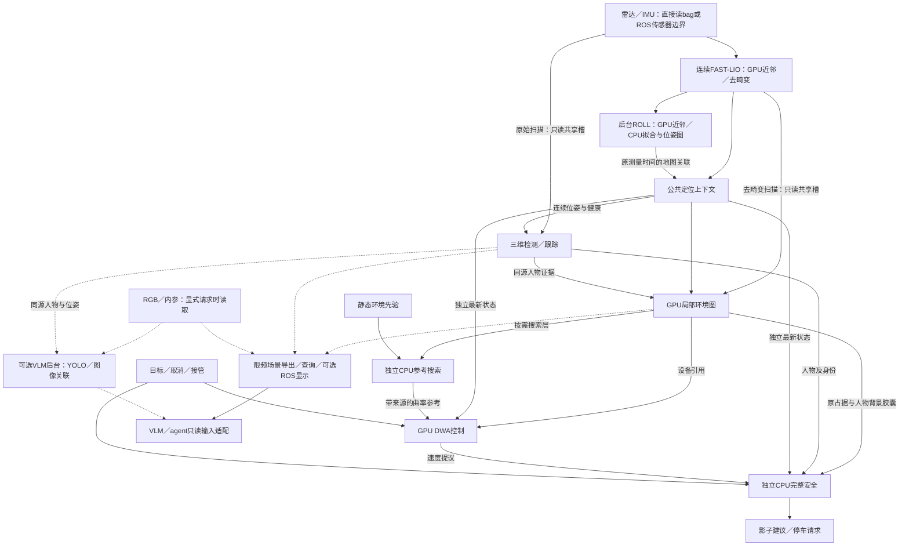

# 感知导航总览

感知模块把雷达和 IMU 观察转换为自车位姿、行人轨迹和环境地图。导航模块接收目标，先生成空间参考，再选择速度，由独立安全进程检查这份建议。两者共用同一批有来源、有时间信息的观察，决策模块也可读取其中的场景信息。

当前支持 rosbag 推理、在线传感器输入、导航影子运行和反馈仿真。影子运行只记录建议，不驱动车辆；反馈仿真由虚拟执行器响应。真实底盘和完整决策执行流程尚未接通。

运行命令见[操作速查](感知导航操作速查.md)，准备环境见[开发指南](开发指南.md)。[推理速度](感知导航推理速度.md)解释耗时和输入年龄，[共同清单](感知导航待办与数据采集.md)维护剩余开发与数据需求。机器依赖和结果位置见[本机记录](../ENVIRONMENT.local.md)。

## 功能与技术文档

建图定位与检测跟踪是两个同级分支：前者回答“轮椅在哪里”，后者回答“周围有哪些人、他们如何运动”。环境表示把几何与人物信息整理成导航和决策可用的输入。导航随后检查路线、选择速度并独立复核。

| 部分 | 主要用途 | 技术文档 |
|---|---|---|
| 检测训练与标注 | 使用完整框、人工中心和伪标签训练检测器，并用实际任务样本继续适配。 | [检测训练](perception/技术实现-检测训练.md) |
| 检测与跟踪推理 | 用因果多帧 VoxelRCNN 检测行人，结合可靠位姿维护世界轨迹。图像辅助单独服务于 VLM。 | [检测与跟踪推理](perception/技术实现-检测与跟踪推理.md) |
| 传感器、建图与定位 | 接入 RSHELIOS_16P 和 D435i，维护标定，以 ROLL＋FAST-LIO 完成建图、有图定位和无图定位。 | [建图与定位](perception/技术实现-建图与定位.md) |
| 环境地图与场景 | 构建局部与静态环境地图，整理人物、图像和先验视图，提供只读查询。 | [环境地图与场景表示](perception/技术实现-环境地图与场景表示.md) |
| 路径规划 | 根据地图、足迹和转弯约束生成空间参考，再检查当前局部路径。 | [路径规划](navigation/技术实现-路径规划.md) |
| 运动控制与安全 | DWA 直接选择速度，独立 CPU 进程检查人物、延迟和完整制动过程。 | [局部控制与安全](navigation/技术实现-局部控制与安全.md) |
| 目标与长程路线 | 转换局部决策目标，组织有来源的分段路线，并等待真实换层确认。 | [任务与路线](navigation/技术实现-任务与路线.md) |

三维定位地图用于扫描配准，环境地图用于描述通行几何。静态环境地图提供历史先验，实时局部环境地图提供当前观察，有图和无图任务都会使用后者。先验视图、导航代价和统一场景是供不同消费者使用的表示，不是额外的地图，详见[地图分类](perception/技术实现-环境地图与场景表示.md#地图与非地图对象)。

## 推理数据流

检测使用原始扫描，环境更新使用去畸变扫描；共享内存不会改变模型输入。跟踪只接受有效算法位姿。位姿失效时，传感器坐标中的检测仍可输出，世界轨迹则标记降级。地图与人物必须对应同一观察截止，未知区域仍保留为未知。

FAST-LIO 连续输出局部位姿，ROLL 在后台提供地图匹配和修正。公共定位上下文负责核对两者的观察时间与会话，再组合出当前可用状态。ROLL 晚到时仍使用原扫描时刻，不阻塞连续前端，也不把旧结果改成新测量。

离开可信地图区域后，系统继续维护连续局部位置，但撤销地图关联。返回地图时，要经过区域检查和配准确认才能重新关联。无图任务仍需要明确的局部目标，系统不会自动探索，也不会把地图目标裁到窗口边缘。

## 运行时与资源职责

统一入口为 `python -B -m runtime`，`perception/scripts/run.sh` 调用同一入口。`runtime/` 组织内存、调度和进程，算法仍保留在各自模块。

| 执行位置 | 负责的工作 |
|---|---|
| 系统 Python 输入进程 | 读取 bag 或传感器，通过原生 C ABI 运行 FAST-LIO 和 ROLL。默认 GPU 近邻与去畸变，CPU 保留原拟合、IMU 传播、小矩阵和 GTSAM。实验性观测归约需另行选择。 |
| 模型环境 GPU 主进程 | 执行三维检测、环境计算和 DWA。CPU维护跟踪状态，地图和控制分别使用独立线程及CUDA流，默认不加载YOLO。常规导航的扫描与地图各只保留一份最新待处理观察，归档与决策输入记录按顺序处理。 |
| 二维导航支持 | 地图线程在GPU上补充有效静态自由支持，保留端点覆盖与原时间；不启动CPU融合进程。独立安全仍在CPU复核。 |
| CPU 参考进程 | 运行单个 Hybrid A* 工作进程，只读搜索所需图层，处理查询预算、取消和迟到结果。 |
| 独立 CPU 安全进程 | 独立接收算法状态、地图和提议，检查当前接触、人物、延迟与制动，不等待主进程 GPU。 |
| 可选后台工作 | 限频保存场景、准备 VLM 图像窗口、提供 Agent 观察、查询或 RViz 显示，不成为地图和控制的前置条件。 |

PCL 和 GTSAM 留在系统解释器对应的原生库中，不跨 Python ABI 导入模型环境。运行时的调度与库路径由 `configs/runtime.yaml` 维护，检测、地图、运动和安全策略仍由模块配置维护。

参考搜索器保留自有的目标距离场缓存，每次查询使用的共享场景仍按次释放。缓存复用需要实际几何和目标格一致，不会沿用旧结果的有效性或刷新观察时间，见[路径规划](navigation/技术实现-路径规划.md#搜索与完整足迹)。

### 数据怎样交给其他进程

输入进程先把一帧数组写入共享主机槽，封存后传递句柄和描述。读取进程通过只读映射处理数组，所有读取方释放后才复用槽位。内部不通过 ROS 话题串联核心算法，也不传整个场景的 pickle。

GPU 地图由 Torch 持有，消费它的 CUDA 流先等待就绪事件。每帧已发布图层保持只读；DWA 另有可以复用的私有计算与传输工作区，两者的存储职责不同。

CPU 消费者只显式取回所需字段，例如安全检查使用的原占据与人物背景层，文中称为“安全胶囊”。完整图层只在需要保存时下载，禁止通过隐式 NumPy 转换取回。准确的所有权和时间规则见[接口约定](接口约定.md#感知导航直接运行时)。

bag 按原观察时间建立回放时钟，live 使用外部 ROS 时间，模拟 live 需要 `/clock`。控制由新定位测量触发，并保留单调时钟看门狗，不重复发布旧反馈来假装新测量。安全接收与复核并行，复核期间到达的新占据或接管信息会参与发布前检查。

原生数值函数与 ROS 诊断壳共用源码，旧编排入口为 `run_ros_diagnostic.sh`。PIN-SLAM 保留独立研究入口；导航控制使用 Hybrid A* 空间参考、DWA 和独立安全。

已有录制演示路线可以用`--route/--route-floor`显式生成bag影子目标，复用同一规划、控制和安全链。它按原包时间选择已知路段，不是在线楼层识别或自主长程调度，见[分段回放](navigation/技术实现-任务与路线.md#录制行程的分段目标回放)。可选RViz显示分别限制点云、人物、地图、RGB和导航图层的频率。占据图、车体足迹、空间参考和DWA预测默认随有效地面高度绘制，历史保留当时的高度；状态文字解释规划等待、拒绝及地面高度缺失，配置和操作见[显示步骤](感知导航操作速查.md#显示与提交目标)。

## 与决策及执行侧的关系

局部 VLM 和外层 Agent 使用不同的输入与调度方式，但都不能绕过导航和独立安全。

| 使用方 | 已有接口 | 尚未完成 |
|---|---|---|
| 局部 VLM | RGB、BEV 和 T1/T2/T3 文件适配；三帧记录；核对原观察的单请求响应接口。 | 自动模型调度，以及服务响应进入持续导航的联调。 |
| 外层 Agent | 异步规划与审查、真实观察影子循环、runtime 状态和可选 RGB，以及影子目标与取消。 | 真实执行与停车反馈、主动移动观察及更广场景验收。 |
| 导航任务适配 | 目标和取消、`TaskPolicy` 票据、T3 逐候选规划检查与阶段反馈适配。 | 局部 VLM 的持续在线执行与真实反馈来源。 |
| 底盘 | 影子建议、独立安全和虚拟执行器验证。 | 唯一真实命令出口、实测反馈与硬件保护。 |

`commands.sock` 的确认只表示意图已经收到。预测路径、几何可达、模型内可制动和实际任务成功各有不同判断依据；当前速度输出均不可执行。实车接入要求见[局部控制与安全](navigation/技术实现-局部控制与安全.md#实车接入边界)。

### 局部VLM与Agent的可选图像输入

VLM 任务窗口由独立后台工作准备：保留过去和当前三次原始观察，再按需运行 YOLO 与图像关联。它不从低频场景归档补造历史，结果也不回写三维跟踪或环境。图像准备失败会单独记录，共用 GPU 时仍可能竞争资源。统一入口不会自动请求 VLM 或发送决策目标。

Agent 使用单独的 `--agent-observations` 出口，约 1Hz 复制同一观察的主机 RGB，在后台编码并对应到已有场景。该出口不加载 YOLO，也不调用模型。Agent 通过私有 Unix socket 查询状态、提交影子目标或取消；意图接收和清除都不证明真实运动或停车。详见[Agent 观察机制](decision/Agent技术实现.md#观察与导航适配)及[影子测试](decision/长程导航任务与评测计划.md#真实观察与runtime影子测试)。

## 产物与维护

运行目录保存来源参数、定位、人物、参考、控制、安全和一份计时汇总。`final_scene/` 只保存最终几何与人物；需要带 RGB 的场景时，显式启用 `--record-views` 限频归档。建图默认封存环境扫描，便于后续构建静态环境地图。

首次 Ctrl+C 请求停车、排空共享引用并保存地图；再次中断会记录任务未完成。操作命令见[速查](感知导航操作速查.md#感知导航直接运行时)。

训练和标注继续使用文件接口。Windows 标注客户端不依赖 ROS 或模型，正式标签保存在 Linux。资源位置与迁移方法由[开发指南](开发指南.md#数据入口与迁移)维护，历史来源从 README 的归档入口查阅。

### 关键结果

`outputs` 按验证节点保留结果。当前完整测速和动态审查保留原日志、图层与必要来源；已经被替代的运行只保留结论、配置及代表样本。历史汇总中的数量和摘要描述当时运行，不保证目录仍包含当时全部逐帧文件。

| 验证节点 | 结果入口与适用范围 |
|---|---|
| 当前实现清理与回归 | [清理核验](../outputs/navigation/current_algorithm_cleanup/report.md)：330项相关回归、地图与导航配对及20秒非执行回放。 |
| 最近完整性能基线 | [地面优化与整链测速](../outputs/navigation/ground_fit_performance/report.md)：保留最近完整运行日志、计时与同输入配对，尚不包含关联交付优化。图文数字由[推理速度](感知导航推理速度.md)统一维护。 |
| 地图通行效果 | [当前四场景审查](../outputs/navigation/map_lightweight_support/review.html)及[剩余问题](感知导航规划诊断与改进.md)。保留原始与导航图、同源RGB、逐帧统计和代表快照。 |
| 规划逐时刻审查 | [10月29日一楼与室外时间轴](../outputs/navigation/planning_timeline/wheelchair_20261029_floor1/review.html)：复用用户实时运行的3671个控制周期，分开查看参考、DWA和安全状态，并提供同包场景图像。未归档的规划曲线及局部地图不补造；问题证据和下一步对照见[失败溯源专题](感知导航规划连续性与失败溯源.md)。 |
| 规划连续性修复 | [前96秒实际图层与曲线对照](../outputs/navigation/planning_continuity/review.html)及[验证报告](../outputs/navigation/planning_continuity/report.md)：修复短暂过期导致的目标撤销和参考状态未恢复，保留同轮基线、冻结案例及未解决原因。 |
| 关联交付优化 | [60秒时效与连续性对照](../outputs/navigation/association_delivery/report.md)：匹配完成后及时重新检查并交付同帧关联，减少重复确认；控制节拍试验已撤回，保留实际输入年龄与剩余场景过期。 |
| 人工审查依据 | [最初审查页面](../outputs/navigation/map_traversability_review/review.html)及[人工意见](../outputs/navigation/map_traversability_feedback/answers.json)，用于追溯问题来源。 |
| 运行时与独立安全联调 | [联调节点](../outputs/runtime/perception_navigation_integration/report.md)：保留故障、模拟live、反馈仿真、地图保存与消费证据；旧完整测速仅保留汇总。 |
| 两层地图与分段路线 | [地图及路线准备](../outputs/navigation/wheelchair_20261029/route_readiness/report.md)，保留静态资产、路线定义与代表查询。 |
| 显示与路线接入 | [分段显示](../outputs/runtime/wheelchair_20261029_route_display/report.md)和[地面随动显示](../outputs/runtime/navigation_ground_display/report.md)，后者保留六个原审查源场景。 |

冻结人物包、上述场景所需的定位与地图来源、修复后的bag、标定和构建依赖继续保留。旧地图策略与未采用范围优化只保留摘要和必要测量，不作为当前入口；历史思路见[归档](archive/感知导航地图诊断历史.md)。本次文件清单和保留校验见[产物清理记录](../outputs/navigation/result_retention/report.md)。
