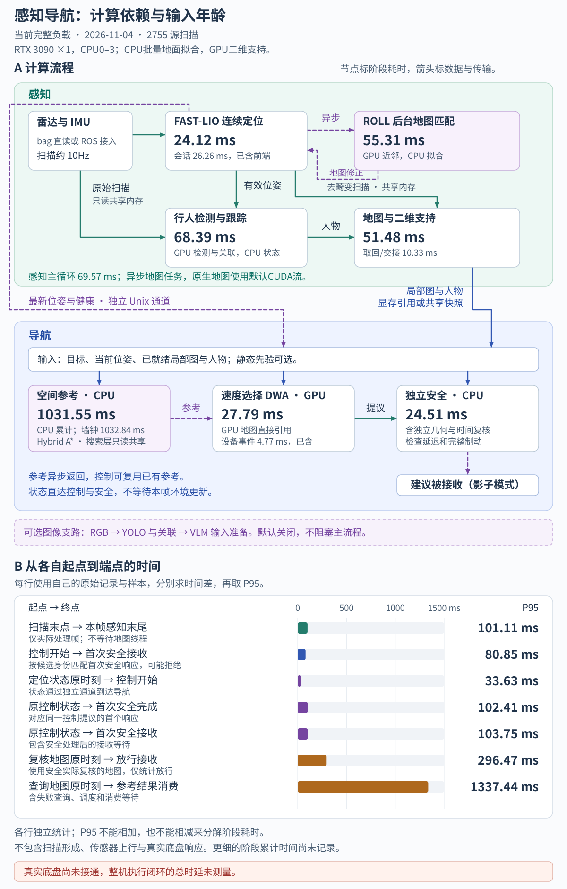

# 感知导航推理速度

静态背景与人物分离已完成短段对照和60秒回放，原地旋转、路线重试简化及本次地图策略尚未完成整包负载复测。当前默认直接使用传感器时间戳，已移除启动时差估计；下文基线未因这项简化而重跑，也不能用于判断旋转参考对查询耗时和生成率的影响。[时差对照](../outputs/perception/time_offset_comparison/report.md)只检查定位差异与短启动，不替代这里的完整负载成绩。

本文保留最近一次完整回放基线，产生于地面候选优化后、异步关联交付优化前。地面候选在CPU批量计算，复用同帧数据并合并完全相同的候选组；局部地图采用整数高度覆盖、0.45自由概率门限、0.2秒人物期限和GPU二维静态支持。下文完整负载基线的表格与配图均对应同一份[结果摘要](../outputs/navigation/ground_fit_performance/results.json)，不代表最新关联交付实现的整包成绩。

关联交付优化仅完成同条件60秒时效对照，结果见[验证报告](../outputs/navigation/history/reports/association_delivery.md)。当前参考查询临时复用已有局部自由证据，不增加地图阶段计算或GPU下载；近场小孔插值及其传输已撤回。同诊断负载60秒回放的地图平均耗时为34.75→33.89毫秒，DWA生成周期由217增至267，具体口径见[参考证据一致性验证](../outputs/navigation/history/reports/reference_start_consistency.md)。

当前规划与控制允许倒车，参考查询提前排除确定受阻的端点，显式路线回放可以在共享预算内选择较近的中间目标。最新[目标可行性验证](../outputs/navigation/history/reports/route_goal_feasibility.md)沿用10月29日bag前60秒、图层归档和计时负载，相对已启用倒车的基线，参考查询累计CPU时间平均247.06→147.71毫秒，实际DWA候选计算21.51→21.79毫秒。查询数量、目标和可用性随策略改变，不能当作同输入纯算法加速比。

该短回放的检测与地图CPU墙钟均值为79.81→85.38和31.71→34.88毫秒，关联过期状态为4.73→6.02秒；没有证据证明所有模块提速。两次开发回放中目标失败片段均改善，全段生成率却有波动，仍需核查场景生产与消费长尾。地图仅增加可选CPU诊断元数据，没有改变分类规则或新增图层下载。最新实现尚待完整负载复测，本文后续表格和配图仍对应开头注明的完整回放基线，不能将短段结果替换成整包成绩。

## 当前地图策略的短段检查

来源为[背景与人物验证](../outputs/navigation/background_person_navigation/report.md)。在Xeon W-2265和物理GPU2的一张RTX 3090上，数字库单线程、未绑定CPU核，以1倍速重算10月29日bag前16秒的定位、检测、地图及规划；开启规划归档与计时，未开启RGB、显示、VLM和真实底盘。前后两次均发布73份地图。诊断显式复用同一固定时差，未重新确认该bag的时钟会话，不改变日常启动策略。

| 阶段 | 修改前均值／P95（ms） | 修改后均值／P95（ms） |
|---|---:|---:|
| 地图与二维支持 | 33.14／57.53 | 31.02／54.40 |
| 安全所需字段取回与场景准备 | 6.11／13.53 | 5.76／12.35 |
| 检测与跟踪 | 74.48／131.08 | 75.38／124.58 |
| 控制周期，含提前退出 | 7.98／21.03 | 8.24／24.18 |

静态支持开始从7.43秒提前至3.63秒，但两版首次DWA候选仍约13.4秒。调度和实际候选数量有所变化，以上不能解释为纯算法加速比，更不能证明所有模块变快。

人物点归属另用65份固定真实输入比较，每帧交错执行8次后取中位数。36帧含有效人物框；旧方法、当前二维连通簇、仅中心区域三种方案的全样本P95分别为1.69、2.05、1.75毫秒。含人物框帧的中位数分别为1.20、1.29、1.09毫秒。连通检查的额外成本有限，因此保留用于排除断开的背景；没有点级真值，点数增加不表示精度提高。

当前60秒回放正常结束，601份源扫描中578份进入检测，发布291份地图，604个控制周期中287个产生候选。地图均值／P95为37.14／67.71毫秒，含提前退出的控制周期为17.24／41.15毫秒。该段场景和调用构成不同于前16秒，不能将两者当作同输入性能对照。本次已移除无用CUDA地面临时数组，正常人物移交不增加整图传输；只在人物来源不匹配时上传保守障碍图。最终接口及GPU一致性检查为99项、通过98项，1项ROS生成消息检查跳过。

图左为同一16秒片段的前后回放，图右为固定点云输入。P95表示样本分布，不是置信区间；详细条件及分组口径见前文。

## 最近一次完整负载基线

2026年11月4日，在Intel Xeon W-2265的CPU0–3和物理GPU2的一张RTX 3090上，各数字库单线程，以1倍速完整回放`2026-10-23-11-19-34.bag`。输入共2755份扫描，2751份进入检测，发布1369份地图，生成2760份控制和2879份安全记录。源观察跨度275.40秒，运行墙钟276.14秒；启动另计12.29秒。

定位、检测、地图和规划均重新计算，复用的仅是输入、标定、起点和固定负载目标。检测、定位、规划、安全与最近的观察调度保持原实现。两个固定目标用于制造负载，不是完整路线任务。本次未开启RGB、VLM、Agent、显示、扫描归档或真实底盘控制。

扫描与地图各保留一个运行任务和一个最新待处理任务。本次替换4份待处理扫描，地图提交1369份、替换0份、因失效丢弃0份。定位仍完整进入独立安全通道，源时间不刷新。归档、决策记录和Agent观察采用顺序模式，不能套用本次负载结果；跳帧后的检测精度尚未验收。

配置与来源见[方法](../outputs/navigation/ground_fit_performance/method.json)、[运行摘要](../outputs/navigation/ground_fit_performance/run/summary.json)和[源码摘要](../outputs/navigation/ground_fit_performance/source_sha256.json)。测速时的75项地面标量／批量一致性、静态导出、地面重获、CPU/CUDA支持、人物期限、流依赖和DWA消费检查通过，见[检查结果](../outputs/navigation/ground_fit_performance/checks.json)。四场景相同输入的2348次更新均逐格一致，470个审查时刻与[原动态页面](../outputs/navigation/map_lightweight_support/review.html)一致，详见[配对结果](../outputs/navigation/ground_fit_performance/paired_results.json)。该页面保留原输入来源，没有用测速替代通行效果验收。

当前源码只保留当前地图策略和 Hybrid A*、DWA、独立安全主链，已移除旧地图、TEB、轨迹再次跟踪和历史人物膨胀分支。清理后的检查见[当前实现核验](../outputs/navigation/history/reports/current_algorithm_cleanup.md)。本文保留最近一次完整测速的原始来源及数值，不将代码清理后的短段运行当作新的整包性能结果。

## 依赖与输入年龄

[单独打开SVG](assets/perception_navigation_latency.svg)。上半部分列阶段P95，地图取回与场景准备单列；参考节点标累计CPU时间，旁注墙钟。下半部分按各自实际使用的原观察计算年龄。各阶段异步执行、样本不同，P95不能相加。DWA设备事件已包含在完整调用中。

定位状态直接送往控制与安全，不等待本帧检测和地图。控制可以使用新位姿、较旧地图及已有参考。感知主循环结束不表示该帧地图已经可用。

## 完整负载基线的阶段耗时

| 感知阶段 | 样本数 | 中位数／ms | P95／ms |
|---|---:|---:|---:|
| FAST-LIO前端 | 2755 | 18.23 | 24.12 |
| 前台定位会话，已含前端 | 2755 | 20.67 | 26.26 |
| 后台ROLL | 2737 | 32.22 | 55.31 |
| 三维检测与跟踪 | 2751 | 51.21 | 68.39 |
| 地图与二维支持，含CPU地面与人物掩码 | 1369 | 28.43 | 51.48 |
| 所需字段取回与场景准备 | 1369 | 3.06 | 10.33 |
| 感知主循环自身 | 2751 | 52.36 | 69.57 |
| 已处理扫描末点到感知末尾 | 2751 | 84.43 | 101.11 |

地图按5Hz源时间选取，源扫描约10Hz。地面候选保持原40次抽样、阈值和同分优先规则，只改变分组排序、复用及批量计算方式。地图生产包含CPU地面拟合、人物掩码、CUDA证据更新、投影、距离场及二维静态支持；取回阶段只准备安全所需图层与场景，不运行导航融合子进程。CPU墙钟包含复制、同步与等待，不能等同GPU核函数时间。前台定位会话已经包含FAST-LIO，ROLL在后台运行。

| 导航阶段 | 样本数 | 中位数／ms | P95／ms |
|---|---:|---:|---:|
| 参考查询累计CPU时间，含失败 | 76 | 92.29 | 1031.55 |
| 参考查询墙钟，含失败 | 76 | 93.43 | 1032.84 |
| 实际DWA候选完整调用 | 279 | 17.34 | 27.79 |
| DWA设备事件，已包含在完整调用 | 279 | 3.61 | 4.77 |
| 独立CPU安全完整处理，已进入安全门 | 361 | 10.25 | 24.51 |
| 其中独立安全门 | 361 | 5.84 | 16.24 |

实际DWA调用279次，候选258份，其中258份找到首次安全响应。等待参考等提前退出不算DWA候选计算。2份控制因地图时效退出，占0.07%；安全放行355次。放行不是车辆执行或到达，正常排空也不代表持续导航通过。

参考查询76次，进入原生Hybrid A* 38次，距离场缓存命中3次。原生原因计数为`{"curvature_search_time_budget": 23, "null": 12, "curvature_search_state_budget": 1, "no_curvature_route": 1, "disconnected_search_region": 1}`。预算耗尽不能解释为已经证明无路。完整失败分类见结果摘要中的`proposal_reasons`。

| 参考内部阶段 | 样本数 | 中位数／ms | P95／ms |
|---|---:|---:|---:|
| costmap_and_endpoints | 38 | 123.39 | 134.22 |
| footprint | 38 | 0.00 | 26.71 |
| footprint_state_search | 38 | 802.75 | 803.40 |
| input_and_prior | 76 | 15.35 | 101.85 |
| total | 76 | 88.84 | 1026.16 |

## 跨模块输入年龄

| 原输入到终点 | 样本数 | 中位数／ms | P95／ms |
|---|---:|---:|---:|
| 控制开始到首次安全响应接收 | 258 | 46.72 | 80.85 |
| 定位状态原时刻到控制开始 | 2760 | 24.17 | 33.63 |
| 原控制状态到首次安全完成 | 258 | 68.63 | 102.41 |
| 原控制状态到首次安全接收 | 258 | 69.85 | 103.75 |
| 安全复核地图原时刻到放行接收 | 355 | 257.52 | 296.47 |
| 查询地图原时刻到参考消费 | 76 | 431.31 | 1337.44 |

候选通过`proposal_binding`与`packet_binding`匹配首个安全响应。完成时间按安全`stamp_s + timing_ms.total/1000`计算，接收再加`telemetry_receive_delay_ms/1000`，随后减去实际使用的状态或地图原时间。首个响应可能拒绝。参考按1倍速回放的单调时钟与源时间偏移中位数换算，残差P95为0.020毫秒；该残差只说明内部换算一致，不是外部测量精度。被替换扫描不计入已处理扫描年龄。

## 设备与通信

输入扫描与位姿通过封存共享槽交接，地图线程只保留自己需要的点和射线原点副本。DWA直接引用只读设备快照；CPU参考与安全按实际字段下载、共享和校验。静态不可变资产继续缓存内容摘要，时间与身份仍逐次核对。

上述完整负载基线使用默认CUDA流和完整距离场，当次测速未修改原生库；本次背景策略已重建环境CUDA库，见前述短段检查。当前异步地图线程显式等待输入流，并在转换图层前等待原生流；封存事件覆盖后续转换，避免把旧实现直接接入新调度造成竞争。近场历史继续启用；二维支持在地图线程当前流执行，缓存静态数组。导航图直接供GPU消费，安全所需字段一次合包取回，不再CPU融合后回传上传。

主进程显式D2H为0.733MiB/s，定位输入进程为31.556MiB/s，分别除以各自运行区间。`transfer_bytes/transfer_calls`按消费者记录，不能解释为全部底层CUDA调用。主进程累计CPU 242.98秒，输入进程217.59秒；没有CPU融合任务。这些累计CPU时间不能相加当作关键路径墙钟。

## 限制与复现

当前仍保留逐格地面最后点写入、16秒体素与地面记忆、近场临时覆盖和2秒普通占据。新增整数计数和弱自由接纳不补缺失高度；二维支持也不会在关联失效、先验未知或未来证据上制造自由。已确认背景上的期限恢复依赖先验一致假设，尚未验证被遮挡的新障碍长期存在的情况。具体剩余问题见[规划诊断](感知导航规划诊断与改进.md)。

地面跟踪做了三轮同输入对照，完整地图做了一轮配对回放，详见[验证报告](../outputs/navigation/ground_fit_performance/report.md)。整链负载只测了一次，没有整链重复运行方差、独立场景、长期运行、部署设备或实车成绩。异步任务的完成时刻会影响规划次数和GPU争用，因此前后整包耗时不能当作相同逐帧输入下的纯算法加速比。DWA 20–30ms、安全完整处理10–20ms、候选首次安全接收40–50ms仍是开发目标，不是安全保证。

在项目根目录运行`bash outputs/runtime/perception_navigation_performance/source/run.sh /tmp/social-nav-ground-fit-runtime`可用当前代码复现，目标目录须不存在。输入沿用已封存的`perception_navigation_performance/inputs`。本次统计脚本为`outputs/navigation/ground_fit_performance/source/collect.py`，发布脚本为同目录`publish.py`；前者核对源码与日志，后者从结果生成本文与SVG草稿。修改前源码与原生库摘要、三轮地面对照、四场景配对结果均保留于本次产物目录。未覆盖原始数据和人工审查结果。
