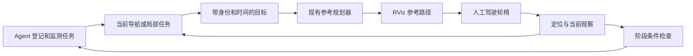

# 有图长程任务人工驾驶测试方案

本文记录智能轮椅有图长程任务的人工驾驶测试方案及阶段进展。轮椅由人使用原车手柄驾驶，系统尝试生成参考路径；阶段根据定位和任务证据自动切换，不要求操作人员逐次点击确认。它用于检查任务理解、局部决策和阶段衔接，不作为自动驾驶或底盘运动能力的验收。

任务范围包括目标点、目标区域、多点及绕圈、视觉语义导航、行人跟随、桌边停靠和乘电梯换层。本文先覆盖正常流程，不展开异常恢复策略；已有的来源、时效、定位有效性和运动保护仍然保留。就座指轮椅停靠到桌边，不包含乘员转移。

当前操作见[系统运行手册](系统运行手册.md)，执行与完成依据见[Agent 技术实现](decision/技术实现-Agent长程导航.md)。本方案列出现场验收项目，文末日期记录保留当时的车辆测试结果。

## 测试前核对

| 环节 | 当前实现 | 现场核对 |
|---|---|---|
| 普通人工导航 | 人工驾驶，程序按定位记录中间经过和终点停稳，支持单点和有序路线预览。 | 再次移动后到达证据失效，经过点无需停车。 |
| 区域绕行 | 保存有序途经记录和对应时间段的实测轨迹。 | 现场采用普通单圈任务，核对途经点顺序、轨迹是否连续及终点停稳情况。 |
| 语义完成 | Agent 接收本轮证据后一次提交完成决定。 | 区分视觉硬条件和偏好，在证据不足时继续观察。 |
| T2 跟随 | 无底盘输出的观察会话可显示动态参考。 | 人物身份、短暂动作、停稳及跟随结束后清除预览。 |
| T3 停靠 | 根据当前桌沿、扫描和局部模型选点，检查接近路径。 | 桌子辨识、候选覆盖、桌边净空与实际停靠。 |
| 乘电梯 | 独立 RGB 与局部雷达用于观察进出，支持目标楼层初值重选。 | 不同出梯位姿下的配准结果及同一任务继续执行。 |

当前 [人工观察配置](../navigation/commissioning/interactive_agent.yaml)指向二楼地图，不能作为全部楼层的数据。各楼层所用定位地图、静态地图和语义目录应相互对应；点、区域、电梯及桌子标注需要适用于本次测试场景。

## 总体流程

Agent 使用现有有序任务要求组织阶段。普通导航提交目标或路线；跟随与停靠通过 `start_local_task` 启动各自局部决策，局部决策持续更新导航目标。任务目标统一送到参考规划器，人工驾驶者依照场景和参考路径操作原车手柄。阶段监测按任务要求使用定位、图像和局部任务状态，条件满足后自动进入下一阶段。

继续使用现有任务句柄、`get_navigation_state`、`set_navigation_monitor`、`wait_for_event` 和 `cancel_navigation`。T2、T3 的局部决策不经 Agent 逐帧转发；Agent 根据状态变化、定期复核或用户要求检查完成条件。局部任务结束后复用同一阶段切换流程，不新增另一套独立的长程任务管理器。

### 目标与参考路径接口

统一目标应保留任务和调用身份、目标修订、坐标系、目标位置及可选朝向、源观察时间和有效期。T2 的目标变化时更新目标修订；T3 候选变化时还保留候选集合和候选身份。动态目标的有效期来自原始观察，重复提交和规划不能刷新它。

T2 的局部目标按有效地图关联转换到预览坐标，搜索目标沿用其来源地图。T3 的停车候选同时转换位置和朝向。检查当前定位生命周期、地图关联与目标修订是否匹配。

普通导航和局部任务共用单所有者人工预览。T2 在人工观察会话只发布预览目标，不向底盘提交目标或速度。现场检查任务切换、心跳丢失、操作者停驶后旧预览是否清除。

## 自动阶段切换

使用已有定位、位姿与速度估计，按任务语义区分经过和停靠。沿用当前配置中的容差和反馈有效期，参数是否适合由现场测试判断，不凭预览请求或模型回复伪造到达。

| 条件 | 计划采用的完成依据 |
|---|---|
| 到达目标点 | 当前有效地图位姿进入目标位置容差；用户或任务要求朝向时检查朝向。要求停靠的目标还需新鲜的定位速度估计表明已停稳并满足当前保持条件。 |
| 进入目标区域 | 当前有效地图位姿进入已标注区域即可触发；若任务同时要求区域内停靠或朝向，则继续检查这些要求。仅进入区域不强制停在 Agent 此前选的某个点。 |
| 按顺序经过多点 | 中间点使用连续定位轨迹和已有途经点／区域判据推进，不要求逐点停车；终点按其任务条件判断。 |
| 绕区域一圈 | Agent 根据有序的实测途经记录及实际轨迹判断是否围绕指定区域完成一圈，并核对指令中的终点要求。 |
| 到点并满足视觉条件 | 先取得对应阶段的位置和需要的停稳证据，再用该阶段、该位置的当前 RGB 判断视觉条件。证据不足不进入下一阶段。 |
| 观察到事件 | 对阶段进入后的真实图像判断指定事件，保存图像源时间和判断依据。持续状态使用当前观察；短暂动作可使用有限的因果图像序列和已发生事件证据。 |

无需手动确认不等于把影子规划或参考路径作为执行反馈。人工模式的自动到达应明确标记为“定位估计”，实际底盘速度仍非独立实测。新阶段不得借用上一阶段的到达证明或旧图，目标、地图及观察身份发生变化时保留原始时间并重新核对。

现场核对任务监控在经过、到达、持续停稳和人工接管时能否正确唤醒 Agent。人物举动等短事件需选择合适的观察间隔，并从日志核对事件与图像是否对应。

## T2：人工驾驶跟随

Agent 按现有统一接口提交人物描述；[T2 工作器](../runtime/follow_decision.py)持续结合三帧 RGB／BEV 和固定参考选人。检测跟踪继续高频运行，[FollowRunner](../runtime/follow.py)把接纳的人物轨迹转成动态跟随目标；目标丢失时选择等待或观察目标。上述决策在人工模式下只生成建议，不发送车速。

在仅观察会话开启 T2 输入后，让目标人物与其他行人同时出现，检查当前 RGB 中的候选、轨迹身份和代次。触发指定动作后，继续记录停车过程，核对 Agent 只用动作发生时的一次判断，并在实际停稳后推进。目标丢失或过期时，预览应及时撤下。

例如“跟随红衣人员，直到其进入电梯”需要同时对应人物身份、动作和源图像；事件到来后 Agent 判断任务语义并决定切换。短暂举动的判断须保留发生时的因果图像与身份，不能用新时间覆盖旧证据。当前 T2 的结果接纳时限、无图只能等待以及搜索半径限制仍需在真实服务和现场数据上核查。

## T3：人工驾驶桌边停靠

在人工观察会话开启桌边停靠，操作者先停在可看清目标桌沿的位置。Agent 用当前 RGB 指出目标桌边，T3 工作器根据同源雷达回波和车体轮廓生成候选。局部模型选点且几何检查通过后，目标进入普通人工导航预览。

现场应分别测试近侧边缘清晰、回波不足、两桌相邻和通道被挡的情况。核对选点及几何检查引用的观察、地图和候选身份。停靠后对比目标与实测位姿、停稳及当前 RGB 中的桌边关系。若候选无效，记录具体原因及 Agent 是否等待或重新选择。[T3 实现](decision/技术实现-VLM局部决策.md#t3目标选择与就座)

## 电梯与楼层切换

进电梯、乘梯、出电梯及按钮操作均由现场人员辅助完成；前一阶段一定是到达当前楼层电梯口。Agent 不规划电梯内路线，负责判断人工乘梯是否完成，并管理感知导航和自身输入的切换。目标楼层不能仅凭用户指令推定为已经到达；Agent 应结合当前 RGB、雷达观察、可见标识或其他实际证据判断。

进入已登记的乘梯阶段后，系统自动停止来源地图定位并启动独立观察，不要求轮椅停稳或来源地图仍有关联。现场测试应确认独立 RGB、局部雷达图及其源时间仍有效，模型不再收到旧全局图。一楼使用用户指定的标准起点和历史参考图：操作者出梯后到达该点、调整朝向并停稳，Agent 对照参考图判断，确认后自动使用固定雷达初值启动定位。模型默认每 5 秒复核，可自行暂存少量有用的乘梯图像；判断完成后清空这些历史帧。界面在乘梯与目标楼层定位期间显示临时请求、图片和判断，每个阶段结束时清除对应内容。

一楼需要分别验证标准起点配准成功和失败后的恢复。成功时核对参考图判断、初值所属地图及新扫描的时间。失败时确认 30 秒到期或观察进程提前退出后，目标楼层 RViz 自动进入人工选点。在预览中停留超过 30 秒，再确认起点。核对 Agent 在选点期间保持等待，人工配准仍失败时可以继续重选，取得有效的一楼地图关联后才恢复原任务，之前完成的阶段得以保留。没有标准起点的楼层仍需验证 Agent 根据等候区地图和新扫描选点、重选的流程。[系统运行手册](系统运行手册.md)

## 分阶段实现与测试

每阶段优先复用现有夹具、记录和服务；离线只做能直接验证接口与行为的必要检查。现场执行时沿用已有测试条件和保护，不因本方案额外拆成大量重复准备环节。完成一个阶段后集中更新相应技术文档和待办，不逐次记录调参流水。

| 阶段 | 实现范围 | 最少必要测试 |
|---|---|---|
| 1. 自动切换 | 人工模式按定位判断到达、进入区域和依次经过途经点，结合图像判断语义条件。 | 现场对照连续执行和明确要求等待的指令，核对到达、停稳、图像来源和阶段切换。 |
| 2. 人工 T2 | 跟随目标预览、人物视觉关联、动作事件和人工模式完成反馈。 | 在二楼对照源观察、人物候选和回复应用时间，核对身份、参考路径、失去目标后的处理及一次动作触发的结束。 |
| 3. 人工 T3 | 接入已知桌子、当前候选、参考预览和自动完成。 | 用代表性当前场景检查候选来源、目标几何及反馈；现场检查一次选点、人工靠近和完成判断。 |
| 4. 电梯与换层 | Agent 管理来源楼层定位停止、独立 RGB 和雷达观察、楼层目录切换及出梯重定位。 | 在目标等候区核对标准点成功、失败后人工重选，以及有效定位恢复后的原任务推进。无标准点楼层核对 Agent 依据新扫描选择初值。 |
| 5. 综合任务 | 将点、区域、多点、视觉、跟随、就座和换层按实际指令组合。 | 执行一条包含所需阶段的现场任务，记录实际阶段切换依据、参考路径状态及人的操作；分别判断成功或不足，不以局部单测代替整条任务。 |

回放中的轮椅沿录制轨迹运动，不会响应 Agent 新建议；它适合验证输入、请求、状态和规划，不证明算法引导后实际到达。模型格式合法也不证明人物身份、桌边选择或事件语义正确；必要时人工审查代表性图像和实际现场表现。

每轮保留实际配置、任务要求与阶段记录、目标和参考路径状态、关键图像及源时间、定位和地图身份、模型原始响应，以及现场实际动作。只保存复现和判断需要的结果；T2／T3 图像发送到模型服务的范围按现场实际配置确认。

## 2026 年 11 月 18 日开发与测试进展

本轮使用新的一、二楼地图和语义标注进行人工驾驶测试。二楼使用高度校正后的三维定位地图及人工修正的静态地图，标注经转换后由现场人员审查确认。人工模式不连接底盘，参考路径和目标只供操作者使用原车手柄时参考；定位估计的到达与停稳也不是独立的底盘停车证据。

代码已接入人工驾驶下的定位到达证据、任务监控触发和 Agent 完成判断；有序多点路线按定位依次记录途经点，绕行复用多点任务的处理方式。界面补充了任务监控、路线显示、目标朝向以及图片放大查看。跨楼层流程已接入独立相机周期观察、一二楼标注对应关系、目标楼层定位初猜和任务延续；乘梯观察的图像与逐次判断在离开电梯后从内存清除，不作为历史记录保存。

现场会话记录显示，“停靠点 1 → 中转等候区”的两个子任务均完成；另一轮“绕圆形区域外一圈 → 到电梯等候区旁，尽量看到四个电梯口”的两个子任务也被记录为完成。这些结果只表明相应人工驾驶会话的任务流程推进，不证明四个电梯口实际全部可见，也不构成自主导航或绕行轨迹质量验收。此前绕行候选曾反复被拒绝，提示词和路径点处理经过调整，稳定性仍需后续检验。

跨楼层任务为“二楼电梯等候区 → 人工辅助乘电梯到一楼 → 一楼大厅中央”。记录显示二楼等候区已完成，22:04 开始乘梯监控，22:07 开始一楼地图切换；现场人员确认已乘电梯到一楼。一楼观察程序启动并持续输出局部定位，但截至 22:10 尚未建立一楼地图关联，乘梯阶段和一楼大厅目标均未完成；随后本次任务被取消。切换初猜来自二楼乘梯前位姿和两层电梯口标注，并非已验证的一楼位姿。由于乘梯观察图像与逐次判断按设计不落盘，现有记录不能复原模型每次判断的视觉依据。

本轮需后续处理的问题：

- 当次版本缺少任务内重选初始位姿的操作。原场地仍需核实配准失败原因，并按本页“电梯与楼层切换”验证人工选点恢复。
- 绕行候选仍可能多次遭拒或生成不理想的途经点，参考路径也不保证现场通行。结合已保留的会话和路径记录继续检查，再以少量人工驾驶任务验证。
- 二楼地图的人工修正空闲及估算地面高度仍需结合现场判断。地图关联成功和任务完成记录不能单独证明地图各处的几何精度。

本轮代表性记录分别位于 `outputs/decision/agent/manual_ui_20261118_190250_726694/`、`outputs/decision/agent/manual_ui_20261118_211442_432935/` 和 `outputs/decision/agent/manual_ui_20261118_220231_588812/`。这些本机运行数据不随 Git 推送；跨楼层记录中的一楼观察日志和定位记录可用于继续排查。
