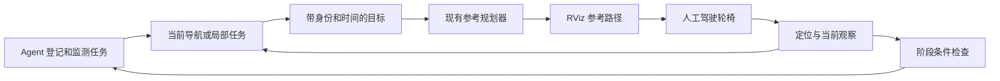

# 有图长程任务人工驾驶测试方案

本文记录智能轮椅有图长程任务的人工驾驶测试方案及阶段进展。轮椅由人使用原车手柄驾驶，系统尝试生成参考路径；阶段根据定位和任务证据自动切换，不要求操作人员逐次点击确认。它用于检查任务理解、局部决策和阶段衔接，不作为自动驾驶或底盘运动能力的验收。

任务范围包括目标点、目标区域、多点及绕圈、视觉语义导航、行人跟随、桌边停靠和乘电梯换层。本文先覆盖正常流程，不展开异常恢复策略；已有的来源、时效、定位有效性和运动保护仍然保留。就座指轮椅停靠到桌边，不包含乘员转移。

当前可用操作和已实现机制分别见[系统运行手册](系统运行手册.md)和[Agent 技术实现](decision/技术实现-Agent长程导航.md)。下列基础、缺口和分阶段安排保留为制定方案时的记录，不代表当前实现状态；本轮结果及未解决问题见文末。

## 当前基础和缺口

| 环节 | 当前代码 | 为本次测试需要补充 |
|---|---|---|
| 普通人工导航 | `ManualNavigation` 支持点和有序路线；`ManualReference` 通过预览租约显示当前段参考路径。 | 目前终点依赖人工 `arrived`；需要基于定位自动产生到达证据，并支持进入区域即切换。 |
| 多点与绕圈 | 已记录路线进度，并以定位轨迹检查顺序和绕行；规划预览按当前段更新。 | 保留中间点连续经过，最终自动结束；实机核查轨迹和分段路径。 |
| 语义完成 | Agent 已能使用到达后的当前 RGB 检查已登记条件；独立观察阶段已有停稳和新图检查。 | 与自动到达结合；针对进行中的短暂事件补充连续观察与事件证据。 |
| T2 跟随 | 运行时已有持续选人、跟随目标、有限搜索和影子执行；Agent 有统一局部任务工具。 | 人工适配器当前拒绝跟随，跟随完成检查只支持实机自动执行；需输出供预览使用的动态目标和人工驾驶反馈。 |
| T3 桌边停靠 | 已有候选、选点和 `SeatingStage` 反馈核心。 | 仍缺当前桌子依据、在线候选与调度、人工目标预览和完成反馈；统一工具当前返回不可用。 |
| 乘电梯 | 尚无电梯任务、算法启停和地图切换流程。 | 保持相机和雷达观测，由 Agent 判断乘梯完成；关闭后重启感知导航，结合目标地图与当前扫描自动重定位。 |

当前 [人工观察配置](../navigation/commissioning/interactive_agent.yaml)指向二楼地图，不能作为全部楼层的数据。各楼层所用定位地图、静态地图和语义目录应相互对应；点、区域、电梯及桌子标注需要适用于本次测试场景。

## 总体流程

Agent 使用现有有序任务要求组织阶段。普通导航提交目标或路线；跟随与停靠通过 `start_local_task` 启动各自局部决策，局部决策持续更新导航目标。任务目标统一送到参考规划器，人工驾驶者依照场景和参考路径操作原车手柄。阶段监测按任务要求使用定位、图像和局部任务状态，条件满足后自动进入下一阶段。

继续使用现有任务句柄、`get_navigation_state`、`set_navigation_monitor`、`wait_for_event` 和 `cancel_navigation`。T2、T3 的局部决策不经 Agent 逐帧转发；Agent 根据状态变化、定期复核或用户要求检查完成条件。局部任务结束后复用同一阶段切换流程，不新增另一套独立的长程任务管理器。

### 目标与参考路径接口

统一目标应保留任务和调用身份、目标修订、坐标系、目标位置及可选朝向、源观察时间和有效期。T2 的目标变化时更新目标修订；T3 候选变化时还保留候选集合和候选身份。动态目标的有效期来自原始观察，重复提交和规划不能刷新它。

当前 `TaskPolicy` 为 T2 跟随和 T3 选点输出局部坐标目标，而 `agent_manual_preview` 仅接受地图坐标目标；T2 的搜索目标已有地图坐标形式。为少改现有参考规划和 RViz 通道，在送入人工预览前增加一处转换：用该目标对应的有效地图关联将局部目标转换到当前地图坐标，并保留原目标和转换来源。T2 的无朝向跟随目标只转换位置；T3 的位姿同时转换朝向。地图关联、局部定位生命周期和源时钟不匹配时不产生新的地图预览，等有效输入恢复；不能把旧坐标换一个时间继续使用。

预览沿用现有的单所有者租约和规划工作器。普通导航、T2 和 T3 在同一时刻只能有一个当前预览目标；切换阶段时先撤销旧租约，再发布新目标。当前 `follow_goal` 会进入普通控制／安全目标链，不能直接作为人工预览复用。需给 T2 增加只发布任务目标和状态的人工模式出口，再复用预览入口；人工观察会话不连接底盘，也不把预览送入速度命令通道。T3 同样只输出目标和状态。若预览不可用，界面显示原因；驾驶和停车仍由现场人员使用原车手柄完成。

## 自动阶段切换

使用已有定位、位姿与速度估计，按任务语义区分经过和停靠。沿用当前配置中的容差和反馈有效期，参数是否适合由现场测试判断，不凭预览请求或模型回复伪造到达。

| 条件 | 计划采用的完成依据 |
|---|---|
| 到达目标点 | 当前有效地图位姿进入目标位置容差；用户或任务要求朝向时检查朝向。要求停靠的目标还需新鲜的定位速度估计表明已停稳并满足当前保持条件。 |
| 进入目标区域 | 当前有效地图位姿进入已标注区域即可触发；若任务同时要求区域内停靠或朝向，则继续检查这些要求。仅进入区域不强制停在 Agent 此前选的某个点。 |
| 按顺序经过多点 | 中间点使用连续定位轨迹和已有途经点／区域判据推进，不要求逐点停车；终点按其任务条件判断。 |
| 绕区域一圈 | 复用现有实际轨迹、方向和闭合检查；规划途经点和点间连线不是完成证据。 |
| 到点并满足视觉条件 | 先取得对应阶段的位置和需要的停稳证据，再用该阶段、该位置的当前 RGB 判断视觉条件。证据不足不进入下一阶段。 |
| 观察到事件 | 对阶段进入后的真实图像判断指定事件，保存图像源时间和判断依据。持续状态使用当前观察；短暂动作可使用有限的因果图像序列和已发生事件证据。 |

无需手动确认不等于把影子规划或参考路径作为执行反馈。人工模式的自动到达应明确标记为“定位估计”，实际底盘速度仍非独立实测。新阶段不得借用上一阶段的到达证明或旧图，目标、地图及观察身份发生变化时保留原始时间并重新核对。

计划调整位置：

- 在 [manual.py](../decision/agent/adapters/manual.py) 用新鲜定位反馈自动报告到达及经过状态，去掉正常流程对 `confirm_arrival()` 的依赖。保留可选人工操作用于取消或提示，不把它作为正常阶段完成的前置条件。
- 在 [navigation.py](../decision/agent/tools/navigation.py) 和 [session.py](../decision/agent/core/session.py) 复用现有句柄、完成记录与 `check_goal`，区分需要停稳的目标和只需经过的区域；支持人工模式的自动定位证据。
- 复用 [monitor.py](../decision/agent/core/monitor.py) 的区域和定期事件。人物举动等短事件需要按该任务提高观察频率，或提供有界的多帧观察，不能假定低频单帧一定能看到动作。
- 在 [manual.py 工作流](../decision/agent/workflows/manual.py) 和界面显示当前目标、路径、定位状态、完成条件和阶段切换；去掉正常流程中提示输入 `arrived` 的说明。

## T2：人工驾驶跟随

Agent 按现有统一接口提交人物描述；[T2 工作器](../runtime/follow_decision.py)持续结合三帧 RGB／BEV 和固定参考选人。检测跟踪继续高频运行，[FollowRunner](../runtime/follow.py)把接纳的人物轨迹转成动态跟随目标；目标丢失时选择等待或观察目标。上述决策在人工模式下只生成建议，不发送车速。

具体接线：

1. 在 [ManualNavigation](../decision/agent/adapters/manual.py) 接入人工专用的 T2 启动、状态和停止，使其不再因 `scope=manual` 被拒绝；复用 Agent 的 `start_local_task`、监测与取消。
2. 在 [runtime/control.py](../runtime/control.py) 和 [runtime/command.py](../runtime/command.py) 增加不连接底盘的目标出口，并通过上述坐标转换交给人工预览。不能将当前 `follow_goal` 的控制授权当作人工预览。
3. 以当前真实定位和新鲜 T2 目标更新参考路径；跟随距离、人物轨迹及结果期限沿用现有算法和配置。预览不代表操作者实际遵循了路径。
4. 向 Agent 暴露与当前图像对应的目标人物身份、人物框或裁剪及其源时间。固定参考由 T2 工作器持有，当前跟随状态只有轨迹身份，尚不足以让 Agent 在多人画面中可靠判断谁做了动作。
5. 将 `finish_local_task` 和 `check_goal` 扩展到人工模式：完成条件来自任务指定的当前状态或已观察事件，停车要求使用实际定位估计；不要求人工点击到达，不将影子反馈当作实车执行反馈。

例如“跟随红衣人员，直到其进入电梯”需要同时对应人物身份、动作和源图像；事件到来后 Agent 判断任务语义并决定切换。短暂举动的判断须保留发生时的因果图像与身份，不能用新时间覆盖旧证据。当前 T2 的结果接纳时限、无图只能等待以及搜索半径限制仍需在真实服务和现场数据上核查。

## T3：人工驾驶桌边停靠

Agent 使用统一局部任务接口启动 `seating`，由 T3 根据桌子及当前观察生成候选并选择目标；目标通过相同参考预览链交给人工驾驶。T3 可以随新观察更新或重新选择候选，Agent 关注用户的任务要求及完成状态，不直接替代局部几何检查。

1. 使用与当前地图对应的桌子标注或人工提供的桌子范围作为先验，并结合当前图像、点云核查；历史桌沿拟合只能作参考。先支持可明确指定桌子的场景，不把完整自动桌面检测设为本次测试的前置条件。
2. 复用 [seating 几何与候选](../decision/vlm/seating/geometry.py)、[在线请求](../decision/vlm/online.py)和现有候选来源校验。当前 T3 输入、桌沿依据和候选生成需要接入实时数据，离线假设不能冒充当前测量。
3. 将选中的局部目标转换为预览目标，按当前地图和车体重新检查。必要时提供观察位置并继续观察；当前 `SeatingStage` 在证据不足或无合适候选时直接结束，需要扩展为可继续观察的阶段。
4. 人工驾驶后，以对应候选和实时定位检查位置、朝向、桌边关系及停稳；把人工模式的定位证据接入阶段反馈。现有 `observe_navigation()` 只接收标识明确的仿真或机器人执行反馈，不能直接把影子规划伪装成实车反馈。
5. `finish_local_task` 和阶段完成只在 T3 所需几何与任务语义证据满足后生效。停靠后是否满足用户要求由 Agent 利用当前观察判断；不需要操作人员点击确认。

## 电梯与楼层切换

进电梯、乘梯、出电梯及按钮操作均由现场人员辅助完成；前一阶段一定是到达当前楼层电梯口。Agent 不规划电梯内路线，负责判断人工乘梯是否完成，并管理感知导航和自身输入的切换。目标楼层不能仅凭用户指令推定为已经到达；Agent 应结合当前 RGB、雷达观察、可见标识或其他实际证据判断。

### 模式切换和观测

Agent 调用统一模式切换工具请求进入乘梯模式，程序撤销旧目标和参考路径，并停止定位、检测、建图、规划等感知导航算法进程。Agent、界面、相机与激光雷达驱动继续运行；IMU 原始数据可保留供扫描处理和后续定位初始化。关闭算法不等于关闭传感器，也不改变原车手柄及已有独立安全机制。

乘梯模式提供带源时间、接收时间、传感器帧和来源的 RGB 与雷达扫描，供 Agent 判断车内外环境和楼层。为避免依赖已关闭的场景生产链，需要独立的有界传感器观察入口；可复用 [observations.py](../perception/sensors/observations.py) 的原始 ROS 传感器接入和 [scene_inputs.py](../decision/vlm/scene_inputs.py) 的单帧雷达俯视渲染。图像和扫描各自保留原始时间，配对时明确时间差，缺少对应输入就分别标识不可用。

此时不提供当前位置、旧局部地图和旧参考路径，也不把单帧扫描标成已定位场景。16 线雷达较稀疏，无回波不能解释为空闲；定位关闭期间不能把不同时刻扫描直接叠加为同一坐标系中的地图。需要去畸变或多帧融合时，必须有与扫描对应的真实姿态／运动依据，否则使用单帧并标识限制。

当前 Agent 依赖运行时输出的场景与有效定位；[NavigationSkill](../decision/agent/tools/navigation.py) 会把断连作为异常，[ManualRuntimeClient](../decision/agent/adapters/runtime.py) 也不能启停进程。需要增加轻量进程管理器和状态，Agent 的模式工具只请求切换，程序负责停止或启动本会话工作进程并报告完成情况。乘梯模式单独构造任务状态和 RGB／雷达输入，不向模型暴露当前不可执行的导航与局部任务工具。已有的硬件安全、急停、人工接管和超时机制不因模式切换撤销。

### 目标楼层和自动重定位

人工辅助出电梯后，Agent 根据真实观察确认目标楼层并请求恢复导航；进程管理器加载该楼层的定位图、静态图和语义目录。恢复请求只是启动，形成有效地图关联后才允许后续地图导航。

每层登记电梯口附近的可定位范围，并提供该区域的地图裁剪和候选位姿来源。Agent 可同时看到目标楼层地图、电梯口附近的固定结构、当前 RGB 和传感器坐标中的雷达扫描。优先让程序在电梯口附近生成少量位置与朝向候选，Agent 根据观察选择；也可在离线对照中让 Agent 直接给出连续位置和朝向，比较哪种更有效。两者都只是定位初值，不是已确认位姿。候选不能只用可视化美观排序，也不能把目标楼层标签或历史答案作为当前观测。

初值和候选明确采用地图坐标、弧度和米，说明位置参考是雷达还是 `base_link`，按现有已确认外参转换；使用目标楼层地图对应的地面高度、雷达高度及必要姿态信息形成六维雷达初值。地图裁剪、扫描及图像的身份、源时间、候选和模型原始回答需要绑定；在应用时核对它们仍对应本次任务、楼层和当前观测，不能将模型答复时间替换为扫描时间。

定位模块使用初值、当前真实扫描和目标三维地图进行配准，再复用残差、内点、重力方向、覆盖范围和连续匹配等检查。若多个候选相似，还需检查候选之间的可区分性；判断不出来时保持定位未确认。重启期间不沿用旧地图位置或旧参考路径。当前 ROLL 只支持已知初值附近的地图匹配，**尚无自动多候选重定位**；[initial_preview.py](../runtime/initial_preview.py) 的扫描投影和高度辅助可复用，但它只用于预览，不是定位结果。候选生成、Agent 选择、启动注入及真实数据效果均待开发测试。

### Agent 上下文和任务恢复

一个进程管理器负责本会话感知导航的启停、地图选择和状态反馈，避免 Agent 执行任意系统命令。切换前后保留原指令、有序任务、已完成阶段和历史记录；新楼层的地图、语义目录、任务视图与观察重新生成。旧楼层活动目标、预览、地图视图和在途模型结果失效；旧地图可以作为历史保留，不作为当前空间依据。若历史消息从后续模型上下文中移除，界面应如实标记。

在任务和地点引用中加入楼层身份，支持同一有序任务引用不同楼层目录；当前 `TaskGoals.record()` 只检查一个 `Catalog`。[session.py](../decision/agent/core/session.py) 当前在空间身份变化时中断活动任务，需要在明确的模式切换期间保留任务进度，并在新的地图、定位和运行时身份确认后恢复。不能把旧层坐标当作新层坐标。

目标楼层和定位证据不足时保持未确认，不猜测，也不请求手动确认作为正常流程的固定步骤。具体候选范围、请求频率和进程切换耗时由离线及现场数据决定。

## 分阶段实现与测试

每阶段优先复用现有夹具、记录和服务；离线只做能直接验证接口与行为的必要检查。现场执行时沿用已有测试条件和保护，不因本方案额外拆成大量重复准备环节。完成一个阶段后集中更新相应技术文档和待办，不逐次记录调参流水。

| 阶段 | 实现范围 | 最少必要测试 |
|---|---|---|
| 1. 自动切换 | 人工模式自动定位到达、进入区域、逐段路线与语义完成，更新界面提示。 | 用合成定位检查点／区域、经过与停稳、语义图像来源；用已有数据或现场一次连续任务检查参考路径和无需点击切换。 |
| 2. 人工 T2 | 接通跟随目标预览、人物视觉关联、动作事件和人工模式完成反馈。 | 单测身份、目标更新和过期结果；用少量真实图像调用模型，再用有人的回放或现场检查路径、身份与一次事件切换。 |
| 3. 人工 T3 | 接入已知桌子、当前候选、参考预览和自动完成。 | 用代表性当前场景检查候选来源、目标几何及反馈；现场检查一次选点、人工靠近和完成判断。 |
| 4. 电梯与换层 | Agent 管理感知导航启停，保持 RGB／雷达观测；实现跨楼层目录切换、候选初值和重新定位。 | 合成测试启停、数据来源及旧结果失效；以真实楼层地图和代表性扫描比较 Agent 选候选与直接给初值，再通过定位配准确认证据；现场用一次人工乘梯验证完整切换。 |
| 5. 综合任务 | 将点、区域、多点、视觉、跟随、就座和换层按实际指令组合。 | 执行一条包含所需阶段的现场任务，记录实际阶段切换依据、参考路径状态及人的操作；分别判断成功或不足，不以局部单测代替整条任务。 |

回放中的轮椅沿录制轨迹运动，不会响应 Agent 新建议；它适合验证输入、请求、状态和规划，不证明算法引导后实际到达。模型格式合法也不证明人物身份、桌边选择或事件语义正确；必要时人工审查代表性图像和实际现场表现。

每轮保留实际配置、任务要求与阶段记录、目标和参考路径状态、关键图像及源时间、定位和地图身份、模型原始响应，以及现场实际动作。只保存复现和判断需要的结果；T2／T3 图像发送到模型服务的范围按现场实际配置确认。

## 2026 年 11 月 18 日开发与测试进展

本轮使用新的一、二楼地图和语义标注进行人工驾驶测试。二楼使用高度校正后的三维定位地图及人工修正的静态地图，标注经转换后由现场人员审查确认。人工模式不连接底盘，参考路径和目标只供操作者使用原车手柄时参考；定位估计的到达与停稳也不是独立的底盘停车证据。

代码已接入人工驾驶下的定位到达证据、任务监控触发和 Agent 完成判断；有序多点路线按定位依次记录途经点，绕行复用多点任务的处理方式。界面补充了任务监控、路线显示、目标朝向以及图片放大查看。跨楼层流程已接入独立相机周期观察、一二楼标注对应关系、目标楼层定位初猜和任务延续；乘梯观察的图像与逐次判断在离开电梯后从内存清除，不作为历史记录保存。

现场会话记录显示，“停靠点 1 → 中转等候区”的两个子任务均完成；另一轮“绕圆形区域外一圈 → 到电梯等候区旁，尽量看到四个电梯口”的两个子任务也被记录为完成。这些结果只表明相应人工驾驶会话的任务流程推进，不证明四个电梯口实际全部可见，也不构成自主导航或绕行轨迹质量验收。此前绕行候选曾反复被拒绝，提示词和路径点处理经过调整，稳定性仍需后续检验。

跨楼层任务为“二楼电梯等候区 → 人工辅助乘电梯到一楼 → 一楼大厅中央”。记录显示二楼等候区已完成，22:04 开始乘梯监控，22:07 开始一楼地图切换；现场人员确认已乘电梯到一楼。一楼观察程序启动并持续输出局部定位，但截至 22:10 尚未建立一楼地图关联，乘梯阶段和一楼大厅目标均未完成；随后本次任务被取消。切换初猜来自二楼乘梯前位姿和两层电梯口标注，并非已验证的一楼位姿。由于乘梯观察图像与逐次判断按设计不落盘，现有记录不能复原模型每次判断的视觉依据。

本轮需后续处理的问题：

- 排查目标楼层初猜和地图配准失败的具体原因。当前已启动定位的观察会话不支持直接重新选择初始位姿，自动关联失败后缺少在同一任务内恢复的操作；需要提供清楚的等待状态、人工扫描预览和重新选点恢复，并在定位有效后核对任务能否继续。
- 绕行候选仍可能多次遭拒或生成不理想的途经点，参考路径也不保证现场通行。结合已保留的会话和路径记录继续检查，再以少量人工驾驶任务验证。
- 二楼地图的人工修正空闲及估算地面高度仍需结合现场判断。地图关联成功和任务完成记录不能单独证明地图各处的几何精度。

本轮代表性记录分别位于 `outputs/decision/agent/manual_ui_20261118_190250_726694/`、`outputs/decision/agent/manual_ui_20261118_211442_432935/` 和 `outputs/decision/agent/manual_ui_20261118_220231_588812/`。这些本机运行数据不随 Git 推送；跨楼层记录中的一楼观察日志和定位记录可用于继续排查。
