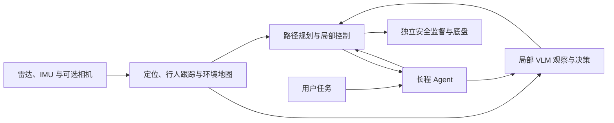

# 系统总览

Social-Nav 面向智能轮椅和移动机器人的长程社交导航。感知提供位姿、人物与环境，局部 VLM 解释场景，Agent 组织任务，导航和独立安全层负责实际运动。接口、仿真或影子运行的存在不代表完整实机闭环已经验收；当前待办见[后续开发测试汇总](后续开发测试汇总.md)。

## 模块与数据流

图中表示职责和数据方向，并不表示所有连接都已完成在线闭环。Agent 已有仿真、影子与显式使能的实机目标通道；T2 跟随和找回已完成离线链路验证，T1 在线群组更新和 T3 就座尚未接入自动任务组合。实际执行与现场反馈仍须实机验证。

### 感知

`perception/` 负责传感器接入、建图、定位、三维行人检测与跟踪，以及静态和实时局部环境地图。默认 ROLL 与 FAST-LIO 分别负责地图关联和连续里程计；无图运行不伪造地图位姿。跟踪使用可靠定位补偿自车运动，定位失效时不以原始里程计替代。静态地图与当前局部观测分别保留来源，先验自由不等于实时观测。

细节见[建图与定位](perception/技术实现-建图与定位.md)、[检测与跟踪](perception/技术实现-检测与跟踪推理.md)和[环境地图](perception/技术实现-环境地图与场景表示.md)。RGB、二维检测和关联是可选决策输入，不是感知导航主链的前置条件。

### 决策

`decision/vlm/` 处理 T1 群组关系、T2 目标身份与跟随、T3 候选选择与就座；请求绑定源观察、身份和任务，返回结果需经过格式、语义与时效检查。当前默认使用远程 SGLang 服务和冻结模型，具体设置见[VLM 局部决策](decision/技术实现-VLM局部决策.md)。

`decision/agent/` 使用独立托管模型组织长程任务，通过工具读取地图及反馈、提交或取消目标。目标被接受不等于完成，定位估计也不能代替实际停稳验收。实现与当前接通范围见[Agent 长程导航](decision/技术实现-Agent长程导航.md)。

### 导航与安全

`navigation/planning/` 使用 Hybrid A* 生成空间参考，`navigation/control/` 使用 DWA 选择符合运动约束的局部速度，`navigation/safety/` 独立检查当前状态与有限时域风险。支持倒车及原地旋转，实际限值由配置和现场验证确定。缺地图不能视为空闲；不可行或状态失效时不能报告任务成功。语义模型不能解除本地安全保护。

具体机制见[路径规划](navigation/技术实现-路径规划.md)、[局部控制与安全](navigation/技术实现-局部控制与安全.md)，现场限制见[系统实机问题](系统实机问题.md)。

## 运行时与资源职责

`runtime/` 组织传感器、观察缓存、进程与调度，算法归各自模块；ROS 用于外部传感器接入和可选显示。跨进程数据保留源测量时间、坐标、身份及会话信息；消费者使用期间，封存的共享数据不可覆盖。GPU 数据复制和流依赖须与消费者对应，不传递整场景 pickle。字段细节见[接口约定](接口约定.md)。

独立安全和人工接管不依赖远程模型可用。运行方式见[系统运行手册](系统运行手册.md)，实际性能及其适用条件见[推理速度记录](推理速度记录.md)。
