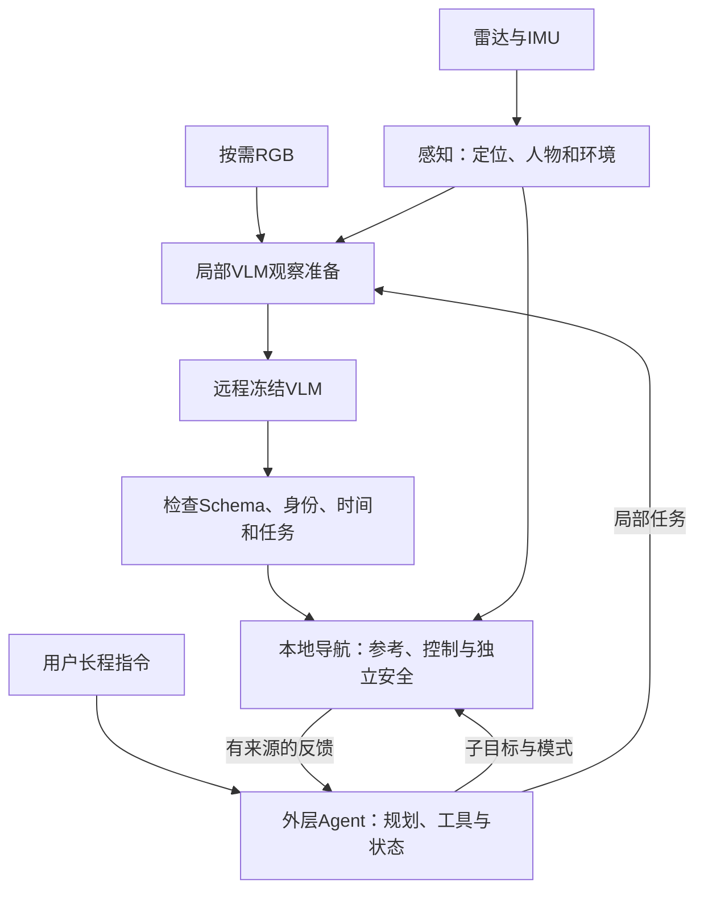

# 系统方案：冻结 VLM 的长程社交导航

Social-Nav 研究如何让低频视觉语言理解帮助高频几何导航。感知负责位置、人物和环境，局部 VLM 判断关系、身份或目标，外层 Agent 组织长程任务，导航与独立安全负责运动可行性。

本文说明研究问题、系统分工、任务规约和推进顺序。当前实现入口见 [README](../README.md)，操作准备见[开发指南](开发指南.md)，字段含义见[接口约定](接口约定.md)，实验协议见[数据与评测](experiments/数据与评测.md)。[旧版方案](archive/旧版方案.md)仅用于追溯。

## 1. 当前决策

局部 VLM 保持权重冻结。研究重点是观察窗口、图像布局、任务规约、Prompt、短输出和独立检查，而不是参数训练。需要验证的是：这些设计能否稳定地产生有助于导航的语义，以及改善具体来自哪里。

| 项目 | 当前选择与用途 |
|---|---|
| 局部 VLM | `Qwen3.8-27B-FP8`，不进行 SFT、LoRA、GRPO 或其他微调。 |
| 服务方式 | 自有 GPU 服务器运行 SGLang，通过 OpenAI 兼容 HTTP 接口调用。 |
| 请求方式 | 串行、非思考、temperature=0，使用 JSON Schema 约束，不自动重试。 |
| 请求节奏 | 周期任务按每 2 秒一次（0.5Hz）设计，T3 按关键事件选择目标；自动在线调度仍待接通。 |
| 语义验证 | 使用可追溯轮椅观察和开发草稿进行有限对照与因果回放，独立场景和正式金标准另行验收。 |
| 外层 Agent | 独立使用 Qwen3.8-Flash 托管 API，以原生工具调用和累积对话读取地图、选择连续位姿并审查结果。当前优先完备地图下的室内点、区域及串联任务，实车反馈仍待接通。 |
| 其他后端 | 兼容服务、vLLM 或其他模型需要单独适配，并按相同协议比较，不自动替换当前选择。 |

模型目录名和服务别名不能证明权重身份。自建服务需要记录实际配置、权重索引和运行时，不能修改架构类来迎合显示名称。托管 API 的模型记录与可复现范围见 [Agent 技术计划](decision/Agent技术开发计划.md#模型与调用)；项目不微调，不代表服务商不会更新模型。机器路径和检查记录只维护在本机记录中。

### 1.1 阅读口径与保留的信息

冻结要求只针对局部 VLM，行人检测器仍可训练。本文区分研究设计和当前实现，实际能力以 README 与专题文档为准，运行参数以配置为准。

研究需要证明：在明确的可观测条件下，低频 VLM 的关系、身份和可供性判断能改善高频导航。合法 JSON、原生群组 F1 或单段演示都不能单独证明这一点，需要消融和独立测试。

### 1.2 研究定位与待验证假设

已有调研将 [GSON](https://arxiv.org/abs/2409.18084)、[VLM-Social-Nav](https://arxiv.org/abs/2404.00210)、[LISN](https://arxiv.org/abs/2512.09920) 和 [SocialNav](https://github.com/AMAP-EAI/SocialNav) 作为研究背景。这些链接保留原来源，不表示本轮重新检索了最新研究，也不将“使用 VLM 识别群组”本身作为首创。

- **H1**：相比只有群体包络，关系类别与可见摄影结构能否减少可定义的社会空间侵入？
- **H2**：根据描述持续核对身份，能否减少跟错人与错误持续时间，同时保持合理的拒答和任务覆盖？
- **H3**：在远程低频约束下，共享观察的联合决策、任务图像和紧凑接口，能否比独立调用更稳定有效？

T3 研究根据指令选择局部目标，当前离线实现以轮椅就座为主，狭窄通道倒退让行为后续扩展。候选生成、语言理解与目标执行分别评价，选中候选不表示完成导航。小模型微调和 GRPO 的旧假设不进入当前主结果。

## 2. 系统边界

长程目标是让智能轮椅在食堂、室外、大楼和房间之间完成群组避让、跟随、队列绕行和终端停靠。约 500m、10min 是后续展示设想，不是已完成结果或安全验收指标。



图中表示模块职责，不表示所有箭头已经形成真实执行闭环。Agent 已有仿真和影子接口，局部 VLM 的持续在线导航，以及真实底盘反馈仍待接通。

人工测试使用[RViz交互入口](感知导航运行手册.md#rviz交互测试)：先选择雷达起点，再选择车体目标。bag可以暂停并在冻结观察上检查规划；实机模式需确认车辆参数并人工使能，由独立CPU安全授权串口。轮椅已有人工选点的实机导航记录，当前配置仍需继续核查运动连续性、到达与停稳，尚未完成实机导航验收。外层 Agent 也尚未接通真实到达反馈。

VLM 不输出速度、转角或连续轨迹。本机独立处理碰撞、停车请求、传感器超时、急停和人工接管，不等待网络。规划、控制和跟踪按各自需求高频更新，初始控制设计可取 10–20Hz，最终频率与运动限值须由实机测定。

默认传感器输入为雷达和 IMU。RGB 仅在显示、场景归档或决策输入准备时读取。YOLO 与二维关联为 VLM 提供图像辅助，不是定位、三维跟踪、环境更新或导航完成的条件；启用后仍可能竞争 GPU 资源。

| 模块 | 承担的职责 |
|---|---|
| `perception/` | 传感器同步与标定、三维检测、因果跟踪、建图、自车定位、健康状态和环境表示。 |
| `decision/vlm/` | 准备局部任务观察，构造 Prompt 与 Schema，调用低频模型并检查响应。 |
| `decision/agent/` | 通过单模型循环选择工具，保留原任务、补充和实际执行记录，不直接控制底盘。 |
| `navigation/planning/` | 根据地图、车体和任务要求生成空间参考，并检查局部可达性。 |
| `navigation/control/` | 根据参考和当前状态选择速度，处理运动约束；默认不再串联第二个轨迹跟踪器。 |
| `navigation/safety/` | 独立检查碰撞、超时、急停和接管，并请求停车，不依赖远程服务在线。 |

共享类型还有未接通部分，见[接口约定](接口约定.md)。类型草案不直接替换现有 HTTP 协议，缺地图不能当作自由空间，状态失效不能当作成功。

### 2.0 检测训练与外层agent的边界

检测训练使用完整框、人工中心和伪标签，允许继续适配实际任务场景。当前已有 bag 候选预计算、本机与 Windows 远程复核、包含位姿历史的数据导出，以及新旧样本加权微调。标注和导出不会自动启动训练，短训练通过也不证明误检已改善。训练与监督范围见[检测训练](perception/技术实现-检测训练.md#监督语义与弱监督方法)。

外层 Agent 回答“去哪里、现在做什么、何时切换步骤”，局部 VLM 回答“这段观察支持什么语义判断”，导航回答“怎样符合几何和运动约束”。Agent 必须通过明确的工具与状态接口使用导航，不能因为 SDK 方便而扩大动作权限。当前仿真、影子和真实执行的区别见 [Agent 技术实现](decision/Agent技术实现.md)。

### 2.1 实机条件与必须补齐的参数

部署受设备条件约束，使用 ROS 1。本地负责检测、定位与导航，自有远程服务运行局部 27B VLM，外层 Agent 使用托管 API。具体系统版本和硬件资源由本机记录维护。

相机参数必须对应当前安装，不能在渲染器或模型中硬编码旧内参。部署评估要覆盖传感器、检测、跟踪、渲染、通信和控制，不能只估算模型显存。

当前本车使用用户确认的矩形轮廓和雷达到车体外参，已确认支持倒车和原地旋转。运动配置、反馈阈值与现场保护还需结合实际响应验证；不能从旧轮间距推断其他参数，也不能在不同驱动方式的平台之间直接沿用运动约束。当前现场待办见[感知导航实机问题](感知导航实机问题.md)。

长程任务允许使用起点、检查点、楼房目标坐标或几何路线图，不要求 VLM 从每张局部图推断全局位置。没有人工语义地图，不等于没有几何地图或导航目标。

### 2.2 定位、环境与几何规划的衔接

感知维护连续的 `odom → rslidar` 位姿，并单独保存地图修正，防止地图跳变进入人物速度估计。本车雷达到车体的外参已由用户确认，`map → odom → base_link → rslidar` 各段 TF 发布者仍需结合现场检查。原始 ROS 里程计不能替代可靠定位；位置缺失或跳变时，下游按[定位接口](接口约定.md#定位状态与连续位姿)降级和重置。

主方案是 ROLL＋FAST-LIO。FAST-LIO 提供连续位置，ROLL 维护地图匹配和修正。运行分为 `mapping` 建图、`localization` 固定地图定位和 `odometry` 无图定位，均可读取 bag 或在线话题。无图模式不运行 ROLL，不伪造地图位姿，也不保证长期绝对位置。起点选择、结果回看、显式 PIN-SLAM 实验后端和 GPU 默认策略见[建图与定位](perception/技术实现-建图与定位.md)。

环境表示分别保存三维定位地图、静态环境地图和实时局部环境地图。统一场景配对人物、当前 RGB 和有效地图关联，供导航、VLM 与 Agent 查询。原始局部状态保留测量语义；导航可在有效关联和受限近场内使用静态历史自由，当前占据与有效期内端点优先。背景恢复依赖先验基本一致的场景假设，不能当作新观测或已验证的实机安全性。机制与适用范围见[环境地图与场景表示](perception/技术实现-环境地图与场景表示.md#静态自由支持的导航派生图)。全局参考查询还可用已有局部自由证据临时补充静态未知，原资产和局部状态不变，见[路径规划](navigation/技术实现-路径规划.md#局部证据进入全局参考)。

默认导航使用 CPU Hybrid A* 生成低频空间参考，再由 GPU DWA 选择速度，独立 CPU 进程检查有限时域运动。用户已确认轮椅支持倒车和原地旋转，规划、DWA 与独立安全共同支持这两项能力；段间先请求停车，旋转仍检查预测时域内的轮廓扫掠。已有目标 API、反馈仿真与影子运行，不表示实机自主导航已验收。算法选择见[路径规划](navigation/技术实现-路径规划.md)，实际性能见[推理速度](感知导航推理速度.md)。

后续巡航和停靠可分别设计速度、转弯与倒车限制。倒车必须满足限速、后方地图与人物检查，并通过有限时域的足迹扫掠；没有安全路线时停车等待或明确失败，语义模型不能放行几何拒绝。

### 2.3 社会关系如何转为可执行代价

VLM 给出关系，导航用当前轨迹计算软代价。默认人物运动采用可靠世界系速度和确定性匀速模型，身体包络使用固定半径，协方差只保留为来源。速度未知时使用当前占据代理，不猜测方向。带不确定性包络保留为显式对照。

| T1 状态 | 导航侧的设计解释 |
|---|---|
| `walking` | 保护紧凑同行队形，按当前可靠位置更新。 |
| `talking` | 保护成员互动中心与连线空间。 |
| `photographing` | 使用有依据的群组区域；紧凑响应没有角色信息，不能虚构摄影者和拍摄方向。 |
| `other`、未知或失效 | 使用群体或个人空间与几何避障，不强加未经支持的关系。 |

当前群组空间采用短连接树，避免把相距很远的成员围成巨大凸包而封堵通道。胶囊链、局部凸包或衰减区域可以作为消融候选，小组关系也不能简单等同于固定距离阈值。

占据和有限时域内的完整足迹检查优先于社会软代价。DWA 在满足硬约束的候选中比较进度、偏离和社会代价，全部不合格时请求停止。

旧 MPPI 的 2.5–3s 时域、约 0.05s 步长、1000–2000 条样本和 1 次迭代仅用于追溯性能预算，不是当前配置或实时性结论。

## 3. 三项主任务与辅助诊断

| 任务 | 输出与当前范围 |
|---|---|
| T1 关系识别 | 输出活动到 PID 群组的对象，已完成本轮离线输入与 Prompt 开发，在线消费待接入。 |
| T2 目标跟随 | 单次匹配输出 `id/match`，因果回放输出 `id/state`，已有保持、丢失和重新匹配诊断，完整状态与独立场景未验收。 |
| T3 目标选择与就座 | 选择候选，并由独立阶段逻辑使用反馈推进；已有三帧离线原型，导航执行未接通。 |

T1 和 T2 当前独立调用，联合传图及状态应用需要另行定义，不能把独立成绩称为联合成绩。排队不属于当前 T1 交付范围。

## 4. 输入设计

### 4.1 默认T1观察

输入包含三个真实过去或当前观察，每次配对 RGB 与全高度单帧扫描 BEV。当前 PID 覆盖已确认且实际观测到的全向三维轨迹，视野外人物仍可成为正常候选，缺失 RGB 保留 null。输入不绘制人工关系，也不放入隐藏身份。

标注审核与导出共用渲染及自车补偿历史。新来源或新渲染需要核对原观察与标签的对应关系，不能直接沿用旧审核，见[标注手册](decision/决策任务标注.md)。

### 4.2 人物编号、时间与缺失值

PID 只在当前请求中有效。程序保留真实轨迹身份及其生命周期，跟踪重建或切换后不能复制旧数字。T2 用此前实际接受的轨迹身份重映射到当前 PID，人工物理身份只用于独立参考。

每次观察的 XY 位于自己的雷达坐标系，不能直接相减来计算人物速度。只有 BEV 内部的历史使用可靠位姿补偿自车运动；位姿失效时不伪造世界轨迹。采集、定位、图像和请求时间分别保存，详见[接口约定](接口约定.md)。

### 4.3 固定前缀与动态输入

各任务 Prompt 由 [VLM 配置](../decision/vlm/configs/project.json)登记，`v/dt/ts/e/o/d` 列由 [VLM 手册](decision/VLM部署与调用.md#实机t1群组输入)解释。T2 另附目标描述和因果历史，不能把真值或未来信息加入请求。

## 5. 输出与校验

### 5.1 T1标签规约与未知语义

紧凑输出按 `walking/talking/photographing/other` 列出群组。每组至少两人，成员来自当前 PID，并在所有群组间互斥。没有支持关系时输出 `{}`；同组多活动按 photographing、talking、walking、other 选择主标签。邻近、同向或拿手机不足以自动成组。

```json
{"walking":[[0,1]],"talking":[[2,3]]}
```

人工标注另保留活动未知、归属未知、角色、参考组和覆盖，不能把富信息导出直接当紧凑答案。未知不等于独行，漏检不等于场景无人，评测见[数据与评测](experiments/数据与评测.md)。

### 5.2 T2目标跟随接口与状态

目标描述只来自初始可见证据，不包含 PID、未来轨迹或敏感身份。无历史匹配输出 `id/match`；因果回放使用 `target_description` 和 `last_target`，历史只能来自本方法已经接受的响应与可靠轨迹。

| `state` | 含义 |
|---|---|
| `visible` | 当前 RGB 能确认目标外观，返回当前 PID。 |
| `occluded` | 此前已确认且允许短时保持，返回重映射 PID，不刷新视觉时间。 |
| `uncertain` | 存在歧义、冲突或证据不足，`id=-1`。 |
| `lost` | 曾确认，但当前无法确认或保持，`id=-1`。 |
| `not_found` | 尚未确认，当前也无合理匹配，`id=-1`。 |

```json
{"id":0,"state":"occluded"}
```

标签框和历史外观不等于当前视觉确认。动态 Schema 根据当前候选和真实历史生成，纯预测保持候选尚未接入。导航已有票据、稳定身份、跟随点和丢失停车 API，并完成离线几何与安全联调；正式在线 PID 映射、响应应用和执行反馈仍需接通。

### 5.3 T3目标点选择与就座阶段

T3 根据指令和场景选择候选目标。就座需要 Agent 或调用方组织独立导航阶段，模型选择不能替代几何执行和真实完成反馈。实现及联调待办由 [VLM 手册](decision/VLM部署与调用.md#t3目标选择与就座)维护。

### 5.4 分层校验与输出预算

每次请求发送任务专用动态 Schema，本地再检查整数类型、当前身份、成员互斥、历史保持资格、完整结束和非思考状态。原始响应不排序、不修复格式，也不补删身份。

输出上限按任务冻结，实际值以配置和结果为准。合法 JSON 不证明语义正确、及时或可以安全执行，T3 阶段核心及合成反馈通过也不证明真实执行已经接通。

## 6. 两秒调用与异步安全

周期任务按每 2 秒提交一次观察设计，初始只允许一个请求在途。模型忙时丢弃新到达任务，不排队累积旧帧。测试以 2 秒为完成期限，实际超时、TTL 和事件触发策略仍需连续回放确定。

调用周期、到达率、完成期限和 HTTP 等待超时分别配置，客户端读取默认值，CLI 可以覆盖，见[客户端配置](decision/VLM部署与调用.md#仓库远程客户端)。HTTP 超时或一次串行测试不能代表机器人调度策略。

请求发出前，适配器须保存 `request_id`、目标观察时刻、轨迹身份映射版本、任务模式版本和候选集合版本。返回时核对这些来源，迟到或旧模式响应不能套用到新 PID、新候选或新任务。

有效群组语义可以短时保持，但空间包络必须用本机最新轨迹重新计算。身份冲突、轨迹失效、网络断开或语义过期时，退回个人空间与保守绕行。跟随或停靠证据不足时停车观察，队列顺序不明时不猜队尾。

VLM 不承担安全认证。突变人群由最新感知和本地碰撞检查处理，不能依赖两秒前的语义。离线测速器也不等于已经实现了上述在线状态管理。

### 6.1 时间预算与信息年龄

| 概念 | 解释 |
|---|---|
| 调用周期 | 计划多久提交一次新观察，当前设计为 2 秒。 |
| 完成 deadline | 是否在计划时刻起 2 秒内取得完整合法结果。 |
| HTTP 超时 | 何时结束单次传输等待，不是实机安全阈值；历史测速默认 60 秒。 |
| 信息年龄 | 当前时刻减去结果对应的最后观察时刻。 |
| TTL | 下游允许持有语义的最大观察年龄，待连续回放确定。 |

准备、渲染、上传、排队、视觉编码、prefill、decode 和校验都会消耗年龄预算。TTL 从观察时间计算，不能从接收时重新计时。2 秒调用周期也不表示 2 秒 TTL 必然足够：结果接近期限到达，而下一次请求发生抖动，就可能出现语义空窗。

连续回放要比较不同年龄预算和保持策略，同时报告错误持续与保守回退代价。不能用无限延长 TTL 掩盖网络长尾。基于离线已渲染图像的测速不包含实机感知与渲染时间，也不证明在线 TTL 策略已完成。

### 6.2 模式、失效与独立安全层

以下是任务模式的设计要求，具体在线接入仍按专题验收：

| 模式或事件 | 语义使用与回退 |
|---|---|
| `NAVIGATE` | 有效 REL 生成软社会代价，失败时退回几何与个人空间。临时让行点属于后续事件触发扩展，仍保留原目的地。 |
| `FOLLOW` | 只跟随已接受的 T2 身份，歧义或失效时停止主动跟随，不追相似人。 |
| `DOCK` | 按就座指令触发 GOAL 选择，执行时持续检查几何，候选或地图变化则取消旧选择。 |
| `SAFE_STOP` | 本地急停、传感器或定位失效优先，恢复必须满足明确条件，旧模型响应不能解除停车。 |
| 模式、PID 或 cid 版本变化 | 拒绝不匹配的旧请求结果，不重新解释它们。 |

适配器同时记录单调时间与机器人观察时间，防止回包顺序、系统时钟变化或模式切换覆盖新状态。交错离线 cases 可以测延迟，但不是连续导航状态序列。

未来真实命令链需要规划、速度平滑、碰撞监测和底盘仲裁，历史设计记为 `cmd_vel_nav → Velocity Smoother → Collision Monitor → 底盘`。这不是当前已经接通的 ROS 出口。雷达碰撞、制动距离、足迹、TTC 与人工急停必须独立于 VLM；网络中断不能解除它们。全局没有安全路线时明确失败，不能由语义“放行”。

## 7. 局部VLM远程部署策略

局部任务优先调用自有 SGLang 服务，使用冻结 FP8 目标模型、单请求、非思考和动态 JSON Schema，默认公开 DSPARK 草稿加速。只有远程服务不可用或所需 GPU 被占用时，才考虑本地备用。环境、启停和连接由 [VLM 手册](decision/VLM部署与调用.md)维护，外层 Agent 的托管 API 不采用本节备用规则。

本地备用使用 Transformers＋Accelerate＋XGrammar，将 FP8 权重反量化为 BF16，并复用冻结输入和检查。两种计算路径不承诺逐字一致；切换时记录原因和实际后端，不静默重放失败请求，也不擅自更换模型或付费 API。纯输入、配置和单元检查可以离线进行。

优化运行时之前先固定模型、视觉预处理和聊天模板。FP8 不表示视觉编码、KV 与缓存全部使用同一精度，上传、视觉编码、prefill 和调度也可能占主要成本。前缀缓存只复用稳定前缀，完整图重放是性能上界；缓存、MTP 或数值路径变化后，还需检查合法率与语义，不能只比较 decode tokens/s。

## 8. 实验与推进顺序

1. 确定轮椅数据来源与划分，按相同观察协议审核参考。
2. 在权重冻结条件下有限比较输入和 Prompt，固定方案后用其他事件验证，并保留失败。
3. 分开评价语义、感知覆盖、结构合法性和时效，再接在线状态与模式切换。
4. 在可靠几何和安全层上接入真实反馈，从受控短程任务推进到长程组合。T3 离线选点和阶段核心可独立开发，实际执行另行验收。

指标由[数据与评测](experiments/数据与评测.md)维护，离线回放不能证明机器人闭环安全。

### 8.1 对照实验与因果解释

至少保留几何与个人空间基线、距离与可靠运动编组基线、当前冻结 VLM 方案，以及关键输入因素的配对消融。各方法使用相同感知层级、有效人物、候选、数据划分和运行条件，不能把完整人工感知的 VLM 与存在漏检的几何方法直接混比。

每次变化记录模型、Prompt、图像、Schema、运行时和输入指纹。答案或输出长度也改变时，速度差不能全部归因于算子；观察窗口改变可观测性时，重新审核标签，或只比较两种协议共同可判部分，并报告全量覆盖差异。

按根序列或地点报告宏平均与独立事件覆盖，置信区间按根录像或房间聚类，不把相邻帧当作独立样本。拍照、未知状态或失败类型不足时明确说明，不能用总体均值掩盖缺项。

### 8.2 实机验证分阶段（离线验证之后）

| 阶段 | 目的与记录 |
|---|---|
| 台架或静止回放 | 检查时钟、身份映射、模式版本、断网、迟到响应和独立急停，先证明旧结果不会被误用。 |
| M1 短程社交导航 | 检查群组、谈话、队列和拍摄通道保护；倒退让行仅在后续能力开放后测试。记录成功率、社会空间侵入、效率和接管。 |
| M2 短程跟随 | 覆盖转弯、交叉、遮挡、相似衣着和 ID 变化，记录跟错持续时间、发现与重捕获延迟和停止行为。 |
| M3 就座 | 覆盖语言指令、桌边空位与占用、通路、候选失效和观察不足，记录候选召回、选择正确性、碰撞及到达姿态误差。 |
| 组合长程路线 | 再串联楼间与室内任务，单次约 500m 演示和多次统计测试分开报告。 |

短程可以从 5–30m、20–90s 的受控事件开始，这只是组织尺度。随机化不同方法的执行顺序，保持路线与速度预算一致，先稳定感知和几何基线，再验证 VLM 增益。实机实验需要安全员、接管、终止条件及明确授权，文档不自动启动机器人。

### 8.3 待完成工作

本节只提供系统级推进入口，不重复各模块清单：

- 感知导航当前以[实机问题](感知导航实机问题.md)推进目标导航与现场性能；已有本车参数与基本动作沿用，阶段结束集中更新。服务器离线诊断已归档，不作为试车前置。当前机制与轮椅端计时分别见[总览](感知导航总览.md)和[推理速度](感知导航推理速度.md)。
- 局部决策已完成本轮 T1 输入与 Prompt 对照，暂不继续搜索 Prompt；仍需独立人工金标准、混合活动，以及 T2 远距离重新匹配、独立场景和完整状态覆盖。当前选择、有限开发结果与 T3 联调任务由 [VLM 手册](decision/VLM部署与调用.md)维护，开发草稿不作为正式验收。
- 标注工具后续补充基于本方法真实历史的 T2 状态审核，并在 Windows 与 Tailscale 下验证断网、写入结果未知、修订冲突、首次取帧和缓存浏览。日常可用不替代这些专项，操作见[决策任务标注](decision/决策任务标注.md)。
- 在线局部决策需要把已有三帧记录、响应接口、T3 规划检查和阶段反馈接到自动服务调度。需要模型测试时，手动启动已有远程服务并控制预算，见[三帧输入与响应](decision/VLM部署与调用.md#直接运行时的三帧输入与响应接纳)。
- 外层 Agent 优先验证完备地图下的室内点目标、语义朝向、区域目标及有序串联，再接真实执行与停车反馈。简单地图、无图、跨条件和原长程任务保留为后续，详见 [Agent 技术计划](decision/Agent技术开发计划.md)和[导航任务计划](decision/长程导航任务与评测计划.md)。
